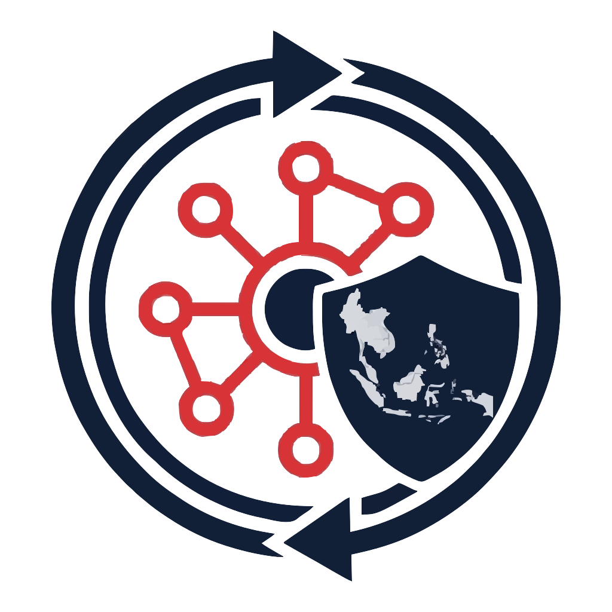
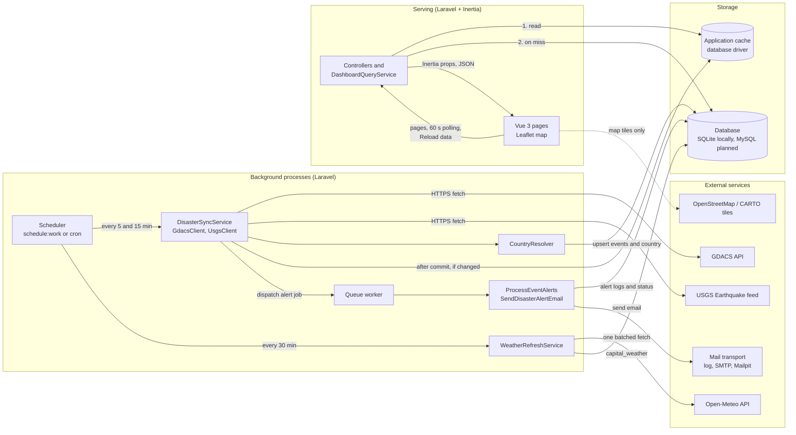
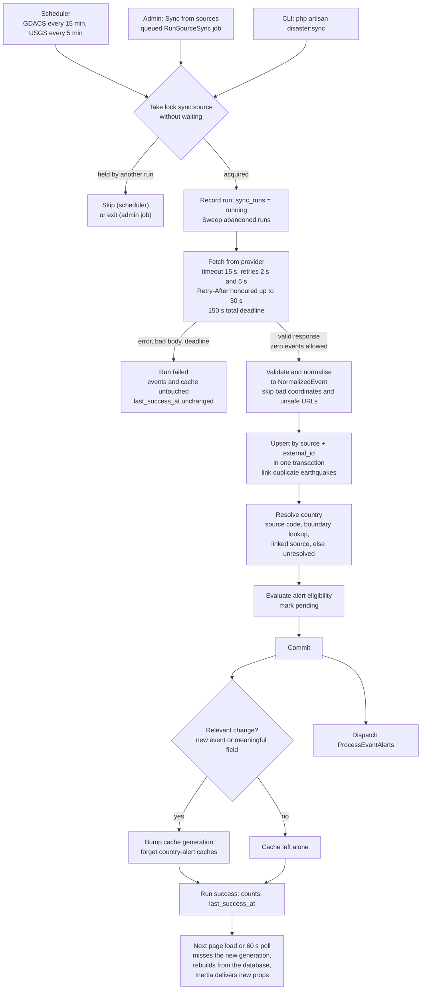
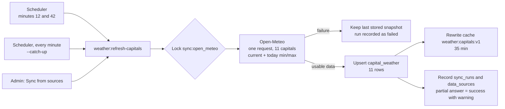
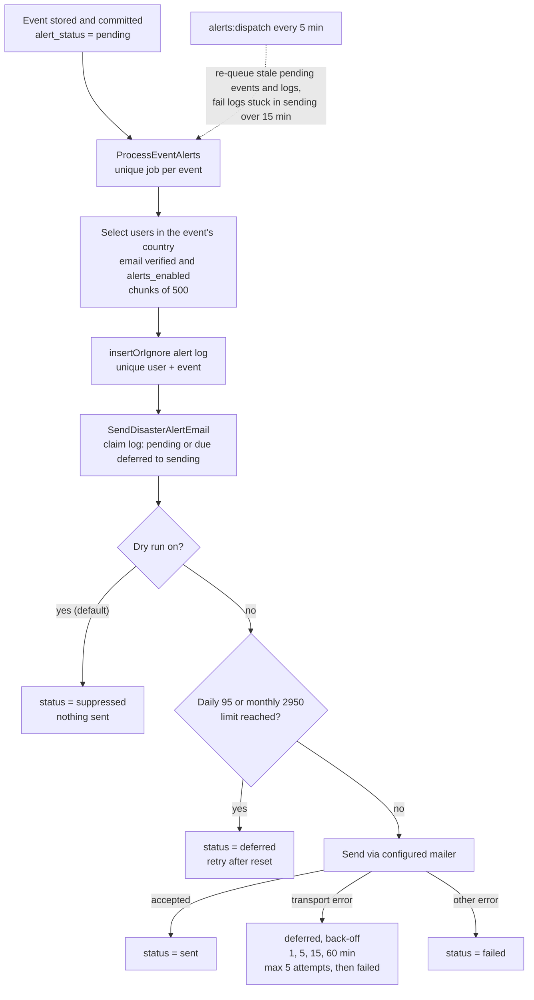
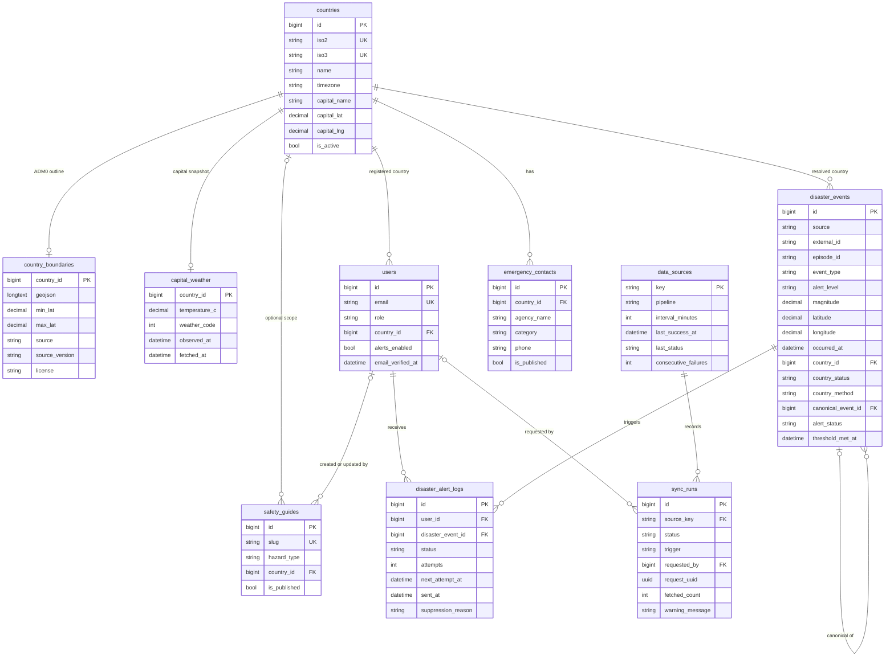

<div align="center">

<picture>
  <source media="(prefers-color-scheme: dark)" srcset="public/DisasterLink_SEA_logo-dark.png">
  
</picture>

# DisasterLink SEA

**Stay Informed. Stay Prepared. Stay Safe.**

A disaster-awareness and emergency-preparedness platform for the 11 countries of Southeast Asia.
Live event map, capital-city weather, country-level email alerts, safety guides and emergency contacts.


[Overview](#overview) ·
[Features](#key-features) ·
[Architecture](#system-architecture) ·
[Data sources](#external-apis-and-data-resources) ·
[Database](#database-design) ·
[Install](#installation-and-local-development) ·
[Status](#project-status-and-limitations)

</div>

---

## Table of Contents

1. [Overview](#overview)
2. [Key Features](#key-features)
3. [Supported Countries](#supported-countries)
4. [Technology Stack](#technology-stack)
5. [System Architecture](#system-architecture)
6. [Data Flow](#data-flow)
7. [External APIs and Data Resources](#external-apis-and-data-resources)
8. [Libraries and Dependencies](#libraries-and-dependencies)
9. [Database Design](#database-design)
10. [Caching, Scheduler and Queue](#caching-scheduler-and-queue)
11. [Installation and Local Development](#installation-and-local-development)
12. [Environment Configuration](#environment-configuration)
13. [Running Background Processes](#running-background-processes)
14. [Testing and Code Quality](#testing-and-code-quality)
15. [Project Directory Structure](#project-directory-structure)
16. [Security and Reliability](#security-and-reliability)
17. [Project Status and Limitations](#project-status-and-limitations)
18. [Future Improvements](#future-improvements)
19. [License and Credits](#license-and-credits)

---

## Overview

**DisasterLink SEA** is a web application that gathers disaster events and weather for Southeast Asia, stores them in its own database, and presents them in one place: an interactive map, an event feed, capital-city weather, preparedness guides and emergency contacts. Registered users can also receive an email when a significant event is reported in their country.

**The problem.** Disaster information for the region is spread across international feeds (earthquakes, cyclones, floods, volcanoes, wildfires, droughts) that are not organised around a single country, and most are not designed for the general public. Preparedness material and emergency numbers live somewhere else again.

**What this project does about it.**

- Collects events from [GDACS](https://www.gdacs.org) and [USGS](https://earthquake.usgs.gov), and weather from [Open-Meteo](https://open-meteo.com), on a schedule.
- Works out which ASEAN country each event belongs to, and never guesses when it cannot tell.
- Serves public pages from its own database, so pages stay fast and keep working when a provider is down.
- Emails verified users about significant events reported in the country they registered.

**Intended users:** residents and travellers in Southeast Asia who want one place to check for hazards, and administrators who maintain safety guides and emergency contacts and watch the health of the data sources.

**Objectives**

1. Make the database the source of truth. External APIs are called only by scheduled backend jobs or an explicit administrator action, never by a page request and never by the browser.
2. Resolve each event's country reliably, or not at all.
3. Send each alert at most once per user per event, within a daily and monthly email limit.
4. Show honestly how fresh the data is.

**Coverage:** the 11 ASEAN countries, at **country level** (see [Supported Countries](#supported-countries)).

> **Project status.** This is an MVP built as a portfolio project. It runs end to end on a developer machine. It has **not** been deployed to production, and real email delivery through a provider has **not** been verified. See [Project Status and Limitations](#project-status-and-limitations).

---

## Key Features

Everything in this section is implemented in the repository. Items that exist in code but are switched off, or are planned, are listed in [Project Status and Limitations](#project-status-and-limitations).

### Disaster monitoring and interactive map

- Events from **GDACS** (earthquakes, tropical cyclones, floods, volcanoes, wildfires, droughts) and **USGS** (earthquakes), stored in the database.
- **Interactive Leaflet map**, a filterable **event feed** (`/events`), and a detail page for each event (`/events/{id}`). The map uses OpenStreetMap tiles, or CARTO tiles when an optional key is set.
- A regional **overview** page (`/overview`).
- The same earthquake reported by both sources is **linked and shown once** (within 5 minutes, 50 km and 0.5 magnitude).
- Event links from upstream data are validated (https only, on `gdacs.org` or `usgs.gov`) before they are stored.

### Country resolution

- An event's country comes from the **source's country code** when it has one (GDACS), otherwise from a **point-in-polygon lookup** against country outlines (Natural Earth, public domain), otherwise from a **linked GDACS earthquake**.
- Events near a border, offshore with no link, or otherwise uncertain stay **unresolved** and never produce email. Place names are never used to guess a country.

### Country-based email alerts

- Registered, **email-verified** users with alerts enabled get an email when a significant event is resolved to their registered country.
- **Eligibility:** GDACS `Orange` or `Red`, or USGS magnitude 5.0 or higher; and either the event occurred in the last 24 hours, or it was seen below the threshold and later escalated.
- Alert emails state that the alert is **country-level** and does not mean the user's own area is affected.
- Queued, de-duplicated delivery with daily and monthly send limits, retries with back-off, and a **dry-run mode** (on by default).
- The Welcome page shows a signed-in user the **recent alerts for their country**.

### Capital weather

- Current conditions and today's min/max for the **11 ASEAN capitals**, refreshed in **one batched request every 30 minutes**.
- The page shows a warning when the stored data is older than 60 minutes, and a stale notice after 3 hours.

### Safety guides and emergency contacts

- One public page, **Be Prepared** (`/preparedness`), with **emergency contacts** filtered by country and **safety guides** filtered by hazard type. Filters live in the URL.
- Guide content is Markdown, rendered on the server with raw HTML removed.
- Previews of both appear on the Welcome page.
- The application ships **no emergency numbers or guide text**: an administrator enters them (see [Project Status and Limitations](#project-status-and-limitations)).

### Accounts

- Registration with a **required country** and an alerts preference, email verification, login, password reset, and password change (Laravel Fortify).
- Profile settings (name, email, country, alert emails on/off), appearance (light/dark) and security settings.
- Roles: `user` and `admin`.

### Admin dashboard (`/admin`)

- **Overview:** registered, verified and admin user counts; guide and contact counts.
- **Safety Guides** and **Emergency Contacts:** create, edit, publish, unpublish, delete.
- **Data Freshness:** a card per source (GDACS, USGS, Open-Meteo) with a status (Healthy, Delayed, Stale, Failed, Never Synced), last attempt and success, counts, errors, and recent run history.
- **Sync from sources:** queues a real sync for GDACS, USGS or Open-Meteo, with per-source queued, running, success, success-with-warnings and failed states.

### Caching and performance

- Public pages read the database through a **generation-keyed cache**. A successful sync that changed something starts a new generation; a failed or unchanged sync leaves the cache alone.
- The public **Reload data** button rebuilds from the database only. It never contacts GDACS, USGS or Open-Meteo.

---

## Supported Countries

The country codes below match the seeded `countries` table (`CountrySeeder`) and `config/disaster_sources.php`.

| ISO3 | ISO2 | Country | Capital (used for weather) |
|:---:|:---:|---|---|
| BRN | BN | Brunei Darussalam | Bandar Seri Begawan |
| KHM | KH | Cambodia | Phnom Penh |
| IDN | ID | Indonesia | Jakarta |
| LAO | LA | Laos | Vientiane |
| MYS | MY | Malaysia | Kuala Lumpur |
| MMR | MM | Myanmar | Naypyidaw |
| PHL | PH | Philippines | Manila |
| SGP | SG | Singapore | Singapore |
| THA | TH | Thailand | Bangkok |
| TLS | TL | Timor-Leste | Dili |
| VNM | VN | Vietnam | Hanoi |

**Geographical hierarchy.** The application works at **country level only**. Users register a country, events are resolved to a country, and weather is shown for each capital. There is **no state/province, city or district data** and no city-level alerting.

---

## Technology Stack

Versions are those installed in this repository (`composer show`, `package.json`).

| Category | Technology |
|---|---|
| **Backend** | PHP (`^8.3`; developed on 8.5), Laravel 13.40 |
| **Frontend** | Vue 3.5, TypeScript 5, Inertia.js 3 (`inertiajs/inertia-laravel` 3.7, `@inertiajs/vue3` 3) |
| **Application architecture** | Server-driven SPA (Inertia), service classes for sync, cache and alerts, queued jobs, scheduled Artisan commands |
| **Database** | SQLite for local development and automated tests; MySQL 8 is the intended production database (see [Status](#project-status-and-limitations)) |
| **CSS and UI components** | Tailwind CSS 4, shadcn-vue style components built on Reka UI, `class-variance-authority`, `tailwind-merge`, Lucide icons, `vue-sonner` toasts |
| **Mapping and geospatial** | Leaflet 1.9; Natural Earth country outlines; point-in-polygon in PHP (no spatial SQL) |
| **Authentication** | Laravel Fortify 1.41 (registration, login, password reset, email verification) |
| **Typed routes** | Laravel Wayfinder 0.1 (generates TypeScript route functions) |
| **Build tools** | Vite through Vite+ (`vite-plus` 1.4), `laravel-vite-plugin`, `@tailwindcss/vite`, `@inertiajs/vite` |
| **Testing** | Pest 5.3 with the Laravel plugin, Mockery; `Http::preventStrayRequests()` so tests never call live APIs |
| **Caching** | Laravel cache, `database` driver by default |
| **Queue and background** | Laravel queue, `database` driver by default; Laravel scheduler |
| **Development tools** | Laravel Pint (formatting), Larastan/PHPStan (static analysis), `vue-tsc`, Laravel Pail, Laravel Boost, GitHub Actions workflow (`.github/workflows/tests.yml`) |

---

## System Architecture

Three separate processes share one database. **Ingestion** (scheduler to providers to database), **serving** (browser to Laravel to cache to database), and **notification** (queue worker to mail). The browser only ever talks to Laravel.



**How to read it**

- Solid arrows into `GDACS`, `USGS` and `Open-Meteo` come only from background services. No page request reaches them.
- The scheduler also runs `alerts:dispatch` every 5 minutes (not drawn) to queue alert work that was missed.
- An administrator's **Sync from sources** queues a `RunSourceSync` job. It runs the same `DisasterSyncService` and takes the same per-source lock as the scheduler.
- The queue and the cache are tables in the same database by default. Neither needs Redis.

---

## Data Flow

### Disaster event synchronization



**Explanation**

1. **Trigger:** the scheduler, an administrator's queued job, or the `disaster:sync` command. All three use one service and one lock per source.
2. **Retrieval:** GDACS is requested as Orange/Red (required) and Green (paged, best effort) separately, over a 7-day look-back; USGS is one `all_day` GeoJSON file. Failures, timeouts and malformed bodies fail the run without touching stored data.
3. **Processing:** each record becomes a `NormalizedEvent` (tags stripped, URL validated, coordinates checked). The provider's own id is the event's identity.
4. **Storage:** `disaster_events` is upserted by `(source, external_id)`, so a repeated fetch never creates duplicates.
5. **Cache:** invalidated only after the transaction commits, and only if something relevant changed. Failed and unchanged syncs do not touch it.
6. **Frontend:** the next request reads the new generation (a miss), rebuilds the payload from the database and returns it. Open pages also poll every 60 seconds.

### Weather refresh

Weather is a separate, simpler pipeline: no country resolution and no email.



The **catch-up** command exists because Laravel never replays scheduler slots missed while a machine slept. Every minute it checks, cheaply and without a lock, whether the last success is older than 60 minutes with no attempt in the last 30, and refreshes only then.

### User notification flow



A user who registers after an event was processed is not back-filled, but still sees the event in "Recent alerts for your country" on the Welcome page for 7 days.

---

## External APIs and Data Resources

| Provider | Purpose | Resource used | Data consumed | Update method | Documentation |
|---|---|---|---|---|---|
| **GDACS** (Global Disaster Alert and Coordination System) | Multi-hazard events with official Green/Orange/Red levels and ISO3 country codes | `https://www.gdacs.org/gdacsapi/api/events/geteventlist/SEARCH` (`GDACS_SYNC_URL`) | Earthquake, cyclone, flood, volcano, wildfire and drought events: id, type, level, severity, coordinates, dates, country, report URL | Scheduler every 15 min (minutes 2, 17, 32, 47), 7-day look-back | [gdacs.org](https://www.gdacs.org/) |
| **USGS Earthquake Hazards Program** | Earthquakes with magnitude and depth | `https://earthquake.usgs.gov/earthquakes/feed/v1.0/summary/all_day.geojson` (`USGS_SYNC_URL`) | Id, magnitude, depth, coordinates, time, place (display only), URL | Scheduler every 5 min | [GeoJSON summary feed](https://earthquake.usgs.gov/earthquakes/feed/v1.0/geojson.php) |
| **Open-Meteo** | Weather for the 11 capitals | `https://api.open-meteo.com/v1/forecast` (`OPEN_METEO_SYNC_URL`) | `temperature_2m`, `relative_humidity_2m`, `precipitation`, `weather_code`, `wind_speed_10m`; daily min and max; one day | Scheduler every 30 min (minutes 12, 42), catch-up check, admin sync | [open-meteo.com/en/docs](https://open-meteo.com/en/docs) |
| **Natural Earth** | Country outlines for coordinate-to-country lookup | Static file `database/seeders/data/asean_country_boundaries.json` (Admin 0, 1:10m, v5.1.2, 11 countries) | Country polygons only | One-off import, loaded by `CountryBoundarySeeder`; **not** a runtime API | [naturalearthdata.com](https://www.naturalearthdata.com/) |

**Browser-side resources** (not fetched by the backend): OpenStreetMap raster tiles (`tile.openstreetmap.org`) or CARTO tiles when `VITE_CARTO_API_KEY` is set, loaded by Leaflet; the "Instrument Sans" font through Bunny Fonts.

**Notes and attribution**

- All three runtime providers are called with TLS verification **on**, explicit timeouts and limited retries.
- GDACS ignores the `eventtypes` and `pagesize` parameters and returns at most 100 rows per page, so the client requests alert levels separately and pages the Green level up to 8 times.
- USGS provides no country, so USGS events are resolved by coordinates or through a linked GDACS record.
- Natural Earth is public domain. Its attribution is not required; see `database/seeders/data/README.md` for provenance.
- Open-Meteo's free API is for non-commercial use and its data is CC BY 4.0, which requires attribution. The HLD lists a visible attribution and a terms re-check as a task before any public deployment (see [Status](#project-status-and-limitations)). Check each provider's current terms before publishing the site.
- The OpenStreetMap tile server has its own [tile usage policy](https://operations.osmfoundation.org/policies/tiles/).

---

## Libraries and Dependencies

Direct dependencies only. Transitive packages are omitted.

<details>
<summary><strong>Backend (Composer)</strong></summary>

| Package | Version | Purpose in this project |
|---|---|---|
| [`laravel/framework`](https://laravel.com/docs) | 13.40 | Application framework: routing, Eloquent, queue, cache, scheduler, mail |
| [`inertiajs/inertia-laravel`](https://inertiajs.com/) | 3.7 | Server adapter that renders Vue pages without a separate API |
| [`laravel/fortify`](https://laravel.com/docs/fortify) | 1.41 | Registration, login, password reset and email verification (backend only; the Vue pages are custom) |
| [`laravel/wayfinder`](https://github.com/laravel/wayfinder) | 0.1 | Generates TypeScript functions for routes and controllers |
| [`laravel/tinker`](https://github.com/laravel/tinker) | 3.0 | Interactive shell |
| [`laravel/chisel`](https://github.com/laravel/chisel) | 0.1 | Installed as a dependency; no use found in the application code |
| `laravel/pint` (dev) | 1.32 | Code formatting |
| `larastan/larastan` (dev) | 3.14 | Static analysis (PHPStan) |
| `pestphp/pest`, `pest-plugin-laravel` (dev) | 5.3 / 5.0 | Test framework |
| `mockery/mockery`, `fakerphp/faker`, `nunomaduro/collision` (dev) | 1.6 / 1.24 / 8.9 | Test doubles, fake data, readable test errors |
| `laravel/pail`, `laravel/sail`, `laravel/boost`, `laravel/pao` (dev) | 1.2 / 1.69 / 2.10 / 1.1 | Log tailing, Docker environment, AI-assistant tooling, test output for agents |

No HTTP client or mail package is added: outbound calls use Laravel's built-in HTTP client. The `resend` mailer is declared in `config/mail.php`, but the `resend/resend-php` package is **not** installed.

</details>

<details>
<summary><strong>Frontend (npm)</strong></summary>

| Package | Purpose in this project |
|---|---|
| [`vue`](https://vuejs.org/), [`@inertiajs/vue3`](https://inertiajs.com/) | UI framework and Inertia client |
| [`leaflet`](https://leafletjs.com/), `@types/leaflet` | Interactive map and event markers |
| [`tailwindcss`](https://tailwindcss.com/), `@tailwindcss/vite`, `tw-animate-css` | Styling |
| [`reka-ui`](https://reka-ui.com/), `class-variance-authority`, `clsx`, `tailwind-merge` | Accessible UI primitives and class utilities behind the `components/ui` set |
| `@lucide/vue` | Icons |
| `vue-sonner` | Toast notifications |
| `@vueuse/core` | Composition utilities |
| `laravel-vite-plugin`, `@laravel/vite-plugin-wayfinder`, `@inertiajs/vite` | Laravel, Wayfinder and Inertia integration in Vite |
| `vite` (as `@voidzero-dev/vite-plus-core`), `vite-plus` | Dev server, build, and `vp check` |
| `typescript`, `vue-tsc`, `@vitejs/plugin-vue`, `concurrently` | Type checking, Vue compilation, running processes together |

</details>

---

## Database Design

SQLite locally and in tests. The migrations are written to be portable to MySQL, but MySQL behaviour has **not** been verified in this review. Tables below are the ones used by the MVP. Timestamps are stored in UTC.



| Table | Purpose and key constraints |
|---|---|
| `countries` | The 11 ASEAN countries. Unique `iso2` and `iso3`; capital name and coordinates drive the weather request. |
| `country_boundaries` | One row per country: simplified GeoJSON outline, bounding box, and provenance (source, version, licence, attribution). Used only to resolve an event's country. |
| `users` | Adds `role` (`user` or `admin`, not mass-assignable), `country_id` and `alerts_enabled` (default true) to the Laravel users table. |
| `disaster_events` | One row per provider event. **Unique `(source, external_id)`** is the event's identity: GDACS uses `{eventtype}:{eventid}` and USGS its feature id. `episode_id` is metadata, not part of the key, so a cyclone's later advisories update the same row. `canonical_event_id` links a duplicate earthquake to its canonical row. `country_status` is `resolved`, `unresolved` or `outside_region`. `threshold_met_at` records when the event first met its alert threshold. |
| `disaster_alert_logs` | One row per alert email. **Unique `(user_id, disaster_event_id)`** guarantees at most one alert per user per event. Status: `pending`, `sending`, `sent`, `deferred`, `failed`, `suppressed`. |
| `capital_weather` | One snapshot row per country (keyed by `country_id`). |
| `data_sources` | One row per source (`gdacs`, `usgs`, `open_meteo`) with last attempt, last success, status and consecutive failures. |
| `sync_runs` | One row per sync attempt: counts, duration, error, optional warning, trigger (`scheduler`, `manual`, catch-up), and the requesting admin. |
| `safety_guides`, `emergency_contacts` | Administrator-managed content with a published flag. A guide with no country applies to all countries. |
| `cache`, `cache_locks`, `jobs`, `failed_jobs`, `job_batches`, `sessions` | Laravel infrastructure tables used by the database cache, queue and session drivers. |

Further tables exist (`disaster_reports`, `shelters`, `emergency_resources`, `resource_distributions`, `rescue_requests`, `volunteers`, `evacuation_routes`) for post-MVP modules that are switched off by default. They are not part of the diagram above.

---

## Caching, Scheduler and Queue

### What is cached, and what is not

The **database** is the source of truth; the **cache** is a rebuildable performance layer. Losing the cache loses nothing.

| Cache key | Holds | TTL | Cleared by |
|---|---|---|---|
| `dashboard:gen` | Integer generation counter | none | Incremented on a relevant sync, a weather change, or Reload data |
| `dashboard:current:v1:g{n}` | Events, summary counts, weather, `generated_at` | 300 s | A new generation orphans the old key |
| `country-alerts:{country_id}:v1` | Recent alerts for one country | 60 s | Forgotten for the old and new country of a changed event |
| `weather:capitals:v1` | The 11 capital observations | 2100 s (35 min) | Rewritten by each weather refresh |
| `dashboard:rebuild` (lock), `dashboard:reload-window` | 10 s rebuild lock and Reload coalescing marker | 10 s | Expiry |

**Not cached:** source status and `data_as_of`, read live from `data_sources` so a sync that changes nothing still keeps the "data as of" time accurate. Safety guides and contacts are read directly from the database.

**Invalidation rules.** A sync invalidates only **after the transaction commits** and only when an event was created or a meaningful field (or its country) changed. Failed and no-change syncs leave the cache alone. If the cache store itself is down when a sync commits, the old generation's payload can be served for up to the 300 s TTL (a decided, bounded-staleness trade-off).

**Drivers.** `CACHE_STORE=database` and `QUEUE_CONNECTION=database` are the defaults. The scheduler and queue worker are separate processes that must clear the same cache the web server reads, which a shared database store does without extra services. **Redis is not required** (config entries exist but are unused by default).

### Scheduled tasks (`routes/console.php`)

| Command | When | Overlap guard |
|---|---|---|
| `disaster:sync gdacs` | minutes 2, 17, 32, 47 | `withoutOverlapping(10)` + 300 s service lock |
| `disaster:sync usgs` | every 5 min (`4-59/5`) | same |
| `weather:refresh-capitals` | minutes 12 and 42 | `withoutOverlapping(10)` + service lock |
| `weather:refresh-capitals --catch-up` | every minute | `withoutOverlapping(10)` |
| `alerts:dispatch` | every 5 min | `withoutOverlapping(10)` |

Times are staggered so two sources never fetch in the same minute.

### Queue

| Job | Purpose | Notes |
|---|---|---|
| `RunSourceSync` | Admin "Sync from sources" | Unique per source, `tries = 1`, 240 s timeout |
| `ProcessEventAlerts` | Select recipients, create alert logs | Unique per event, `tries = 1` |
| `SendDisasterAlertEmail` | Send one alert email | Unique per log, `tries = 1`; retries are driven by the log row, not the queue |

`DB_QUEUE_RETRY_AFTER` defaults to 360 s, which is longer than the job timeout so a running job is never handed to a second worker. A **database queue does nothing unless a worker is running.**

---

## Installation and Local Development

### Prerequisites

| Tool | Requirement |
|---|---|
| PHP | 8.3 or newer (`composer.json`), with the SQLite extension. Developed on 8.5. |
| Composer | 2.x |
| Node.js and npm | A current LTS release (no `engines` field is set; developed on Node 24) |
| Git | any recent version |
| Database | **SQLite needs nothing extra** and is the default. MySQL 8 is optional locally. |

No other services are needed to run the app. A local SMTP catcher such as [Mailpit](https://mailpit.axllent.org/) is optional.

### Install

```bash
# 1. Clone the repository and enter it
git clone https://github.com/DevGuild-mm/DisasterLink_SEA.git
cd DisasterLink_SEA

# 2-8. One command: composer install, copy .env, generate the key,
#      run migrations, npm install, build assets
composer setup

# 9. Load reference data (see the notes below)
php artisan db:seed
```

`composer setup` runs exactly: `composer install`, copy `.env.example` to `.env` if missing, `php artisan key:generate`, `php artisan migrate --force`, `npm install`, `npm run build`.

<details>
<summary><strong>The same steps one by one, and using MySQL instead of SQLite</strong></summary>

```bash
composer install
cp .env.example .env
php artisan key:generate
```

**SQLite (default).** No `.env` change needed. If `database/database.sqlite` does not exist, create it first with `touch database/database.sqlite` (Laravel may also offer to create it when you migrate).

**MySQL (optional).** Create an empty database, then in `.env` replace the SQLite setting:

```dotenv
DB_CONNECTION=mysql
DB_HOST=127.0.0.1
DB_PORT=3306
DB_DATABASE=disasterlink_sea
DB_USERNAME=your_user
DB_PASSWORD=your_password
```

Then:

```bash
php artisan migrate
npm install
npm run build
php artisan db:seed
```

The automated tests always use in-memory SQLite (`phpunit.xml`).

</details>

### What `db:seed` does

`DatabaseSeeder` is **idempotent** (it upserts and uses `firstOrCreate`) and safe to re-run locally. It loads:

- the 11 countries, their country outlines (`CountryBoundarySeeder`) and the three data-source rows;
- two **local sample accounts** (one user, one administrator) with a fixed, well-known password, defined in `database/seeders/DatabaseSeeder.php`.

> **Never run `db:seed` against a shared or production database.** The sample accounts are for a private local machine only. Create your own administrator with `php artisan admin:create`, and change or delete the sample accounts if the database is ever reachable by anyone else.

The seeder does **not** create safety guides, emergency contacts or any events. An administrator adds guides and contacts in `/admin`, and events arrive from the first sync.

**Create an administrator** (prompts for the details; the password is not echoed):

```bash
php artisan admin:create
```

### First run

```bash
composer dev                          # web server, queue worker, log tail, Vite  (terminal 1)
php artisan schedule:work             # scheduler                                  (terminal 2)
```

Open <http://127.0.0.1:8000>. To load data immediately instead of waiting for the scheduler:

```bash
php artisan disaster:sync             # GDACS and USGS (calls the real providers)
php artisan weather:refresh-capitals  # capital weather (calls Open-Meteo)
```

Sign in with your administrator account and open `/admin` to see Data Freshness.

---

## Environment Configuration

Variable names come from `.env.example` and the `config/` files. Never commit a real `.env`.

<details>
<summary><strong>Variables by area</strong></summary>

**Application**

| Variable | Default in `.env.example` | Notes |
|---|---|---|
| `APP_NAME` | `Laravel` | Set to `DisasterLink SEA` for correct branding in emails and titles |
| `APP_ENV`, `APP_DEBUG` | `local`, `true` | Use `production` and `false` when deployed |
| `APP_KEY` | empty | **Required.** Generated by `php artisan key:generate` |
| `APP_URL` | `http://127.0.0.1:8000` | Used in links inside emails |
| `VITE_CARTO_API_KEY` | empty | Optional. Without it the map uses OpenStreetMap tiles |
| `MODULE_INTELLIGENCE`, `MODULE_COORDINATION`, `MODULE_COUNTRIES`, `MODULE_REPORTS` | `false` | Switch on post-MVP modules. Off means their routes return 404 |

**Database**

| Variable | Notes |
|---|---|
| `DB_CONNECTION` | `sqlite` by default. `DB_HOST`, `DB_PORT`, `DB_DATABASE`, `DB_USERNAME`, `DB_PASSWORD` are commented out and needed only for MySQL |

**Cache, queue and session**

| Variable | Default | Notes |
|---|---|---|
| `CACHE_STORE` | `database` | |
| `QUEUE_CONNECTION` | `database` | A worker must run |
| `DB_QUEUE_RETRY_AFTER` | `360` (config default) | Must stay above the sync job timeout (240 s) |
| `SESSION_DRIVER` | `database` | |

**Mail**

| Variable | Default | Notes |
|---|---|---|
| `MAIL_MAILER` | `log` | Emails are written to `storage/logs`. Use `smtp` with Mailpit to see them in an inbox |
| `MAIL_HOST`, `MAIL_PORT`, `MAIL_USERNAME`, `MAIL_PASSWORD`, `MAIL_SCHEME` | `127.0.0.1`, `2525`, null | Set to match your local SMTP catcher |
| `MAIL_FROM_ADDRESS`, `MAIL_FROM_NAME` | `hello@example.com` | |

**External data sources** (all optional; defaults are in `config/disaster_sources.php` and are **not** listed in `.env.example`)

| Variable | Default |
|---|---|
| `GDACS_SYNC_URL` | `https://www.gdacs.org/gdacsapi/api/events/geteventlist/SEARCH` |
| `USGS_SYNC_URL` | `https://earthquake.usgs.gov/earthquakes/feed/v1.0/summary/all_day.geojson` |
| `OPEN_METEO_SYNC_URL` | `https://api.open-meteo.com/v1/forecast` |
| `DISASTER_SYNC_USER_AGENT` | `DisasterLinkSEA/1.0` |

None of the three providers needs an API key.

**Alert notifications**

| Variable | Default | Notes |
|---|---|---|
| `ALERTS_DRY_RUN` | `true` | **While true, nothing is sent**: alert logs are marked `suppressed`. Set `false` to send through the configured mailer |
| `ALERT_EMAIL_DAILY_LIMIT` | `95` | Counted from sent logs, UTC day |
| `ALERT_EMAIL_MONTHLY_LIMIT` | `2950` | UTC month |

Other alert rules (thresholds, 24 h recency, retry back-off) are in `config/alerts.php`.

**Present in `.env.example` but unused by default:** `REDIS_*`, `MEMCACHED_HOST`, `AWS_*`, `BROADCAST_CONNECTION`.

</details>

**To see an alert email locally:** set `ALERTS_DRY_RUN=false`, keep `MAIL_MAILER=log` (or point `MAIL_*` at Mailpit), run the queue worker, and make sure a verified user's country matches an eligible event. To test mail configuration alone: `php artisan mail:test`.

---

## Running Background Processes

The scheduled syncs and the alert emails **only run while the scheduler and the queue worker are running.**

| Purpose | Command |
|---|---|
| Web server, queue worker, log tail and Vite together | `composer dev` (runs `php artisan dev`; list them with `php artisan dev:list`) |
| Web server and Vite only | `npm start` |
| Scheduler (**not** started by `composer dev`) | `php artisan schedule:work` |
| Queue worker on its own | `php artisan queue:work --timeout=240 --tries=1` |
| Frontend dev server | `npm run dev` |
| Production frontend build | `npm run build` |

`composer dev` starts the worker as `queue:listen --tries=1 --timeout=0` (no time limit). That is fine locally; do not copy it to production.

**Custom Artisan commands**

| Command | Purpose |
|---|---|
| `php artisan disaster:sync {source=all}` | Fetch `gdacs`, `usgs` or `all`, and store the events |
| `php artisan weather:refresh-capitals [--catch-up]` | Fetch capital weather; with `--catch-up`, only if it is overdue |
| `php artisan alerts:dispatch` | Queue pending, deferred and stuck alert work |
| `php artisan mail:test` | Send a test email to check the mail setup |
| `php artisan admin:create` | Create an administrator, or promote an existing user (options `--name`, `--email`, `--password`, `--country`) |

In production the scheduler would be driven by a cron entry (`* * * * * php artisan schedule:run`) and the worker by a process supervisor. Neither has been set up or tested here.

---

## Testing and Code Quality

The suite uses **Pest** on in-memory SQLite, with `Http::preventStrayRequests()` set in the base `TestCase`, so no test calls GDACS, USGS or Open-Meteo.

| Task | Command |
|---|---|
| Full PHP suite | `php artisan test --compact` |
| One file or test | `php artisan test --compact tests/Feature/DisasterSyncTest.php` or `--filter=testName` |
| Lint, static analysis and tests together | `composer test` |
| Format PHP | `composer lint` (check only: `composer lint:check`) |
| Static analysis | `composer types:check` (PHPStan/Larastan) |
| Frontend lint and format check | `npm run check` (`npm run check:fix` to fix) |
| Frontend TypeScript check | `npm run types:check` |
| Full CI check | `composer ci:check` |
| Production frontend build | `npm run build` |

At the time of writing the PHP suite reported 721 tests: 718 passed, 3 skipped. Coverage includes sync and change detection, country resolution (including against the real boundary file), alert eligibility and delivery, the dashboard cache and its invalidation, weather refresh, admin access control, authentication and settings pages. There is **no JavaScript test runner**; front-end behaviour was checked manually in a browser. A GitHub Actions workflow (`.github/workflows/tests.yml`) runs `composer setup` and `composer ci:check`.

---

## Project Directory Structure

```text
DisasterLink_SEA/
├── app/
│   ├── Actions/Fortify/            registration and password-reset actions
│   ├── Console/Commands/           disaster:sync, weather:refresh-capitals, alerts:dispatch,
│   │                               mail:test, admin:create
│   ├── Http/
│   │   ├── Controllers/            public pages, Admin/, Settings/
│   │   ├── Middleware/             admin gate, module switches, registration throttle
│   │   ├── Requests/               form validation
│   │   └── Responses/              post-login and post-registration redirects
│   ├── Jobs/                       RunSourceSync, ProcessEventAlerts, SendDisasterAlertEmail
│   ├── Mail/                       DisasterAlertMail, TestMail
│   ├── Models/
│   └── Services/Disaster/
│       ├── Sync/                   clients, normalisation, DisasterSyncService, CountryResolver
│       ├── Dashboard/              DashboardCache, DashboardQueryService, SourceHealthService
│       ├── Alerts/                 AlertEligibility
│       └── Weather/                WeatherRefreshService
├── config/                         disaster_sources.php, alerts.php, modules.php, ...
├── database/
│   ├── migrations/
│   └── seeders/ (+ data/)          countries, boundaries, data sources, Natural Earth file
├── docs/                           HLD and ASEAN location-data research
├── public/                         logo and icons
├── resources/
│   ├── js/                         pages/, components/, layouts/, composables/, wayfinder routes
│   ├── css/
│   └── views/                      app shell and the alert-email template
├── routes/                         web.php, settings.php, console.php (scheduler)
├── tests/                          Pest feature and unit tests
└── .github/workflows/tests.yml     CI
```

Some services (`DisasterAnalyticsService`, `DisasterIntelligenceService`, `EmergencyCoordinationService` and similar) and their pages belong to the post-MVP modules that are switched off by default.

---

## Security and Reliability

Only measures present in the code are listed.

**Authentication and authorization**

- Fortify handles registration, login, password reset and email verification. The user model implements `MustVerifyEmail`.
- All `/admin/*` routes use `auth`, `verified` and `admin` middleware. A non-admin gets 403. Tests cover this.
- `role` is not mass-assignable and registration ignores a supplied role (`AdminRoleHardeningTest`).
- Password rules are strengthened in production (minimum 12 characters, mixed case, numbers, symbols, not in known breaches). `DB::prohibitDestructiveCommands` is on in production.
- Two-factor authentication is **not** enabled.

**Rate limiting**

| Target | Limit |
|---|---|
| Login | 5 per minute per email and IP |
| Registration | 6 per minute per IP |
| `/api/disaster-dashboard` | 60 per minute; `?refresh=1` 6 per minute per IP, then 429 |
| Admin "Sync from sources" | 3 per minute, plus a 60 s per-source cooldown |

**Input and output safety**

- Server-side validation through form requests; a registered country must exist and be active.
- Upstream URLs are stored only if `https` and on `gdacs.org` or `usgs.gov`; titles and descriptions are stripped of tags and length-limited.
- Safety-guide Markdown is rendered with raw HTML stripped and unsafe links disallowed.
- External HTTP uses TLS verification, timeouts and limited retries.

**Synchronization and background reliability**

- One lock per source (`sync:{source}`, 300 s) is shared by the scheduler and admin jobs; scheduler entries add `withoutOverlapping(10)`.
- A 150 s total deadline bounds a sync. A failed sync rolls back and leaves events, cache and `last_success_at` unchanged.
- Abandoned `running` and expired `queued` run rows are marked failed by a sweep; a queued run is claimed with one atomic update, so an expired one is never run late.
- Queue jobs are unique and use `tries = 1`; `retry_after` (360 s) exceeds the job timeout (240 s). Alert retries are driven by the log row with back-off, then `failed`.
- Duplicate emails are prevented by the unique `(user_id, disaster_event_id)` key and an atomic claim of the log before sending.
- Data freshness is tracked per source in `data_sources` and `sync_runs`, and a zero-event response is recorded as a success with zero events, not as proof of health.

**Configuration:** secrets belong in `.env`, which is git-ignored; `.env.example` contains no credentials and the providers need no keys.

---

## Project Status and Limitations

**Implemented and covered by the automated tests:** GDACS and USGS ingestion; country resolution; duplicate-earthquake linking; alert eligibility, queueing, quota and dry-run; capital weather with catch-up; the cached public pages; registration, login, settings and the Welcome country-alerts area; safety guides and contacts with admin CRUD; the admin dashboard, Data Freshness and queued manual sync.

**Not production-ready.** The following are open:

| Area | State |
|---|---|
| Deployment | Not deployed. No hosting, HTTPS, cron, process supervisor, backups or monitoring have been set up. The HLD plans a self-managed VM with MySQL, but that is design only. |
| Database | Developed and tested on SQLite. MySQL 8 is the intended production database, but **MySQL production behaviour has not been verified**. The HLD mentions an earlier migration check on MySQL; it was not repeated here, and the test suite does not run on MySQL. |
| Documentation | The Mermaid diagrams in this README have **not been rendered on GitHub** yet. Check them after pushing. |
| Email delivery | Verified only through the `log` mailer and the test suite. A real provider (the HLD plans Resend) has **not** been configured: the `resend/resend-php` package is not installed and no sending domain exists. Alerts are in dry-run by default. |
| Scheduler and worker | Must be started manually. `composer dev` does not start the scheduler, and there is no "scheduler stopped" banner. |
| Content | No safety-guide or emergency-contact content is seeded. Numbers must be entered by an administrator from official sources. |
| Provider terms | Attribution wording and current terms for Open-Meteo, GDACS, USGS and OpenStreetMap tiles should be re-checked before a public launch. |

**Known limitations**

- **Country-level only.** An alert means "reported in your country", not "your area is affected".
- **Offshore earthquakes** from USGS often fall outside the land outlines and stay unresolved (no email) unless a matching GDACS record gives the country.
- **Multi-country GDACS events** alert the primary country only.
- Events within 2 km of another country's border are left unresolved by design.
- Country outlines are generalised (1:10m), so a coastal point can fall a few kilometres outside its country.
- Sending is capped (95 per day, 2950 per month by default). A single event in a country with more users than the daily cap spreads delivery over several days.
- Long-running GDACS events that were already Orange/Red when first seen, and older than 24 hours, do not alert.
- No unsubscribe link or `List-Unsubscribe` header in emails; users switch alerts off in Settings.
- **USGS interval mismatch in the admin view.** USGS is actually scheduled **every 5 minutes** (`4-59/5 * * * *`, and `interval_minutes` = 5 in `config/disaster_sources.php`). However `DataSourceSeeder` stores the USGS `interval_minutes` as 15, and the sync service only creates a missing `data_sources` row (it never updates an existing one). On a database prepared with `db:seed`, the admin Data Freshness card therefore shows a 15-minute interval and a "next run" estimate 15 minutes after the last attempt, and the public Live/Stale status (which uses 2 × the stored interval) tolerates 30 minutes instead of 10. The admin Healthy/Delayed/Stale thresholds for USGS are fixed (10 and 30 minutes) and are not affected. The sync schedule itself is unaffected.
- The Welcome country-alert list is not part of the 60 s polling.
- Some weather fields the older UI showed (feels-like temperature, daily precipitation sum, wind direction) are not stored and display as "—".
- A hydration warning is known on `/user/confirm-password`, and some unused starter files remain.
- **Post-MVP modules exist in code but are off** (`MODULE_*` flags, routes return 404): regional intelligence, country monitoring pages, emergency coordination (shelters, resources, volunteers, rescue requests) and citizen reports. They are not part of the supported MVP and have not been reviewed to the same standard.

The design and every deviation from it are recorded in [`docs/DisasterLink_SEA_HLD.md`](docs/DisasterLink_SEA_HLD.md) (v1.7). Where the HLD and the code differ, the code is authoritative.

---

## Future Improvements

Not implemented; listed for direction only.

- Production deployment: hosting, MySQL, HTTPS, supervised worker, backups and monitoring.
- A real email provider with a verified sending domain, plus one-click unsubscribe.
- Scheduler and worker "stopped" detection in the admin dashboard.
- Maritime-zone country resolution for offshore events; alerts for every affected country of a multi-country event.
- State/province and city reference data, city-level weather and impact-area analysis.
- Escalation emails (for example Orange to Red) and additional channels.
- NASA EONET as a display-only source.
- A MySQL-backed cache generation counter for a hard freshness guarantee.
- A JavaScript test runner and browser tests.
- Pruning of old sync runs and raw payloads.
- Localisation.

---

## License and Credits

**License.** The repository contains no `LICENSE` file, so no open-source license has been specified. Until one is added, all rights are reserved by the author(s).

**Data credits**

- Disaster events: [GDACS](https://www.gdacs.org), a cooperation framework between the United Nations and the European Commission, and the [USGS Earthquake Hazards Program](https://earthquake.usgs.gov).
- Weather: [Open-Meteo](https://open-meteo.com) (data under CC BY 4.0).
- Country outlines: [Natural Earth](https://www.naturalearthdata.com/) (public domain).
- Map tiles: © [OpenStreetMap](https://www.openstreetmap.org/copyright) contributors; optional basemap by [CARTO](https://carto.com/).

**Built with** [Laravel](https://laravel.com), [Vue](https://vuejs.org), [Inertia.js](https://inertiajs.com), [Tailwind CSS](https://tailwindcss.com), [Leaflet](https://leafletjs.com) and [Pest](https://pestphp.com).

> DisasterLink SEA provides supplementary information only. In an emergency, follow the instructions of your local authorities.
