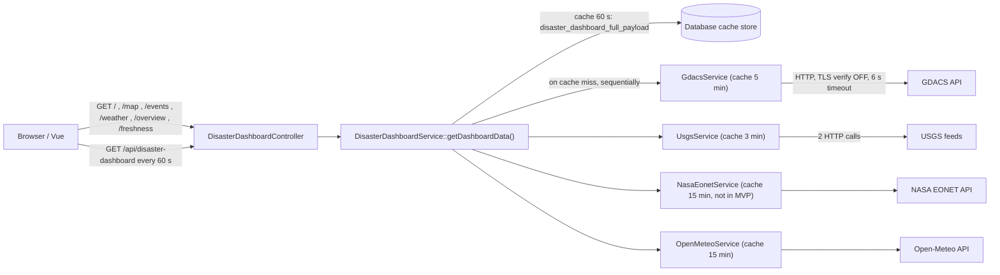
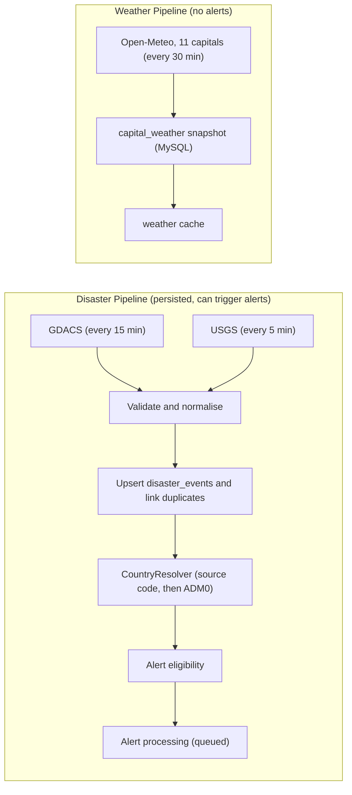
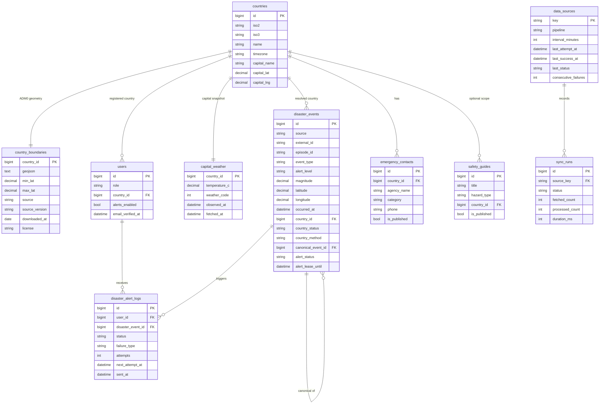
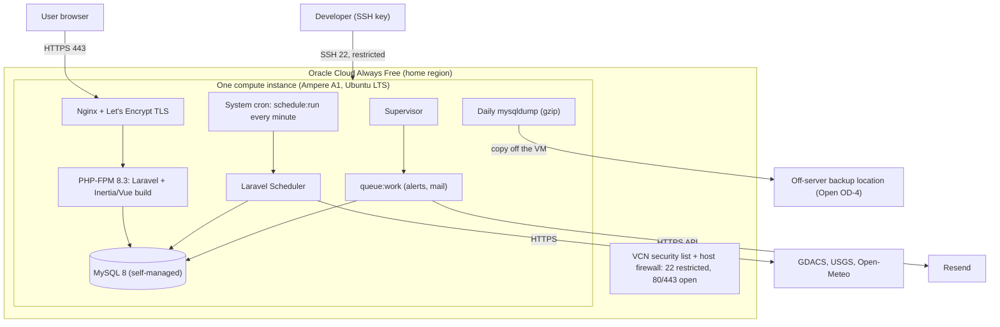
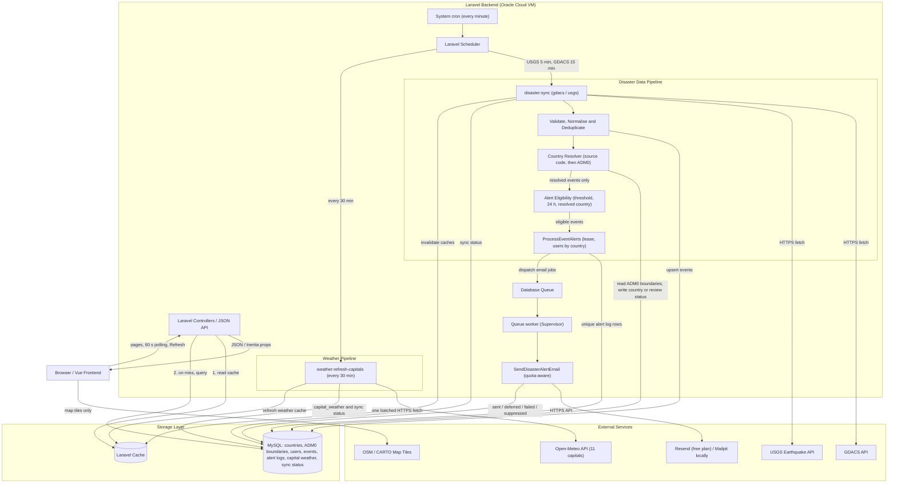
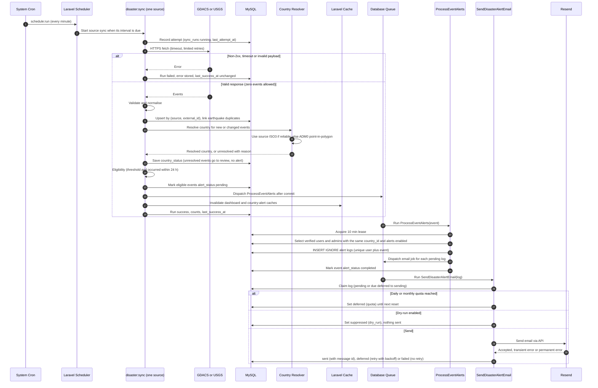
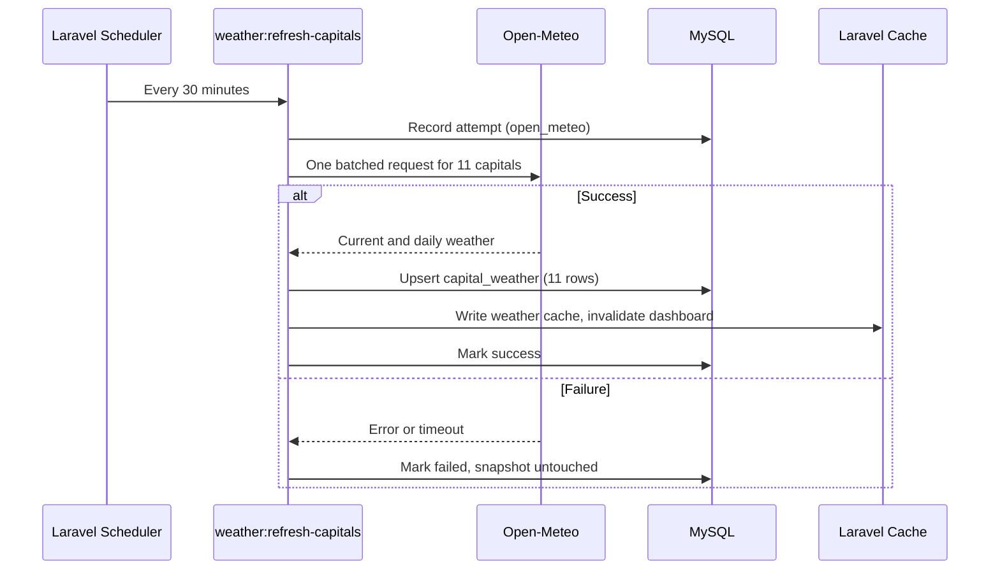
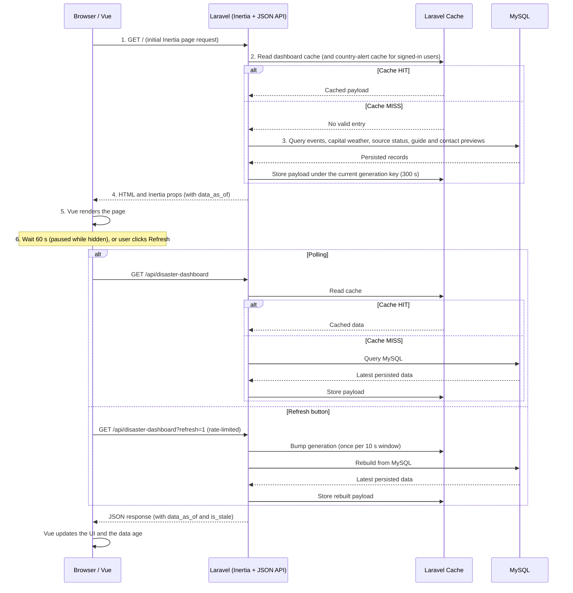
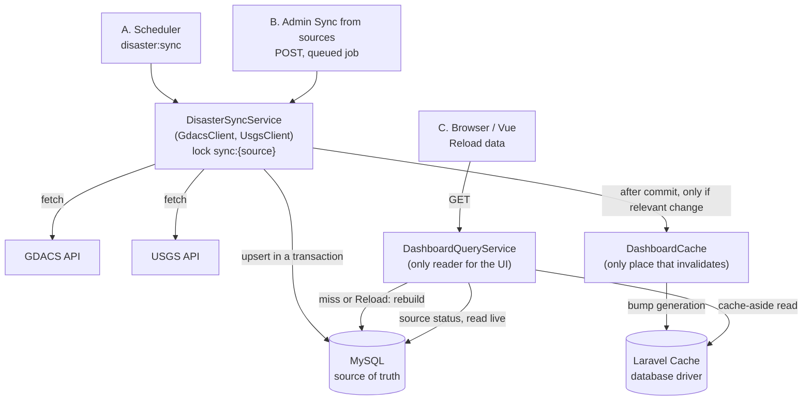

# DisasterLink SEA — High-Level Design (HLD)

> Southeast Asia Disaster Awareness & Emergency Guide
> *Stay Informed. Stay Prepared. Stay Safe.*

---

## 1. Document Information

| Item | Value |
|---|---|
| Document | High-Level Design — DisasterLink SEA |
| Version | **1.6** (implementation record of Phase 6; no new requirements) |
| Revision date | 10 November 2026 |
| Path | `docs/DisasterLink_SEA_HLD.md` (canonical HLD) |
| Related document | `docs/ASEAN_LOCATION_DATA_RESEARCH.md`. It researched **State/Province (ADM1)** data for the earlier v1.1 design. In v1.2 it is a **reference only** (licensing approach, geoBoundaries findings). The State/Province dataset it recommends is **not** part of the MVP. |
| Basis | Read-only inspection of the repository snapshot `DisasterLink_SEA`; the original brief; the v1.1 decision brief; the v1.2 decision brief |
| Audience | The two developers implementing the MVP |
| Constraints | 2 developers · about 1 week · zero-budget preference · Laravel 13 / PHP 8.3 · Vue 3 / TypeScript · Inertia · **MySQL in production** · **SQLite for local development and automated tests** |
| Status | Draft for team review. **v1.3 (§27) makes the MVP local-first**: production deployment is deferred. **v1.4 (§28) defines the cache layer and the three data operations** (scheduler sync, admin manual sync, UI reload). Where §28 differs from earlier sections, §28 applies; then §27; then the earlier sections. Open decisions are in §26.2, §27.9 and §28.14. |

### 1.1 Revision history

| Version | Date | Summary |
|---|---|---|
| 1.0 | 9 Nov 2026 | First HLD: As-Is inspection of the repository and To-Be design (State/Province alerts, three disaster sources, city weather). |
| 1.1 | 9 Nov 2026 | Applied decisions D1–D10: • EONET removed • Country → State/Province location • "inside or nearby" province matching with impact radius • 11-capital weather every 30 min • Data Freshness admin-only • recoverable alert leases • dry-run `suppressed` state |
| **1.2** | **9 Nov 2026** | **Incorporates the approved MVP scope and architecture decisions** (§26.1). Main changes: • **Country-level alert model** replaces State/Province matching: StateMatcher, impact radius, `disaster_event_states`, `states`, `state_boundaries`, `cities`, `state_id` and `city_id` are removed from the MVP. • **Event country resolution**: source country code first, then an **ADM0 country-boundary** point-in-polygon lookup; otherwise unresolved → review, no email. • Registration and profile ask for **Country only**. • **Recency: event occurred within 24 hours** for all alert sources. • Email provider **Resend Free Plan**, with quota-aware queued delivery. • Hosting **Oracle Cloud Always Free**, with a deployment architecture and operational responsibilities. • **Safety Guides and Emergency Contacts**: a Welcome preview plus separate detail pages filtered by country. • Manual refresh semantics corrected (admin "Refresh now" really syncs; public Refresh bypasses the cache). • Decision register (ADRs) updated. |

| **1.3** | **10 Nov 2026** | **Local-first MVP and simplifications** (§27, Proposed, pending team approval). Main changes: • **Production deployment deferred** (Oracle Cloud, Resend, MySQL server, Supervisor, TLS, backups) to a later phase. The MVP must work end to end on a developer machine. • **Recency counts from escalation:** an event that becomes Orange/Red after it started can still alert. • **USGS may take its country from a linked GDACS record** (OQ-2 = yes). • **Simpler alert reliability:** no event leases; one `alerts:dispatch` command; delivery quota counted from the database. • **Heartbeats and `Cache::flexible` dropped.** • **ADM0 provider proposed:** Natural Earth Admin-0 (public domain). • Revised 7-day local roadmap. |
| **1.4** | **10 Nov 2026** | **Cache layer and the three data operations** (§28, approved requirements; no code changed). Main changes: • **Target flow documented:** GDACS/USGS → `DisasterSyncService` ← Scheduler / Admin manual sync → MySQL → Cache → `DashboardQueryService` → UI. • **Single cache strategy:** `Cache::remember` cache-aside on the `database` driver, with a generation counter; `Cache::flexible` text removed. • **Invalidation only after commit and only on relevant change;** failed and no-change syncs leave the cache alone; source health and `data_as_of` are read live. • **Admin manual sync** is a queued, unique, throttled job with queued / running / success / failed states and a per-source result. • **Public "Reload data" never calls GDACS/USGS;** admin button is "Sync from sources". • **Reliability values calculated:** run deadline, lock TTL, `withoutOverlapping(10)`, job timeout, queue `retry_after`; abandoned-run sweep. • Phase 2 follow-ups listed with their true state; real Phase 2 component names recorded. • **Clarified:** four statuses plus a nullable `warning_message` ("Success with warnings" is a display state); atomic claim of queued rows; a job that cannot get the lock exits; `sync_runs` is extended (with `request_uuid`) instead of a `sync_requests` table. |
| **1.5** | **10 Nov 2026** | **Phase 5 implementation record (§29).** Phase 5 (pages served from MySQL through a generation-keyed cache) is built, so statements that the public pages call GDACS, USGS, EONET or Open-Meteo, that `DashboardCache` / `DashboardQueryService` are future work, and that v1.4 changed no code, are marked as historical with a pointer to §29. §29 lists every difference between the design (§28) and the code, including: the public event id format, 404 for unknown events, the removed weather fields, the weather refresh schedule and lock, the 7-day window, and one decided design question (UD-6: a stale dashboard payload may be served for up to 300 s if cache invalidation fails). Earlier text is kept; it is annotated, not rewritten. |
| **1.6** | **10 Nov 2026** | **Phase 6 implementation record (§30).** Guides and contacts (public pages, admin CRUD, Welcome previews), the admin dashboard, the admin "Sync from sources" job (`RunSourceSync`), the `sync_runs` migration, the abandoned-run sweep, the `warning_message` for a Green-level GDACS failure, and the admin Data Freshness tab are built. The public `/freshness` page is removed. Safety Guides and Emergency Contacts are one public page, `/preparedness` (§30.5). §28 items marked [Future work] for Phase 6 are annotated. §30 lists every difference from the design and what is **not** built (scheduler heartbeat banner, content seeding, extra Overview counts, country review list, guide caching). |

v1.2 **supersedes** the State/Province design of v1.1. Where v1.1 and v1.2 differ, v1.2 applies. **Where v1.3 (§27) differs from earlier sections, §27 applies. Where v1.4 (§28) differs from any earlier section, §28 applies. Where §29 (v1.5) and §30 (v1.6) record how Phase 5 and Phase 6 were actually built, they describe the implemented state and list every difference from §28.**

### 1.2 Labels

| Label | Meaning |
|---|---|
| **[Exists]** | Confirmed in the current code (file named) |
| **[Partial]** | Code exists but doesn't meet the requirement |
| **[Missing]** | Required; no implementation exists |
| **[Proposed]** | Design recommendation in this HLD (**not** a user-approved decision unless listed in §26.1) |
| **[Approved]** | A user-approved decision (§26.1) |
| **[Unverified]** | Not confirmed from the repository or primary sources |
| **[Open]** | A decision still to be made (§26.2) |
| **[Verify before deploy]** | A deployment verification item (§26.3) |

Priority labels: **Must Have (MVP)**, **Should Have**, **Future**.

> **Nothing in this document is implemented yet.** Sections describing fixes (XSS, TLS, IDs, stale data) are requirements for the implementation, not claims about the current code. **No application source code was modified while writing v1.0, v1.1 or v1.2.**

---

## 2. Project Overview

### 2.1 Executive summary

DisasterLink SEA is a disaster-awareness web platform for the 11 ASEAN countries: Brunei Darussalam, Cambodia, Indonesia, Laos, Malaysia, Myanmar, Philippines, Singapore, Thailand, Timor-Leste and Vietnam.

**Today** the application fetches GDACS, USGS, NASA EONET and Open-Meteo data during visitors' page requests and keeps it only in cache. Nothing is persisted, there are no alerts, and there are known XSS and TLS issues (§5).

**The MVP (v1.2):**
- **Scheduled ingestion** of **GDACS** (every 15 min) and **USGS** (every 5 min) into **MySQL**, the source of truth.
- **Event country resolution:** the source country code, else coordinates in an **ADM0 country boundary**. Unresolved events go to **review** and never generate email.
- **Country-level email alerts** via **Resend**, through a quota-aware, idempotent queue. Users who registered country X get alerts for eligible events (GDACS Orange/Red, USGS M ≥ 5.0, occurred in the last 24 h) whose resolved country is X. **The email never claims the user's own city or province is affected.**
- **Weather** for the 11 capitals from **Open-Meteo**, refreshed in one batch every 30 minutes.
- **Public pages:** map, events, weather; Safety Guides and Emergency Contacts (Welcome preview + detail pages filtered by country).
- **Admin Dashboard:** Overview (user count), Safety Guide CRUD, Emergency Contact CRUD, **Data Freshness** (admin-only).
- Deployed to **Oracle Cloud Always Free** on one self-managed VM (Nginx, PHP-FPM, MySQL, cron, Supervisor).

### 2.2 Who sees what

| Audience | Can do |
|---|---|
| **Public visitors** (no account) | View events on the map and feed, capital weather, safety guides and emergency contacts |
| **Registered users and administrators** | Register a **Country**. After verifying their email, receive country-level alert emails, and see recent alerts for their country on the Welcome page |
| **Administrators** | Also manage guides and contacts, see the registered-user count, and monitor Data Freshness |

---

## 3. Objectives and Scope

### 3.1 Goals

1. MySQL becomes the persistent source of truth for disaster events.
2. External APIs are called **only by scheduled backend jobs** (or an explicit admin refresh), never during a public page request and never by the browser.
3. Each event's country is resolved **reliably or not at all**. There is no guessing from place names.
4. Correct, never-duplicated **country-level** email alerts within the free Resend quota, with visible delivery status.
5. A simple tabbed Admin Dashboard, including source health computed from real sync records.
6. Fix the As-Is security and reliability issues (§5.4).
7. Deployable to Oracle Cloud Always Free with documented operations.

### 3.2 Non-goals (MVP)

- State/Province or city-level alerting, matching or reference data.
- Impact-area or impact-radius analysis.
- NASA EONET ingestion.
- Selected-city weather, a city picker, or geocoding.
- Paid email, paid hosting or managed services.
- Push/SMS/LINE, localisation, Google OAuth.

### 3.3 MVP scope

| Area | MVP |
|---|---|
| Sources | GDACS, USGS (disaster); Open-Meteo (weather) |
| Location | `countries` reference table + **ADM0 country boundaries** (for event country resolution only) |
| Users | Country only |
| Alerts | Country-level; GDACS Orange/Red; USGS M ≥ 5.0; occurred ≤ 24 h ago; verified email; alerts enabled |
| Email | Resend Free Plan, queued, quota-aware, idempotent |
| Weather | 11 capitals, scheduled batch every 30 min, cached |
| Content | Safety Guides and Emergency Contacts: Welcome preview + 2 detail pages + admin CRUD |
| Admin | Overview, Guides, Contacts, Data Freshness |
| Hosting | Oracle Cloud Always Free, one VM |

### 3.4 Future enhancements (not MVP dependencies)

- NASA EONET (display only).
- State/Province alerts, with the State/Province reference and boundary datasets (see the research report).
- City/Township reference data.
- City-specific weather selection.
- Impact-radius calculations.
- State-level point-in-polygon matching.
- Advanced geographic impact analysis (GDACS impact polygons, cyclone tracks).
- Maritime-zone country resolution for offshore events (§12.5).
- Escalation emails.
- Push/LINE channels.
- Localisation.
- Google OAuth.

---

## 4. Technology Stack

| Layer | Repository reality | MVP decision |
|---|---|---|
| Backend | Laravel `^13.17`, PHP `^8.3` [Exists] | Keep |
| Frontend | Vue `^3.5`, TypeScript, Tailwind, shadcn-vue [Exists] | Keep the design system and theme |
| Integration | Inertia v3, Laravel Wayfinder [Exists] | Keep |
| Auth | Fortify: registration, reset, **email verification** [Exists] | Keep. Add `country_id` and roles. |
| Database | SQLite default in `.env.example`; tests use in-memory SQLite [Exists] | **Production: MySQL 8** (self-managed on the Oracle VM). **Local development and tests: SQLite.** Country resolution runs in PHP, so no spatial SQL is needed. |
| Cache | `CACHE_STORE=database` [Exists] | Keep (zero cost) |
| Queue | `QUEUE_CONNECTION=database`, job tables exist, no job classes [Partial] | Database queue + **persistent worker (Supervisor)** |
| Scheduler | Only the demo `inspire` command [Missing] | Laravel Scheduler triggered by **system cron** |
| Mail | `MAIL_MAILER=log` [Partial] | Local: `log` / Mailpit. Production: **Resend** (`MAIL_MAILER=resend`, `RESEND_API_KEY` in `.env`) [Approved provider; transport package Verify before deploy] |
| Map | Leaflet `^1.9.4`; OSM or CARTO tiles from the browser [Exists] | Keep. Fix popup XSS. |
| Disaster APIs | `GdacsService`, `UsgsService` [Exists, request-path] | **MVP**, moved to scheduled ingestion |
| NASA EONET | `NasaEonetService` [Exists, request-path] | **Removed from MVP.** Removed from the dashboard payload and the schedule. Future only. |
| Weather | `OpenMeteoService` (11 capitals in one batch) [Exists, request-path] | **MVP**, moved to a 30-min scheduled batch |
| Boundary data | — [Missing] | **ADM0 country boundaries** (provider Open, §12.3) |
| Hosting | — | **Oracle Cloud Always Free** (Ubuntu VM, Nginx, PHP-FPM 8.3, MySQL 8, cron, Supervisor, Let's Encrypt) |
| Roles | None [Missing] | `admin` / `user` |

---

## 5. Current System Architecture (As-Is)

This section records what the repository does **today**. It is unchanged in substance since v1.0.

### 5.1 Summary

> **Historical (As-Is, before the MVP work).** This section and the diagram below describe the code as inspected at the start. The request-path services named here (`GdacsService`, `UsgsService`, `NasaEonetService`, `OpenMeteoService`) were **removed in Phase 5**; the pages now read MySQL only (§29). Kept to show where the design started.

The app is a **read-through cache over four external APIs**. Nothing about disasters is stored in the database.

### 5.2 Request flow (confirmed)

1. Seven routes are served by `DisasterDashboardController`:
   - six Inertia pages: `/`, `/overview`, `/map`, `/events`, `/weather`, `/freshness`
   - one JSON endpoint: `GET /api/disaster-dashboard`

   Each calls `DisasterDashboardService::getDashboardData()` with `@set_time_limit(120)`.
2. The service checks the cache key `disaster_dashboard_full_payload` (60 s).
3. On a miss, it calls the services **sequentially inside the visitor's request**, each with its own cache:

   | Source | TTL | Requests |
   |---|---|---|
   | GDACS | 300 s | 1 |
   | USGS | 180 s | 2 |
   | EONET | 900 s | 1 |
   | Open-Meteo | 900 s | 1 |

   That is up to 5 outbound calls × 6 s timeout.
4. Events are merged in memory (`isSameIncident`), cached for 60 s, and returned.

### 5.3 Per-integration behaviour (confirmed)

| Source | Endpoint / parameters | Notable issues |
|---|---|---|
| GDACS | `geteventlist/SEARCH`, `eventtypes=EQ,TC,FL,VO,WF,DR`, `alertlevel=Green;Orange;Red` | `uniqid()` fallback ID; `episodeid` read but unused; loose lat/lng box admits non-ASEAN events; `title` not sanitised. The country is taken from GDACS `iso3`/`country` where present, otherwise from a bounding-box guess. |
| USGS | `all_hour.geojson` **and** `all_week.geojson` | **A non-200 from both feeds is reported as `Live` with 0 events and cached**; `uniqid()` fallback; **country guessed from the last comma segment of the `place` text** (e.g. "Papua New Guinea"); `all_hour` redundant |
| NASA EONET (not MVP) | `v3/events?status=all&days=30&limit=30&bbox=…` | Invented severity; closed events included; truncation |
| Open-Meteo | `v1/forecast`, 11 capitals in one call | Fetched during requests; bundled into the disaster payload |

### 5.4 Confirmed weaknesses → v1.2 requirement

| # | Finding | Evidence | Addressed in |
|---|---|---|---|
| A1 | No persistence | No disaster migrations or models | §11, §15 |
| A2 | External calls in the user request path (up to ~30 s) | All controller actions | §6, §17 |
| A3 | Stale fallback is dead code: data and meta expire together, so an outage returns `Unavailable` with no events | All four services | §16.5 |
| A4 | A USGS outage is reported as `Live` with 0 events | `UsgsService` | §10.4, §18 |
| A5 | Source health inferred from cache; the frontend defaults to `status: 'Live'` | Services; `useDisasterTelemetry.ts` | §18, §19 |
| A6 | `Http::withoutVerifying()` (TLS off) | All four services | §20.2 |
| A7 | XSS via an `innerHTML` popup with upstream `title`, `country`, `severity_text`, `source_url` | `DisasterMap.vue` | §20.3 |
| A8 | Unvalidated `:href="ev.source_url"` | `DisasterEventFeed.vue`, `EventsPage.vue`, popup | §20.3 |
| A9 | Unstable `uniqid()` identifiers | Three disaster services | §11.3 |
| A10 | **Manual Refresh never bypasses the cache**; `$forceRefresh` is unreachable | Header button → `GET /api/disaster-dashboard` | §19.3 |
| A11 | Country is free text, guessed from place strings | Services | §12 (country resolution) |
| A12 | Tests call live APIs | `tests/Feature/ExampleTest.php` | §20.6 |

### 5.5 Keep

- The normalisation code in `GdacsService` / `UsgsService`.
- The WMO weather map in `OpenMeteoService`.
- The dedup heuristic (tightened in §11.5).
- The polling composable.
- Fortify with email verification.
- The design system: tokens, Instrument Sans, `DisasterHeader` / `DisasterFooter`, dark mode.
- The Weather UI (`WeatherMonitoring.vue`), unchanged.

### 5.6 Current pages → v1.2 decision

| Route | Page | Auth | v1.2 decision |
|---|---|---|---|
| `/` | `Welcome.vue` | Public | Keep. Add Login/Register buttons, a **country alerts** area, and **previews** of Safety Guides and Emergency Contacts (§8.1). |
| `/overview`, `/map`, `/events` | Existing | Public | Keep; data from MySQL via cache |
| `/weather` | `WeatherPage.vue` | Public | Keep the UI; data from the scheduled 11-capital snapshot |
| `/freshness` | `FreshnessPage.vue` | **Public** | **Removed from the public UI**; moves to the Admin Dashboard |
| `/dashboard` | Starter placeholder | `auth`, `verified` | Redirect: admin → `/admin`, user → `/` |
| `/settings/*` | Profile / Security / Appearance | `auth` | Profile gains **Country** and the alert-email toggle |
| `/login`, `/register` | `AuthSimpleLayout` | Guest | Themed, with a Login/Register toggle and a **Country** select |
| — | — | — | **New:** `/safety-guides` and `/emergency-contacts` detail pages (public) *(v1.6: replaced by one page, `/preparedness`; the old URLs redirect; §30.5)* |
| — | — | — | **New:** `/admin` (tabs) |

---

## 6. Proposed System Architecture (To-Be)

### 6.1 Principles

1. **Three separate processes:**
   - **ingestion**: scheduler → GDACS / USGS / Open-Meteo → MySQL,
   - **serving**: browser → Laravel → cache → MySQL,
   - **notification**: queue → Resend.

   The browser never calls GDACS, USGS or Open-Meteo.
2. **MySQL is the source of truth.** Cache is a performance layer.
3. **Source-specific schedules:** USGS 5 min, GDACS 15 min, Open-Meteo 30 min, each with its own status record.
4. **Country resolution is a distinct step**, between normalisation and alert eligibility. Unresolved means no email, and the event goes to review.
5. **Event identity ≠ alert identity:**
   - events are keyed by `(source, external_id)`,
   - alerts by `(user_id, disaster_event_id)`.
6. **Recoverable, idempotent background work:** leases, unique keys and atomic claims.
7. **Zero cost:** database cache and queue, free tiers, one Always Free VM.
8. **Minimal UI change:** reuse pages and the theme; one admin page with tabs; two simple content pages.

### 6.2 Application components

| Component | Responsibility | Type | Priority |
|---|---|---|---|
| `disaster:sync {gdacs\|usgs}` | Fetch → validate → normalise → upsert → link duplicates → **resolve country** → evaluate eligibility → record status | Scheduled command | Must |
| Source clients (`GdacsClient`, `UsgsClient` on `SourceClient`) | Fetch + validate + normalise only: TLS on, no cache, no `uniqid`. **[Exists]** (v1.4: replaces the planned `GdacsService` / `UsgsService` refactor) | Service | Must |
| `DisasterSyncService` | Lock, run bookkeeping, transactional upsert (`persist()`), change detection, post-commit cache invalidation; shared by the scheduler and the admin sync job. **[Exists]**; see §28.3. (Replaces the planned `DisasterEventUpserter`; earthquake linking is still to come.) | Service | Must |
| `DashboardCache` / `RunSourceSync` | Cache keys, TTLs, invalidation (§28.5–§28.7) / queued admin sync job (§28.8). **[Future work]** | Service / Job | Must |
| **`CountryResolver`** | Source country code → else ADM0 point-in-polygon → else unresolved | Service | Must |
| `AlertEligibility` | Severity thresholds + 24 h recency + resolved country | Service | Must |
| `ProcessEventAlerts` | Lease the event; select users in that country; create unique alert logs; dispatch mail jobs | Queued job | Must |
| `SendDisasterAlertEmail` | Claim the log; check the Resend quota; send (or suppress in dry-run); record the outcome | Queued job | Must |
| `alerts:recover` | Expired leases, stale `pending` / `deferred` logs, stuck `sending` logs | Scheduled command | Must |
| `weather:refresh-capitals` | One Open-Meteo batch for the 11 capitals → snapshot + cache | Scheduled command | Must |
| `DashboardQueryService` | Public dashboard payload from MySQL with cache-aside; merges live source status (§28.5) | Service | Must |
| `CountryAlertsQuery` | Recent eligible events for the signed-in user's country (Welcome page) | Service | Must |
| `SourceHealthService` | Healthy / Delayed / Stale / Failed / Never Synced | Service | Must |
| Admin controllers | Overview, Guide CRUD, Contact CRUD, Data Freshness, Refresh now | HTTP | Must |
| Public content controllers | `/preparedness` (`PreparednessController`; `/safety-guides` and `/emergency-contacts` redirect to it) | HTTP | Must |

### 6.3 API and route design

| Method & path | Purpose | Auth | Notes |
|---|---|---|---|
| `GET /` `/overview` `/map` `/events` `/weather` | Existing Inertia pages | Public | Props from `DashboardQueryService` (cache → MySQL) |
| `GET /api/disaster-dashboard` | Dashboard JSON for 60 s polling | Public, `throttle:60,1` | `?refresh=1` (**"Reload data"**, §28.4) **rebuilds the dashboard from MySQL and repopulates the cache** (rate-limited per IP, `throttle:6,1`, 10 s coalescing). It never calls external APIs. |
| `GET /preparedness` | **[v1.6]** The public "Be Prepared" page: Emergency Contacts and Safety Guides together (§8.3, §30.5) | Public | Two independent filters in the URL: `?country={ISO2}` (contacts) and `?hazard={type}` (guides) |
| `GET /safety-guides` | *(Earlier design: Safety Guides detail page.)* **v1.6:** permanent redirect (301) to `/preparedness#guides` | Public | Keeps `?country` only |
| `GET /emergency-contacts` | *(Earlier design: Emergency Contacts detail page.)* **v1.6:** permanent redirect (301) to `/preparedness#contacts` | Public | Keeps `?country` only |
| `GET /api/locations/countries` | Country select options | Public | Cached 24 h |
| `GET /api/me/country-alerts` (or an Inertia prop on `/`) | Recent eligible events for the user's country | `auth` | Cached per country, 60 s |
| `POST /register`, `PUT /settings/profile` | Fortify registration / profile with `country_id` and `alerts_enabled` | Guest / `auth` | Validated server-side |
| `GET /admin` | Admin Dashboard (tabs) | `auth`, `verified`, `admin` | `?tab=overview\|guides\|contacts\|freshness` |
| `GET /admin/stats` | Overview counts | admin | |
| `Route::resource('admin/safety-guides')`, `Route::resource('admin/emergency-contacts')` | CRUD | admin | Form Requests + gate *(v1.6: implemented as explicit `POST`, `PUT` and `DELETE` routes under `/admin`; listing, viewing and editing happen in the Safety Guides and Emergency Contacts tabs of the `/admin` page, which is separate from the public page)* |
| `GET /admin/data-sources` | Freshness and source health | admin | Reads `data_sources` and `sync_runs` live (not cached) |
| `POST /admin/data-sources/refresh` | **Sync from sources** (v1.4, §28.8): `source = gdacs\|usgs\|all`; queues `RunSourceSync`, returns 202 with a per-source state | admin, `throttle:3,1` | Same `DisasterSyncService` and `sync:{source}` lock as the scheduler; result in `sync_runs` |

The full overall diagram is in §21.

---

## 7. User Roles and Permissions

### 7.1 Roles [Missing → Proposed]

- `users.role`: `admin` | `user`, default `user`, backed by a PHP enum. **Not** mass-assignable.
- Admins are created by a seeder or `php artisan app:make-admin {email}`. The command also asks for the admin's **Country**.

### 7.2 Permission matrix

| Capability | Guest | User (unverified) | User (verified) | Admin (verified) |
|---|---|---|---|---|
| Map, events, weather, Safety Guides, Emergency Contacts (preview + detail pages) | ✓ | ✓ | ✓ | ✓ |
| Registration promotion on the Welcome page | ✓ | — | — | — |
| "Recent alerts for {Country}" on the Welcome page | — | ✓ (with a verify-email notice) | ✓ | ✓ |
| Edit own profile, Country, alert-email toggle | — | ✓ | ✓ | ✓ |
| **Receive country-level alert emails** | — | ✗ | ✓ | ✓ (**same rules as users**) |
| Admin Dashboard, CRUD, Data Freshness, Refresh now | ✗ | ✗ | ✗ | ✓ |

Administrators are **not** excluded from alerting. An admin is alerted for events resolved to the admin's own registered country.

### 7.3 Enforcement

- `/admin/*` routes use `['auth', 'verified', 'admin']`; Form Requests also check `Gate::allows('admin')`.
- `auth.user.is_admin` is shared with Inertia **only** to show or hide UI.
- Feature tests confirm a `user` gets 403 on every admin route.

---

## 8. UI and Page Architecture

Preserve:
- the tokens in `resources/css/app.css` and Instrument Sans,
- `DisasterHeader` / `DisasterFooter`,
- dark mode,
- the shadcn-vue components.

The **Weather UI is unchanged.** Don't redesign unrelated sections.

### 8.1 Welcome page (`/`)

| Element | Status | Change | Priority |
|---|---|---|---|
| Hero, CTAs, `RegionalOverview`, features, sources | [Exists] | Keep; data from the MySQL-backed dashboard | Must |
| Login / Register buttons | [Missing] | Add to `DisasterHeader` for guests (desktop + mobile) | Must |
| **Country alerts area** (`CountryAlerts.vue`) | [Missing] | Guests: registration promotion. Signed-in: recent alerts for their country (§8.2). | Must |
| **Safety Guides preview** | [Missing] | Up to 3 published guides (all-country, or the signed-in user's country) with "View all safety guides →" `/preparedness#guides` *(v1.6)* | Must |
| **Emergency Contacts preview** | [Missing] | Up to 3 key contacts for a selected country (default: the signed-in user's country, otherwise a country chooser) with "View all emergency contacts →" `/preparedness?country={ISO2}#contacts`, or `/preparedness#contacts` without a country *(v1.6)* | Must |
| Weather | [Exists] | **Unchanged**; reads the 11-capital snapshot | Must |
| "Data Freshness" nav links + `/freshness` route | [Exists] | **Removed** from the public UI | Must |
| "Last updated HH:MM" next to the map/feed | [Missing] | Backend `data_as_of` timestamp only, not diagnostics | Should |

### 8.2 Country alerts area: wording

| Visitor | Content |
|---|---|
| **Guest** | "Register your country to receive email alerts for significant disasters reported in that country." Bullets: • Alerts are based on the country an event is reported in. • A country-level alert does **not** mean every city or area in that country is affected. • Each alert includes event details and a link to the original source so you can judge the information yourself. • Guests keep full access to public information. CTAs: **Create free account**, **Log in**. No personal data is shown. |
| **Signed-in (user or admin)** | "Recent alerts for **{Country}**." Eligible events (§13.1) resolved to the user's country in the last **7 days** [Proposed, OQ-5], newest first. Each row: event type, location description, magnitude/severity, time, source, link to the original source. A fixed note: "Alerts are country-level. Check the event location and official sources to see whether your area is affected." |
| **Signed-in, unverified** | The same, plus "Verify your email to receive alert emails" with Fortify's resend link |
| **Signed-in, no country** (legacy account) | A prompt to set a country in Settings |

**Removed wording (v1.1):** "your State/Province is affected", "alerts are limited to your State/Province", "near your province", "this event does not affect the whole country".

### 8.3 Safety Guides and Emergency Contacts pages [Approved structure]

> **v1.6 (§30.5):** the two pages below were built as **one public page, `/preparedness`**, with an Emergency Contacts section and a Safety Guides section and two independent filters. The table keeps the original design; where it differs, §30.5 applies. In particular, the guides are filtered by **disaster type only**, not by country.

| Page | Content | Filter |
|---|---|---|
| `/safety-guides` | Published guides grouped by hazard type (earthquake, cyclone, flood, volcano, wildfire, general). Each guide is shown as an expandable card with sanitised Markdown content. | **Country** select (`?country=TH`): shows guides for that country **plus** all-country guides (`country_id IS NULL`). No State/Province filter. |
| `/emergency-contacts` | Published contacts as a table/cards: agency, category, phone (`tel:` link), alternative phone, website (validated https), notes | **Country** select. Default: the signed-in user's country, otherwise "choose a country". No State/Province filter. |

Both pages reuse `DisasterHeader` / `DisasterFooter` and the existing card and table styles. A header nav item "Be Prepared" links to `/safety-guides`, with Emergency Contacts beside it. *(v1.6: the header has one "Be Prepared" item that links to `/preparedness`; there is no separate Emergency Contacts item.)*

### 8.4 Login and Registration

1. A themed auth layout (`AuthSplitLayout` with DisasterLink SEA colours and logo); responsive.
2. A **Login | Register** toggle using Inertia `<Link>`s to the Fortify routes, so throttling and verification are unchanged.
3. Register adds **one Country select** (11 options from `GET /api/locations/countries`). **No State/Province or City fields.**
4. Server validation: `country_id` must exist in `countries` and be active (`Rule::exists('countries','id')->where('is_active', true)`).
5. Email verification is unchanged (Fortify + `MustVerifyEmail`).
6. `settings/Profile.vue` gets **Country** and the **"Email me disaster alerts"** toggle (§13.2).

### 8.5 Admin Dashboard (`/admin`)

| Tab | Content | Priority |
|---|---|---|
| 1. Overview | **Registered users** (total, verified, admins); Safety Guides count; Emergency Contacts count. Optional: events in the last 24 h, alerts sent/failed/deferred in the last 24 h, events awaiting country review, Resend quota used today and this month. | Must (counts); Should (extras) |
| 2. Safety Guides | Table + filters (hazard, country); create, view, edit, delete, publish | Must |
| 3. Emergency Contacts | Table + country filter; create, view, edit, delete, publish | Must |
| 4. Data Freshness | Cards for **GDACS, USGS, Open-Meteo** (§18); last 10 runs per source; **Refresh now** per source | Must (status); Should (Refresh now) |
| Country review list | Events with `country_status = unresolved` and the reason | Should |

---

## 9. Location Management Architecture

### 9.1 Country-only location [Approved]

Users and administrators register a **Country** only. There is no State/Province or City/Township reference data, selection or storage in the MVP.

**`countries` (reference table, 11 rows):**

| Column | Notes |
|---|---|
| `id` | PK |
| `iso2` | ISO 3166-1 alpha-2, unique (e.g. `TH`) |
| `iso3` | ISO 3166-1 alpha-3, unique (e.g. `THA`). **Join key for the GDACS `iso3` and the ADM0 boundary records.** |
| `name` | e.g. "Thailand", "Brunei Darussalam" |
| `timezone` | e.g. `Asia/Bangkok`, for alert email times [Proposed]. Indonesia spans three time zones, so use the capital's zone and also show UTC (OD-2). |
| `capital_name`, `capital_lat`, `capital_lng` | Used by the 11-capital weather batch (replaces the hard-coded capitals list) |
| `sort_order`, `is_active` | |
| timestamps | |

**`users`:**
- add `country_id` (FK → `countries`, `restrictOnDelete`, indexed),
- add `alerts_enabled` (bool, default `true`),
- add `role`.

**`state_id` and `city_id` are not added.**

**Legacy users** without a country (only the seeded test user exists) are prompted to set one. Users without `country_id` are never alert-eligible.

**Seeding:** `CountrySeeder` upserts by `iso2` (idempotent) and clears `locations:countries`.

### 9.2 Country boundaries (ADM0)

The ADM0 boundary dataset is used **only** to resolve an event's country from its coordinates (§12). It is **not** used for impact areas, radii or sub-national eligibility. Storage, import and the provider decision are in §12.3–12.4.

### 9.3 Relationship to the research report

`docs/ASEAN_LOCATION_DATA_RESEARCH.md` evaluated **State/Province (ADM1)** datasets for the v1.1 design. In v1.2:
- its ADM1 recommendation (319 State/Province records, the Vietnam 2025 derivation, etc.) is **Future** only,
- its findings on **geoBoundaries' mixed per-country licences**, ODbL share-alike and GADM's redistribution restriction still inform the ADM0 provider decision (§12.3).

---

## 10. External API Integration Architecture

### 10.1 MVP API scope

| Integration | Priority | Purpose | Pipeline | Persisted in |
|---|---|---|---|---|
| **GDACS** | Must | Multi-hazard events with official Green/Orange/Red levels and ISO3 country codes; alert source (Orange/Red) | Disaster | `disaster_events` |
| **USGS** | Must | Earthquakes (magnitude, depth, epicentre); alert source (M ≥ 5.0) | Disaster | `disaster_events` |
| **Open-Meteo** | Must | Current weather + today's forecast for the **11 ASEAN capitals** | Weather | `capital_weather` + cache |
| NASA EONET | **Future** | — | — | — |

**Consequence of removing EONET:** EONET-only map items (some wildfires, volcanoes, landslides) disappear. GDACS still covers WF, VO, FL, TC and DR at its own thresholds. EONET never sent alerts.

### 10.2 Pipelines

### 10.3 Per-source configuration (`config/disaster_sources.php` + `data_sources` rows)

| Setting | GDACS | USGS | Open-Meteo |
|---|---|---|---|
| Endpoint | `gdacsapi/api/events/geteventlist/SEARCH`, `fromdate` = now − 7 days, `todate` = now, EQ,TC,FL,VO,WF,DR | `summary/all_day.geojson` (one request; drop `all_hour`) | `v1/forecast`, 11 capital coordinates, `current` + `daily` (1 day), one batched request |
| **Interval** | **15 min** (:02, :17, :32, :47) | **5 min** | **30 min** (:12, :42) |
| Delayed after | 30 min | 10 min | 60 min (`open_meteo.delayed_after_minutes`) |
| Stale after | 60 min | 30 min | 3 h (`open_meteo.stale_after_minutes`) |
| Timeout (connect / total) | 5 s / 15 s | 5 s / 15 s | 5 s / 15 s |
| Retries in a run | 2 (2 s, 5 s) on connection error / 429 / 5xx; respect `Retry-After` | same | same |
| Alert threshold | Orange or Red | M ≥ 5.0 | none |
| Country info from the source | `iso3`, `affectedcountries` | **none** (only free-text `place`, which is **not** used) | n/a |

The staggered offsets mean no two sources fetch in the same minute. The providers don't publish strict rate limits for these endpoints *[Unverified]*; the intervals are conservative.

### 10.4 Normalisation and validation

Adapters return `NormalizedEvent` DTOs (no cache, no persistence):

| Field | GDACS | USGS |
|---|---|---|
| `source` / `external_id` | `gdacs` / `"{eventtype}:{eventid}"` | `usgs` / feature `id` |
| `episode_id` | `episodeid` (metadata only) | — |
| `event_type` | EQ→earthquake, TC→cyclone, FL→flood, VO→volcano, WF→wildfire, DR→drought | earthquake |
| `alert_level` | official | derived from magnitude (`alert_level_derived = true`); display only |
| `magnitude` / `severity_value`, `severity_unit`, `depth_km` | `severitydata` | `mag`, depth |
| `latitude`, `longitude` | GeoJSON point | epicentre |
| `source_country_iso3` | `iso3` (+ `affectedcountries` list stored in `source_meta`) | null |
| `location_text` | GDACS country/name text (display only) | `place` (**display only, never used for country resolution**) |
| `occurred_at` | `fromdate` | `time` (ms) |
| `ended_at` | `todate` when the event is not current *[GDACS field semantics Unverified]* | — |
| `source_updated_at` | `datemodified` | `updated` |
| `source_url` | `url.report` (validated, §20.3) | `url` (validated) |
| `title`, `description` | tags stripped, entities decoded, length-limited | `title` |

**A run is FAILED, and stored events untouched, on:** non-2xx, timeout, unparseable body, or wrong shape. **A valid response with zero events is a success with `fetched_count = 0`** (not a failure, and not by itself proof of health; §18).

Records with invalid coordinates or no stable ID are skipped and counted.

### 10.5 Open-Meteo usage and attribution

| Item | Value (as published, checked 9 Nov 2026) [Verify before deploy] |
|---|---|
| Free API | Non-commercial use |
| Free limits | 600/min, 5,000/hour, 10,000/day, 300,000/month |
| Data licence | CC BY 4.0: attribution required |
| MVP usage | **48 calls/day** (one batch every 30 min) |
| Attribution | "Weather data by Open-Meteo.com" with a link, near the weather section and in the footer data credits (exact wording from Open-Meteo's licence page) |

### 10.6 Other network integrations (not scheduled)

| Integration | Called by | MVP |
|---|---|---|
| OSM / CARTO map tiles | Browser (Leaflet) | Unchanged |
| **Resend** | Queue worker (HTTPS API) | §13.9 |
| Open-Meteo Geocoding | — | **Not used** (Future) |
| Google OAuth | — | Not planned |

---

## 11. Disaster Data Processing

### 11.1 Ingestion steps (`disaster:sync {source}`)

1. Take the locks: scheduler `withoutOverlapping(10)` and, in every path (scheduler and admin job), `Cache::lock("sync:{source}", 300)` inside `DisasterSyncService`. After taking the lock, abandoned `running` / stale `queued` rows of that source are marked failed (§28.10). *(v1.4, §28.9)*
2. Insert a `sync_runs` row (`running`) and set `data_sources.last_attempt_at`.
3. Fetch (timeout, limited retries).
4. **Validate.** If invalid: the run fails, the error is recorded, **`last_success_at` is not updated**, and **no stored event changes**.
5. **Normalise** to DTOs.
6. **Upsert** by `(source, external_id)` (§11.3).
7. **Link** USGS↔GDACS duplicates of the same earthquake (§11.5).
8. **Resolve country** for new events, and for events whose coordinates or source country changed (§12). Unresolved events are kept with `country_status = unresolved` and a reason.
9. **Evaluate alert eligibility** (§13.1). Newly eligible events get `alert_status = pending`, and `ProcessEventAlerts` is dispatched **after commit**.
10. **After commit, and only if a relevant change was made (§28.6),** invalidate the dashboard (generation bump) and the affected `country-alerts` entries (§28.5). A failed or no-change run leaves the cache alone. *(v1.4)*
11. Complete the run (`success`, counts, duration) and update `data_sources` (`last_success_at`, `consecutive_failures = 0`).

### 11.2 `disaster_events`

| Column | Notes |
|---|---|
| `id` | PK |
| `source` | `gdacs` / `usgs` |
| `external_id` | stable provider ID |
| `episode_id` | GDACS latest episode (metadata) |
| `event_type` | earthquake / cyclone / flood / volcano / wildfire / drought |
| `title`, `description`, `location_text` | plain text; `location_text` is for display only |
| `alert_level`, `alert_level_derived` | |
| `magnitude`, `severity_value`, `severity_unit`, `depth_km` | nullable |
| `latitude`, `longitude` | decimal(9,6), nullable |
| `occurred_at` | event occurrence time (UTC); **used for the 24 h recency rule** |
| `ended_at`, `source_updated_at` | |
| `source_url` | validated https or null |
| `source_meta` | json: e.g. GDACS `affectedcountries`, `iso3`, raw severity text |
| `country_id` | FK → `countries`, **null unless confidently resolved** |
| `country_status` | `resolved` / `unresolved` / `outside_region` |
| `country_method` | `source_code` / `adm0_lookup` / `linked_source` / null |
| `country_note` | reason when unresolved (e.g. "point not inside any ASEAN country boundary", "near a border between TH and MM", "no coordinates") |
| `canonical_event_id` | FK self (null = canonical) |
| `alert_status` | `not_eligible` / `pending` / `processing` / `completed` |
| `alert_lease_until`, `alert_attempts`, `alerts_completed_at` | lease (§13.4) |
| `first_seen_at`, `last_seen_at`, `last_synced_at` | |
| `raw_payload` | json null; pruned after 30 days |
| timestamps | |

**Indexes:**
- `UNIQUE (source, external_id)`
- `INDEX (occurred_at)`
- `INDEX (country_id, occurred_at)`: Welcome country alerts and recipient processing
- `INDEX (event_type, occurred_at)`
- `INDEX (country_status)`
- `INDEX (canonical_event_id)`
- `INDEX (alert_status, alert_lease_until)`

### 11.3 Event identity

- **The provider ID is the identity.** All `uniqid()` fallbacks are removed (A9).
- **GDACS:** `external_id = "{eventtype}:{eventid}"`. `episode_id` is stored as **metadata, not part of the key**. GDACS episodes are updates (e.g. the next cyclone advisory), and keying on them would create a new event, and a new initial alert, per advisory.

  > *Decision status: carried forward from v1.1 (decision D10 in the v1.1 brief). Not re-approved in the v1.2 brief; retained because it remains justified.*
- **USGS:** the feature `id`.
- **Missing ID (rare):** a deterministic `syn:` hash of `source | event_type | round(lat,2) | round(lng,2) | occurred_at (minute)`. **Never alert-eligible.**
- **Alert identity is separate:** `UNIQUE (user_id, disaster_event_id)` (§13.3).

### 11.4 Updates, disappearance, active state and retention

- Update in place when `source_updated_at` or a tracked field changes. Re-run country resolution if the coordinates or source country change.
- **Never delete** an event because it's missing from a response; update `last_seen_at` only for events present.
- **Active:**
  - GDACS: not ended and seen within 3 days,
  - USGS: recent = `occurred_at` within 7 days.
- **Retention:** 12 months; `raw_payload` pruned after 30 days.

### 11.5 Cross-source deduplication (earthquakes only)

- The only MVP overlap is **earthquakes reported by both USGS and GDACS**. Other GDACS hazards are never linked.
- **Link only if all of these hold:**
  - |Δ occurrence time| ≤ **5 min**,
  - distance ≤ **50 km**,
  - |Δ magnitude| ≤ **0.5**.

  Aftershocks and separate nearby quakes don't meet these together.
- **Precedence:** the first-arriving row stays canonical (usually USGS). A linked row never becomes a chain.
- **Alerts run for the canonical row only.** Eligibility is evaluated on the **group**: an Orange/Red GDACS duplicate can make a USGS M 4.8 canonical row eligible. The user receives at most one alert per earthquake.
- **Country via the group:** if the canonical row is unresolved but its linked GDACS row has a reliable ISO3, the canonical row may take that country with `country_method = linked_source` [Proposed, OQ-2].
- **Display:** each group is shown once, with all source links and the highest official level.
- **Residual risk:** two separate quakes within 5 min, 50 km and 0.5 magnitude would merge. The effect is one alert instead of two, which is the safe direction.

---

## 12. Event Country Resolution

*(Replaces v1.1's "Disaster Location Matching". There is no State/Province matching and no impact radius.)*

### 12.1 Approved resolution order

| Step | Rule | Result |
|---|---|---|
| 1 | **Reliable source country information.** GDACS `iso3` is present **and** is one of the 11 ASEAN ISO3 codes in `countries`. | `country_status = resolved`, `country_method = source_code` |
| 2 | Otherwise, **coordinates against the ADM0 country boundaries** (§12.2) | resolved (`adm0_lookup`), or continue to step 3 |
| 3 | Country **cannot be determined confidently** | `country_status = unresolved` + `country_note`. The event is **kept**, shown on the map and listed for **review**. **No email.** |
| 4 | **Never guess** from a place name or ambiguous location text (e.g. USGS `place` "120 km SW of …, Indonesia"), and never from insufficient coordinates | — |

**Additional proposed details** [Proposed]:

- **GDACS events with several affected countries** (e.g. a cyclone listing Philippines and Vietnam): the MVP resolves **one** country (`iso3`, the primary country) and stores the full `affectedcountries` list in `source_meta`. Users in the **other** affected countries are **not** alerted in the MVP [Open: OQ-1].
- **GDACS `iso3` that is non-ASEAN or empty:** fall through to the ADM0 lookup. If the point is not inside an ASEAN boundary → `outside_region` (stored or hidden, never alerted).
- **USGS:** has no country field, so it always uses the ADM0 lookup, unless OQ-2 (`linked_source`) applies.

### 12.2 ADM0 point-in-polygon lookup (`CountryResolver`)

1. Load the 11 ASEAN ADM0 boundaries once per sync run (simplified GeoJSON + bounding box per country).
2. **Prefilter** by bounding box.
3. **Point-in-polygon** (ray casting; MultiPolygons and holes handled) for each candidate country.
4. **Confidence rule** [Proposed]:
   - resolved only if the point is inside **exactly one** country polygon, **and** not within **2 km** of another ASEAN country's polygon (a guard against simplification error at land borders),
   - otherwise → `unresolved`, with note "near the border between X and Y".
5. A point inside no ASEAN polygon → `unresolved` (note "outside ASEAN land boundaries"), or `outside_region` if it is also far (> 300 km) from every ASEAN bounding box [Proposed thresholds].

**Coordinate reference system and geometry handling:**
- Boundaries and event coordinates are both **WGS84 longitude/latitude** (EPSG:4326 / CRS84). GeoJSON order is **[longitude, latitude]**. The resolver must not swap axes.
- No reprojection is needed.
- Geometries are validated at import (`make_valid` if needed) and simplified to a documented tolerance, keeping ≥ 1 km accuracy.
- The antimeridian is not relevant for ASEAN.
- **Why PHP, not MySQL spatial:** it works identically on SQLite (local development and tests) and MySQL (production), with 11 polygons and millisecond lookups, and avoids SRID/axis-order pitfalls. MySQL spatial is a Future option.

### 12.3 ADM0 dataset requirements and provider decision

**Requirements:**
- **ADM0 only**, 11 ASEAN countries. No ADM1/ADM2/city data.
- Polygon/MultiPolygon in WGS84.
- A licence permitting storage in our database and use in a public web app.

**Provider status: [Open: OD-1].** The exact dataset provider, version and licence are **not approved**. The research report studied ADM1, not ADM0.

**Candidates for the team to choose from** (facts checked 9 Nov 2026; licences must be re-verified before public use):

| Candidate | Licence situation | Notes |
|---|---|---|
| **geoBoundaries gbOpen ADM0** (per-country files) | **Mixed per country** (from the geoBoundaries metadata): Brunei Public Domain; Cambodia, Indonesia, Laos, Malaysia, Singapore, Thailand and Timor-Leste **ODbL 1.0**; Myanmar **CC BY-SA 2.0**; Philippines **CC BY 3.0 IGO**; Vietnam **CC BY 4.0** | Not uniformly CC BY 4.0. ODbL and CC BY-SA bring **share-alike** obligations. Per-country files are not edge-matched, so small gaps or overlaps at shared borders are possible (hence the 2 km confidence guard). |
| geoBoundaries **CGAZ** (composite global ADM0) | **Unverified** | Designed to be gap- and overlap-free between countries. Licence must be checked. |
| **Natural Earth** Admin-0 | Public domain (per Natural Earth's terms) | Generalised (1:10m or 1:50m). Border precision is lower, which matters for border events. Version to be recorded. |
| GADM | Free for non-commercial use; **redistribution needs permission** | Not recommended |

**Whichever is chosen, store** the provider, dataset version, download date, licence and attribution text (§12.4). Show the attribution in the footer data credits. **Verify the licence before public redistribution or any commercial use** [Verify before deploy].

### 12.4 Import, storage, indexing and querying

| Aspect | Design [Proposed] |
|---|---|
| Import | An offline script (`tools/geo/`, Python + Shapely or `mapshaper`): download the chosen dataset → keep the 11 ASEAN ISO3 → validate → simplify → write `database/seeders/data/asean_country_boundaries.json` + a data `README` (source, version, download date, licence, attribution) |
| Storage | **`country_boundaries`** table, 1:1 with `countries`: `country_id` (PK/FK), `geojson` (longText, simplified MultiPolygon), `min_lat`, `max_lat`, `min_lng`, `max_lng`, `vertex_count`, `source`, `source_version`, `downloaded_at`, `license`, `attribution`, `simplify_tolerance`, `imported_at` |
| Seeding | `CountryBoundarySeeder` upserts by `country_id` in a transaction; idempotent |
| Indexing | Bounding-box columns (11 rows, so a full read is trivial); no spatial index needed |
| Querying | `CountryResolver` loads all 11 rows once per sync run (cached in memory, plus the Laravel cache for 24 h); the bounding-box prefilter, then point-in-polygon in PHP |
| Maintenance | Re-import when the dataset is updated; record the version; no user data depends on boundaries, so re-import is safe |

### 12.5 Limitations (stated honestly)

- **Offshore events:** many ASEAN earthquakes have epicentres **at sea**. An ADM0 *land* boundary does not contain them, so **USGS-only offshore earthquakes will usually be `unresolved` → no email**, unless a linked GDACS record supplies the country (OQ-2). This is the approved conservative behaviour, but it means fewer earthquake alerts.
  - *Future:* maritime-zone boundaries (territorial sea / EEZ datasets, licence to verify) could resolve offshore events, but **must not be added without a decision**, because EEZ claims overlap in disputed areas.
- **Border events** within 2 km of a shared land border → `unresolved` (review).
- **Multi-country GDACS events:** only the primary country is alerted in the MVP (OQ-1).
- **Country-level granularity:** an alert means "reported in your country", **not** "your area is affected". The UI and emails say this explicitly (§8.2, §13.8).

---

## 13. Email Notification Architecture

### 13.1 Alert eligibility [Approved thresholds]

An event is **alert-eligible** when **all** of these hold:

| # | Condition |
|---|---|
| 1 | Source is **GDACS or USGS** (EONET never alerts) |
| 2 | **Severity:** GDACS `alert_level ∈ {orange, red}` **or** USGS `magnitude ≥ 5.0`. For a linked earthquake group: any member meets its own source's threshold. |
| 3 | **Recency:** the event **occurred within the last 24 hours** (`occurred_at ≥ now − 24 h`; GDACS `fromdate`, USGS origin `time`), evaluated when the event becomes eligible |
| 4 | `country_status = resolved` (a `country_id` is set) |
| 5 | Canonical row (`canonical_event_id IS NULL`) and not a synthetic ID |

**Consequences of the approved 24-hour rule** (documented, not changed):
- A GDACS event that **started more than 24 h ago** (e.g. a multi-day cyclone or flood later raised to Orange/Red) **will not alert**.
- On **first launch** or after downtime, only events that occurred in the last 24 h can alert. Older events are stored as `not_eligible`. No separate "baseline" rule is needed.
- An event that becomes eligible later (e.g. Green → Orange) alerts only if that happens within 24 h of `occurred_at`.

### 13.2 Recipients: four distinct concepts

| Concept | Where | Rule |
|---|---|---|
| **Event country resolution** | Ingestion (§12) | Produces `disaster_events.country_id` or `unresolved` |
| **User country matching** | `ProcessEventAlerts` | `users.country_id = event.country_id` |
| **Alert eligibility** | Ingestion (event) + job (user) | Event: §13.1. User: `email_verified_at IS NOT NULL` and `alerts_enabled = true`, **role `user` or `admin`**. |
| **Email delivery** | `SendDisasterAlertEmail` | Resend, quota-aware, idempotent (§13.4–13.9) |

- **`alerts_enabled`** defaults to `true`, with a profile toggle "Email me disaster alerts" (Must) [Proposed: opting out is allowed; Open OQ-4].
- Users who register after an event's alerts were processed aren't back-filled. They still see the event in "Recent alerts for {Country}".

### 13.3 `disaster_alert_logs`

| Column | Notes |
|---|---|
| `id` | |
| `user_id` FK (cascade), `disaster_event_id` FK (canonical) | **`UNIQUE (user_id, disaster_event_id)`**: alert identity |
| `status` | `pending` → `sending` → `sent`; `deferred` (quota reached or transient error; retry later); `failed` (permanent error or attempts exhausted); `suppressed` (dry-run, never sent) |
| `attempts`, `last_attempt_at`, `next_attempt_at` | |
| `sent_at` | set only when Resend **accepted** the message |
| `provider_message_id` | Resend email ID |
| `failure_reason`, `failure_type` | `transient` / `permanent` / `quota` / `uncertain` |
| `suppression_reason` | e.g. `dry_run` |
| timestamps | `INDEX (status, next_attempt_at)` |

*No `state_id` or `match_type` (removed in v1.2).*

### 13.4 Workflow (country-level)

| # | Step | Component |
|---|---|---|
| 1 | Scheduled ingestion fetches GDACS or USGS | `disaster:sync` |
| 2 | Normalise to the internal structure | adapters |
| 3 | **Resolve country** (source code → ADM0 → unresolved). **If unresolved: mark for review and stop. No eligibility processing.** | `CountryResolver` |
| 4 | Apply **severity thresholds** | `AlertEligibility` |
| 5 | Apply the **24-hour recency** rule | `AlertEligibility` |
| 6 | Mark `alert_status = pending`; dispatch `ProcessEventAlerts` after commit | sync |
| 7 | **Lease the event:** `UPDATE … SET alert_status='processing', alert_lease_until=NOW()+10 min, alert_attempts+1 WHERE id=? AND (alert_status='pending' OR (alert_status='processing' AND alert_lease_until<NOW()))`. 0 rows → exit. | `ProcessEventAlerts` |
| 8 | **Find users with `country_id = event.country_id`**, verified, alerts enabled (users **and** admins), in chunks of 500 | same |
| 9 | **Claim idempotently:** `INSERT IGNORE` into `disaster_alert_logs` (`pending`). The unique key stops duplicates. Extend the lease per chunk. | same |
| 10 | Dispatch `SendDisasterAlertEmail` for **every `pending` log of this event**, so a resumed run also covers logs created before a crash. Then `alert_status = 'completed'`. | same |
| 11 | Mail job **claims the log** (`pending`/`deferred` with `next_attempt_at ≤ now` → `sending`); 0 rows → exit | `SendDisasterAlertEmail` |
| 12 | **Quota check** (§13.9); if exhausted → `deferred` (`failure_type = quota`) with `next_attempt_at` = the next reset | same |
| 13 | **Dry-run** (`ALERTS_DRY_RUN=true`) → `suppressed`; nothing sent; no `sent_at` | same |
| 14 | **Send via Resend** → success: `sent`, `sent_at`, `provider_message_id`, quota counter +1 | same |
| 15 | Error classification: transient (network, 5xx, 429) → `deferred` with backoff (1, 5, 15, 60 min), max **5 attempts**, then `failed`; permanent (4xx validation, invalid recipient, unverified sender domain) → `failed` immediately, **no retry** | same |

**Recovery (`alerts:recover`, every 5 min):**
- expired `processing` leases → re-dispatch,
- `pending` events older than 5 min → re-dispatch,
- `pending` / `deferred` logs whose `next_attempt_at` has passed → re-dispatch,
- `sending` older than 15 min → `failed` (`failure_type = uncertain`), **not resent**: at-most-once for this rare crash window.

### 13.5 Duplicate prevention

| Scenario | Mechanism |
|---|---|
| Scheduler runs repeatedly | `withoutOverlapping`; idempotent upserts; the event moves `pending → processing → completed` once; `INSERT IGNORE` |
| Two workers, same event | The lease; one wins |
| Worker crash mid-batch | The lease expires → `alerts:recover` resumes; steps 8–10 are idempotent. **No batch is lost.** |
| Two workers, same log | Atomic status claim + `ShouldBeUnique` on the log ID |
| Event updated | `completed` is never reset; the unique key prevents a second log |
| Retry after success | The log is `sent`, so the claim affects 0 rows |
| Crash after Resend accepted, before `sent` is written | The log stays `sending` → `failed` (uncertain), visible to admin, not resent |

### 13.6 Dry-run and first launch

- `.env.example` defaults to **`ALERTS_DRY_RUN=true`**. Logs become `suppressed` (reason `dry_run`) and are **never counted as sent**.
- First launch is governed by the 24-hour rule (§13.1). Only events that occurred in the last 24 h can alert.

### 13.7 Events that change after alerting

- Updates never resend the initial alert.
- **Escalation emails** (e.g. Orange → Red) are **Future**.

### 13.8 Email content (country-level wording)

- **Subject:** "[DisasterLink SEA] {Event type} reported in {Country}: {magnitude or alert level}".
- **Body:**
  - event type,
  - **event location** (`location_text`),
  - **country**,
  - **coordinates** when available,
  - **magnitude or severity** when available,
  - **occurrence time** (in the country's timezone + UTC),
  - **source name** (GDACS / USGS),
  - a **link to the original source event**,
  - a link to the event on DisasterLink SEA.
- **Fixed statement:** "This alert is sent because the event was reported in {Country}, your registered country. It does not mean your city or area is directly affected. Please check the event location and official sources, and follow local authorities."
- Links to `/emergency-contacts?country={ISO2}` and `/safety-guides`. *(v1.6: the links are `/preparedness?country={ISO2}#contacts` and `/preparedness#guides`. The old URLs in emails already sent still work through the 301 redirects, §30.5.)*
- **Footer:** "Manage alert emails in your account settings" (Must). A signed one-click unsubscribe link and a `List-Unsubscribe` header are Should Have.
- The email **must not** claim that the user's city, town or province is affected.

### 13.9 Resend Free Plan [Approved provider]

**Planning assumptions** (from the approved brief; **verify before deploy**, because providers change limits):

| Limit | Value |
|---|---|
| Emails per month | 3,000 |
| Emails per day | 100 |
| Domains | up to 3 |
| Data retention | 30 days |

**Configuration:**
- `MAIL_MAILER=resend`, `RESEND_API_KEY=…` in `.env` only.
- Laravel's Resend transport requires the `resend/resend-php` package [Verify before deploy].
- `MAIL_FROM_ADDRESS` on a **verified sending domain** [Open OD-3: which domain; zero-budget domain availability].
- **The API key is never in frontend code, the repository or logs.** Commit only `.env.example` placeholders.
- Local development uses `MAIL_MAILER=log` or Mailpit. Switching provider later means changing the mailer and env vars only.

**Quota-aware delivery:**
- **Counters:** `email_quota:{YYYY-MM-DD}` and `email_quota:{YYYY-MM}` (atomic increments, in cache with DB fallback), incremented only on Resend acceptance.
- **Reset boundary** for the daily counter [Verify before deploy: UTC or account timezone].
- **Before each send:** if the daily counter ≥ **95** or the monthly counter ≥ **2,950** (a safety margin; configurable `RESEND_DAILY_LIMIT`, `RESEND_MONTHLY_LIMIT`), the log becomes **`deferred` (quota)** with `next_attempt_at` = the next daily or monthly reset. **It is never dropped.**
- A Resend **429 / quota error** is also treated as `deferred` (quota), not as a permanent failure.
- **Order:** deferred logs are retried oldest event first (FIFO by `occurred_at`, then log ID).
- **Staleness:** a deferred alert whose event is more than **48 h** old when the quota frees is sent anyway, with a "delayed delivery" note [Proposed, OQ-3: send late or mark `failed (expired)`].
- **Visibility:** the admin Overview shows today's and this month's usage, plus counts of deferred, failed and suppressed logs.

**Capacity reality:**
- Country-level alerts go to **every** opted-in, verified user in that country.
- **A single event in a country with more than 100 registered users exceeds the daily quota on its own.** The rest are delivered over the following days.
- At 3,000 a month, a few hundred users and several eligible events a month can exhaust the monthly quota.
- This is acceptable for a training project but is a **key limitation** (§26.4). The remedies are a paid tier or a second provider (Future, not MVP).

---

## 14. Weather Data Architecture

### 14.1 Design [Approved]

- **Coverage:** the **11 ASEAN capital cities** only, from `countries.capital_*`.
- **Refresh:** **one scheduled batch every 30 minutes** (`weather:refresh-capitals`):
  1. one Open-Meteo request with 11 coordinates,
  2. map WMO codes (existing table),
  3. upsert the `capital_weather` snapshot (11 rows: `country_id`, temperature, weather code, condition, wind, humidity, daily min/max, `observed_at`, `fetched_at`),
  4. write the cache `weather:capitals:v1`,
  5. record the run in `sync_runs` / `data_sources`.
- **Failure:** the snapshot and cache are untouched (the last good data stays). The run is recorded as failed and the error stored. `sync_runs.http_status` is set only for a real HTTP error answer (for example 503); a connection failure or any other exception leaves it empty.
- **Partial response:** when fewer than all active capitals have a usable observation, the usable ones are stored, the others keep their previous observation (their `observed_at` shows how old it is), and the run is a **success with a warning** ("Partial response: usable observations for N of M capitals…"), not a failure. N counts the capitals for which the API returned a usable observation (`sync_runs.fetched_count`), **not** the database rows that changed: an answer with usable data for all capitals is a full success even if only one row's values differ. The number of changed rows is a separate count (`updated_count`). A response with no usable capital is still a failure.
- **Catch-up:** Laravel does not replay scheduler slots missed while the machine slept and has no wake event. `weather:refresh-capitals --catch-up` runs **every minute**. A pre-check without the lock, repeated under the `sync:open_meteo` lock, refreshes only when the last success is older than `delayed_after_minutes` (60) **and** no attempt (any trigger, success or failure) happened in the last `catch_up_retry_minutes` (30). A fresh state costs one read and no request; an outage costs at most one extra attempt per 30 minutes. The run is recorded with trigger `catch_up` (scheduled runs `scheduler`, admin runs `manual`).
- **Public reads never call Open-Meteo:** browser → Laravel → cache → (on a miss) `capital_weather` → response.
- **The Weather UI is unchanged.** *(v1.5: not fully met. The snapshot has no columns for four old fields, so the UI no longer shows them. See §29.4.)*
- **No selected-city weather, no city picker, no on-demand weather endpoint, no city cache keys.**

### 14.2 Weather freshness

- **One policy:** `config/disaster_sources.php` holds `open_meteo.delayed_after_minutes` = 60 and `stale_after_minutes` = 180. The admin status, the public warning and the catch-up refresh all read these values.
- **Admin:** the Open-Meteo `data_sources` row (interval 30 min; Delayed > 60 min; Stale > 3 h), plus the newest and oldest `observed_at`, how many capitals were not updated within the Delayed limit, and how many of the 11 capitals have data.
- **Public:** the existing per-city observation time. Older than 60 minutes the payload carries `is_stale = true` and the page shows "Weather data may be out of date" (status `Delayed`); older than 3 h it says the cached observations are stale (status `Stale`). The wording never claims a failed refresh unless an error is recorded. No diagnostics are shown publicly.
- **Open-Meteo terms, attribution and limits:** §10.5 [Verify before deploy].

---

## 15. Database Architecture

### 15.1 Entity relationships

### 15.2 Tables

| Table | Status | Purpose and key constraints | Priority |
|---|---|---|---|
| `users` | Change | + `role`, `country_id` (FK, indexed), `alerts_enabled` | Must |
| `countries` | New | 11 rows; `UNIQUE iso2`, `UNIQUE iso3`; timezone; capital name and coordinates | Must |
| `country_boundaries` | New | 1:1 with `countries`; ADM0 GeoJSON + bounding box + provenance (source, version, download date, licence, attribution) | Must |
| `disaster_events` | New | §11.2; `UNIQUE (source, external_id)`; `country_id` / `country_status` / `country_method` | Must |
| `disaster_alert_logs` | New | `UNIQUE (user_id, disaster_event_id)`; statuses incl. `deferred` / `suppressed` | Must |
| `capital_weather` | New | 11 rows; latest weather snapshot | Must |
| `data_sources` | New | Rows `gdacs`, `usgs`, `open_meteo` | Must |
| `sync_runs` | New | One row per attempt (`fetched_count`, `processed_count`, `created_count`, `updated_count`, `skipped_count`, `http_status`, `error_message`, `duration_ms`); pruned after 30 days | Must |
| `safety_guides` | New | `title`, `slug` (unique), `hazard_type`, `summary`, `content` (Markdown, sanitised on render), `country_id` NULL (= all countries), `is_published`, `sort_order`, `created_by`, `updated_by` | Must |
| `emergency_contacts` | New | `country_id` (required), `agency_name`, `category`, `phone`, `alt_phone`, `website` (https), `notes`, `is_published`, `sort_order` | Must |
| `cache`, `cache_locks`, `jobs`, `failed_jobs`, `job_batches`, `sessions` | [Exists] | Unchanged | — |
| **Removed in v1.2** | — | `states`, `state_boundaries`, `cities`, `disaster_event_states`; `users.state_id`, `users.city_id`; alert-log `state_id` and `match_type` | — |

All timestamps are stored in **UTC**.

### 15.3 Deduplication and idempotency summary

| Concern | Mechanism |
|---|---|
| Same provider event seen again | `UNIQUE (source, external_id)` → upsert |
| GDACS episodes | `episode_id` is metadata, not part of the key |
| Same earthquake from USGS and GDACS | `canonical_event_id` (strict 5 min / 50 km / ΔM 0.5) |
| One initial alert per user per incident | `UNIQUE (user_id, disaster_event_id)` on the canonical ID |
| Concurrent alert processing | `alert_status` + `alert_lease_until` |
| Concurrent sending | Conditional status claim on the log row |
| Quota exhaustion | `deferred` + `next_attempt_at` (never dropped) |

---

## 16. Cache Architecture

### 16.1 What lives where

| Data | MySQL (truth) | Cache |
|---|---|---|
| Users, countries | ✓ | Country options (24 h) |
| Country boundaries | ✓ | In-memory per sync run (+ 24 h cache) |
| Disaster events | ✓ | Dashboard payload; country alerts per country |
| Alert logs | ✓ | — |
| Capital weather | ✓ (snapshot) | ✓ `weather:capitals:v1` |
| Sync status | ✓ | — (admin reads live) |
| Guides / contacts | ✓ | Previews and lists per country (10 min) |
| Resend quota counters | ✓ (derived from `sent_at` counts as a fallback) | ✓ atomic counters |

### 16.2 Cache-aside for the dashboard

> **Superseded by §28.5 (v1.4).** The `Cache::flexible` design that stood here was already dropped in §27.5. The one authoritative strategy is `Cache::remember` cache-aside with a generation counter (§28.5, §28.7). A miss builds from MySQL and never calls an external API.

**`?refresh=1`** (public "Reload data" button): rebuilds from MySQL and repopulates the cache, rate-limited and coalesced (§28.7). It **never** calls external APIs.

### 16.3 Keys and TTLs

| Key | TTL | Invalidated by |
|---|---|---|
| `dashboard:current:v1:g{gen}` (+ `dashboard:gen`) | 300 s | **v1.4 (§28.5):** a successful sync with a *relevant* change; a weather change; Reload data. Not a failed or no-change sync. |
| `country-alerts:{country_id}:v1` | 60 s | A sync with a relevant change in that country (old and new country) |
| `weather:capitals:v1` | 35 min | Rewritten every 30 min |
| `guides:{country\|all}:v1`, `contacts:{country}:v1` | 10 min | Admin create/update/delete |
| `locations:countries` | 24 h | `CountrySeeder` |
| `geo:adm0:v1` | 24 h | `CountryBoundarySeeder` |
| `admin:stats` | 60 s | TTL |
| `email_quota:{date}`, `email_quota:{month}` | 2 days / 32 days | Increment-only |

### 16.4 Outages and stale data

- **API outage:** public pages read MySQL and the snapshot. Data age is shown from `data_as_of` / `data_sources`. **Stale data is never labelled fresh.**
- **Cache unavailable:** a helper falls back to MySQL.
- **Cache presence is never evidence of source health.**

---

## 17. Scheduler, Queue and Deployment Architecture

### 17.1 Schedule (`routes/console.php`) — MVP jobs only

| Job | Frequency | Options |
|---|---|---|
| `disaster:sync usgs` | **every 5 min** | `withoutOverlapping(10)` *(code currently uses the 24 h default: Future work, §28.11 item 4)* |
| `disaster:sync gdacs` | **every 15 min** (`2-59/15 * * * *`) | `withoutOverlapping(10)` |
| `weather:refresh-capitals` | **every 30 min** (`12,42 * * * *`) **[Implemented, Phase 5]** | `withoutOverlapping()` *(v1.5: implemented as `withoutOverlapping(10)`, like the event syncs, plus a 300 s `sync:open_meteo` lock; see §29.3)* |
| `alerts:recover` | every 5 min | `withoutOverlapping()` |
| `scheduler:heartbeat` | every minute | Writes `last_scheduler_tick` (monitoring) |
| `model:prune` (`sync_runs`, `raw_payload`) | daily | |
| `queue:prune-failed --hours=168` | daily | |
| Database backup (§17.5) | daily (system cron or scheduler) | |
| **Email delivery** | **Queue worker** (not scheduled) | §17.2 |

**EONET is not scheduled.**

### 17.2 Queue processing

- `QUEUE_CONNECTION=database`. **Jobs only run while a worker process is running.** A database queue does nothing on its own.
- **Production:** a **persistent worker** under **Supervisor**:
  - `php artisan queue:work --queue=alerts,mail,default --tries=5 --max-time=3600 --sleep=3`,
  - `autorestart=true`, logs to `storage/logs/worker.log`,
  - `php artisan queue:restart` on every deploy.
- **Local:** `php artisan queue:work --timeout=240 --tries=1` in a terminal (or `composer dev` if it starts one; check). Without a worker, queued admin syncs stay `queued` (§28.8).
- **v1.4:** for the sync job the worker uses `--timeout=240 --tries=1`, and `DB_QUEUE_RETRY_AFTER` must be 360 (§28.9); the `--tries=5` above applies to the mail queues only.

| Operation | Mode |
|---|---|
| Fetch / validate / normalise / upsert / link / **country resolution** / eligibility marking | Synchronous in the scheduled command |
| Recipient selection + alert-log creation | Queued `ProcessEventAlerts` (`alerts`) |
| Email sending (Resend) | Queued `SendDisasterAlertEmail` (`mail`), rate-limited |
| Admin "Sync from sources" (was "Refresh now") | Queued, unique `RunSourceSync` → same `DisasterSyncService` and lock as the scheduler (§28.8); timeouts in §28.9 |

### 17.3 Monitoring and failure visibility

| Signal | Where |
|---|---|
| Last scheduler tick | `scheduler:heartbeat` → admin Data Freshness banner "Scheduler stopped" if > 3 min old |
| Worker alive | A `queue:heartbeat` job dispatched every minute updates `last_worker_tick`; banner if > 5 min old |
| Source health | `data_sources` / `sync_runs` (§18) |
| Alert delivery | Overview counts of `sent` / `deferred` / `failed` / `suppressed`; `failed_jobs` count |
| Logs | `storage/logs/laravel.log`, `worker.log`, Nginx logs; inspected via SSH (`tail`, `journalctl`) |
| Server | OCI console metrics (CPU, memory, disk) [Verify available metrics]; `df -h` check in the daily backup script |

### 17.4 Local development (immediate priority)

| Need | Command |
|---|---|
| App + Vite | `composer dev` (check what it starts) |
| Scheduler | `php artisan schedule:work` |
| Worker | `php artisan queue:work --queue=alerts,mail,default --timeout=240 --tries=1` (§28.9) |
| Mail | `MAIL_MAILER=log`, or Mailpit (`127.0.0.1:1025`, UI `:8025`) |
| Database | **SQLite** (default); MySQL optional to rehearse production |
| One-off | `php artisan disaster:sync usgs`, `disaster:sync gdacs`, `weather:refresh-capitals` |

### 17.5 Deployment architecture: Oracle Cloud Always Free [Approved hosting]

| Element | Design |
|---|---|
| Compute | **One** Always Free instance. Planning reference: Ampere A1 up to **2 OCPUs / 12 GB RAM** for this project, subject to the account's eligible allocation, home-region restriction and available capacity. **Not guaranteed** [Verify before deploy]. ARM (aarch64): all components (PHP, MySQL, Node for builds) have ARM builds. |
| OS / runtime | Ubuntu LTS; Nginx; PHP-FPM 8.3 with the required extensions; Composer; Node only if building on the server (preferably build assets locally or in CI and upload) |
| Application | The Laravel app serves the Inertia/Vue build (`public/build`); `APP_ENV=production`, `APP_DEBUG=false` |
| Database | **MySQL 8 self-managed on the VM** (default) [Proposed]. Any Oracle-managed MySQL option must be verified for Always Free eligibility first. |
| Scheduler | System **cron**: `* * * * * cd /var/www/app && php artisan schedule:run >> /dev/null 2>&1` |
| Queue | **Supervisor**-managed persistent `queue:work` (§17.2) |
| HTTPS | Let's Encrypt (`certbot`) with **automatic renewal** (timer), checked by `certbot renew --dry-run`. Needs a domain/hostname pointing to the VM [Open OD-3]. |
| Secrets | `.env` on the server only (`chmod 600`, owned by the deploy user): `APP_KEY`, DB credentials, `RESEND_API_KEY`. Never committed. |
| Deployment | A documented script: build assets → upload/`git pull` into a **new release directory** → `composer install --no-dev --optimize-autoloader` → link the shared `.env` and `storage` → `php artisan migrate --force` → `config:cache`/`route:cache`/`view:cache` → **switch the `current` symlink** → `php-fpm reload` → `queue:restart` |
| Rollback | Switch the symlink back to the previous release. Database rollback relies on backups (avoid destructive migrations without a backup) |
| Backups | Daily `mysqldump --single-transaction` → gzip → keep 7 days on the VM **and** copy off the VM (OD-4). **Monthly restore test** into a local or scratch database. |
| Security (team responsibility; Oracle Cloud is **not** managed hosting) | SSH keys only, password login disabled, port 22 restricted to team IPs where practical; `ufw` + OCI security list allow only 22/80/443; `unattended-upgrades` for security patches; MySQL bound to localhost; least-privilege DB user; `fail2ban` (Should) |
| Monitoring | §17.3 |

**Operational responsibilities and risks:**

| Area | Risk | Mitigation |
|---|---|---|
| Home-region capacity | A1 capacity "out of host capacity" errors when creating the instance | Retry creation; a smaller shape; plan early [Verify before deploy] |
| Account eligibility / verification | Sign-up needs identity and card verification; account rules may change | Verify before the deploy day |
| Idle-resource policy | Oracle may reclaim Always Free instances it considers idle *[Unverified: current policy]* | Verify the current policy; the 5-min sync keeps CPU lightly active |
| Security updates | An unpatched OS or PHP | Unattended upgrades + a monthly manual review |
| Firewall / SSH | Exposed services | Security list + `ufw`; keys only |
| TLS renewal | An expired certificate | certbot timer + renewal dry-run; check expiry monthly |
| Backup / recovery | Data loss with a single VM | Daily dumps, off-VM copy, restore tests |
| Deployment / rollback | A broken release | Release directories + symlink rollback |
| Worker supervision | Alerts stall | Supervisor `autorestart` + worker heartbeat banner |
| Scheduler reliability | No syncs | Cron + heartbeat banner + the Freshness "Never Synced / Stale" states |
| Resource limits | Memory/disk exhaustion | Modest PHP-FPM pool, MySQL buffer sizing, log rotation, disk check |

### 17.6 Free-tier caveat

Oracle Cloud Always Free resources, eligibility and policies can change. If the instance can't be obtained, the design runs on any Linux host with PHP 8.3, MySQL, cron and a process supervisor. **No paid infrastructure is an MVP requirement.**

---

## 18. Data Freshness Monitoring (Admin-only)

### 18.1 Model

**`data_sources`** has one row per MVP source: **`gdacs`, `usgs`, `open_meteo`**. EONET is not included.

| Field | Meaning |
|---|---|
| `last_attempt_at` | Set when a run starts |
| `last_success_at` | Set **only** when a run completes successfully. **A failed request never updates it.** |
| `last_status` | `success` / `failed` / `running` |
| `last_error` | Message of the latest failure (truncated) |
| `consecutive_failures` | Reset to 0 on success |
| `last_fetched_count` | Records received in the last successful run |
| `last_processed_count` | Records upserted/processed (created + updated) |
| `last_empty_success_at` | Last time a successful run returned zero records |

**`sync_runs`** holds each attempt's `status`, `http_status`, counts, `duration_ms` and `error_message`.

The public `/freshness` page and its nav links are **removed** (Approved). The Admin Dashboard's Data Freshness tab is the only place these diagnostics appear.

### 18.2 Status rules (`SourceHealthService`), in order

| # | Status | Condition |
|---|---|---|
| 1 | **Never Synced** | `last_attempt_at IS NULL` |
| 2 | **Failed** | `last_status = failed`. Shown as **Failed (repeated)** when `consecutive_failures ≥ 3`. The last success is kept and shown. |
| 3 | **Stale** | `now − last_success_at >` Stale threshold, or attempts made but never succeeded |
| 4 | **Delayed** | `now − last_success_at >` Delayed threshold |
| 5 | **Healthy** | otherwise |

| Source | Interval | Delayed | Stale |
|---|---|---|---|
| USGS | 5 min | 10 min | 30 min |
| GDACS | 15 min | 30 min | 60 min |
| Open-Meteo | 30 min | 60 min | 3 h |

**Zero events:** a successful response with zero events keeps the status computed from timestamps, so it can be Healthy. It is **not proof** of health by itself:
- the card shows "Last run returned 0 events",
- if a disaster source returns zero events for **24 hours straight**, the card shows a warning "No events for 24 h: check the source" [Proposed],
- a request that failed is **never** shown as Healthy, whatever is in the cache.

**Partial weather response:** a run that updated only some capitals stays a success but carries a warning ("usable observations for N of M capitals"; changed rows are counted separately in `updated_count` and never decide this); the card and the run list show it, and the status is still computed from timestamps.

### 18.3 Admin tab content and Refresh now

- **One card per source** (GDACS, USGS, Open-Meteo), each showing:
  - status badge,
  - last attempt, last success, next run (from the schedule, or "≈ estimated"), interval,
  - records received / processed in the last run,
  - duration,
  - latest error,
  - consecutive failures.

  The Open-Meteo card also shows the newest and oldest `capital_weather.observed_at`, how many capitals were not updated within the Delayed limit, and capital coverage (n of 11).
- **Banners:** "Scheduler stopped" and "Queue worker stopped" (§17.3).
- **Sync from sources** (v1.4; was "Refresh now"), per source or all: queues `RunSourceSync`, which **really fetches from the provider** through `DisasterSyncService`, using the same lock as the scheduler. The response says `queued`, `already_running`, `already_queued` or `cooldown` per source, and the card then shows queued / running / success / success with warnings / failed from the `sync_runs` row (§28.8). It never claims a sync has started or finished before the worker has run it, and never returns a cached response as if it were new.
- The last 20 `sync_runs` are shown below the cards.

---

## 19. Frontend Data Refresh and Telemetry

### 19.1 Verified current behaviour (`useDisasterTelemetry.ts`)

| Behaviour | Verified |
|---|---|
| Polls every 60 s | Yes |
| Pauses when hidden; fetches when visible again | Yes |
| No overlapping requests | Yes |
| Retry banner on failure | Yes |
| **Issue:** defaults set every source to `status: 'Live'` | Yes: remove (A5) |
| **Issue:** "Showing most recent cached data" wording | Yes: reword |

### 19.2 Polling

**Keep 60 s** (existing behaviour; reconciled in v1.1). Polling is read-only against Laravel and **never triggers external synchronisation**.

### 19.3 Manual refresh (A10)

| Button | Behaviour |
|---|---|
| **Public "Reload data"** (v1.4; was "Refresh") | Calls `GET /api/disaster-dashboard?refresh=1`. The backend **rebuilds the dashboard from MySQL, repopulates the cache** and returns the persisted data with its true `data_as_of` and a new `generated_at`. Rate-limited (`throttle:6,1`, 10 s coalescing). **It doesn't call GDACS / USGS / Open-Meteo.** Tooltip: "Reload the latest stored data. Does not contact GDACS or USGS." |
| **Admin "Sync from sources"** (Data Freshness tab) | **Triggers an actual source sync** (queued job, §18.3, §28.8) |

The unreachable `$forceRefresh` branch in the current service is removed.

### 19.4 Failure and staleness in the UI

- On a request failure, keep the last good data, show "Couldn't reach DisasterLink SEA. Showing data from HH:MM" with Retry, and back off 2 → 4 → 8 min after consecutive failures.
- The payload carries `data_as_of` and `is_stale` per pipeline. **The UI never labels data "Live" or "fresh" unless the backend reports the source as Healthy**, and always shows the data's age.

---

## 20. Security and Reliability

These are **requirements for the implementation**. None of them is implemented in the current code yet.

### 20.1 Authentication and authorisation

| Item | Requirement |
|---|---|
| Admin | `admin` middleware + gate on all `/admin/*` routes and Form Requests; 403 tests |
| Roles | `role` not mass-assignable; seeder/command only |
| Alerts | Verified email + `alerts_enabled`; both roles |
| Location | `country_id` must exist and be active (server-side) |
| Throttling | Fortify login 5/min [Exists]; `throttle` on `/api/*`; `?refresh=1` 6/min; admin Sync from sources 3/min |
| Passwords | [Exists] `Password::min(12)…uncompromised()` in production |

### 20.2 External HTTP

- **Never disable TLS verification:** remove `Http::withoutVerifying()` (A6). On a local XAMPP setup missing CA certificates, set `curl.cainfo` in `php.ini`.
- Explicit timeouts; limited retries; `Retry-After` respected.
- Non-2xx, timeout or invalid body = **failed run**; stored data untouched; `last_success_at` unchanged.
- An empty valid response is not treated as a failure, nor as proof of health (§18.2).

### 20.3 Frontend rendering and URLs (A7, A8)

1. Leaflet popups are built with DOM APIs (`createElement`, `textContent`) or a mounted Vue component. **No `innerHTML` with upstream data.** Coerce `magnitude` with `Number()`.
2. `source_url` is validated **server-side** (only `https:`, `http:` upgraded; optional host allow-list `gdacs.org`, `*.usgs.gov`; otherwise null) **and client-side** before rendering any `href` (reject non-http(s)). Applies to the feed, events page and popup.
3. `rel="noopener noreferrer"` on external links.
4. Titles and descriptions are stripped of tags and length-limited at normalisation.
5. Safety Guide Markdown is rendered server-side with a sanitiser (`html_input: 'strip'`, `allow_unsafe_links: false`); no unsanitised `v-html`.
6. Contact `website` must be https; `tel:` links built from digits only.
7. CSP header: Should Have.

### 20.4 Identifiers and data integrity

- **No `uniqid()` for persistent IDs** (A9). Source IDs are used, and deterministic `syn:` hashes (never alert-eligible) only as a fallback.
- `UNIQUE (source, external_id)`, `UNIQUE (user_id, disaster_event_id)`.

### 20.5 Background reliability

- `withoutOverlapping`, locks, recoverable leases, atomic claims, `afterCommit` dispatch.
- Classified retries: transient → backoff, max 5; permanent → no retry; quota → `deferred`.
- `alerts:recover`.
- Alert logs are written before mail jobs are dispatched, so delivery status and failures are always visible.

### 20.6 Testing strategy

| Layer | Approach |
|---|---|
| External APIs | **`Http::fake()` with fixtures** under `tests/Fixtures/{gdacs,usgs,open_meteo}/` (valid, empty, malformed, 500, timeout). `Http::preventStrayRequests()` in the base `TestCase`, so no live calls happen. |
| Database | SQLite in-memory (existing `phpunit.xml`); `RefreshDatabase` |
| Mail | `Mail::fake()`; Resend is never called in tests |
| Queue | `Queue::fake()` for dispatch assertions; synchronous runs for pipeline tests |
| Time | `travelTo()` for the 24 h recency and quota resets |

**Must-have tests:**
- Upsert idempotency; a GDACS episode update creates no new event.
- **Country resolution:** GDACS ISO3 → resolved (`source_code`); USGS point inside Thailand → resolved (`adm0_lookup`); offshore point → unresolved; a point 1 km from the TH/MM border → unresolved; ambiguous `place` text is **not** used.
- **Eligibility:** GDACS Green → not eligible; Orange → eligible; USGS M 4.9 → not, M 5.0 → eligible; occurred 25 h ago → not eligible; unresolved → never.
- **Recipients:** a Thailand user is alerted for a Thailand event; a Vietnam user isn't; an unverified user isn't; an admin in Thailand is; `alerts_enabled = false` → not.
- **Idempotency:** re-run → no second log; lease recovery after a simulated crash; dry-run → `suppressed`.
- **Quota:** the 96th email of the day → `deferred`, then sent after reset; a 4xx permanent error → `failed`, no retry.
- **Source health:** USGS non-200 → Failed, `last_success_at` unchanged; a valid empty response → success with 0.
- **Security:** a `javascript:` `source_url` → null; admin routes → 403 for users.

Existing tests: replace `ExampleTest`'s live home-page hit with a faked version (A12).

---

## 21. Overall Architecture Diagram

**In simple English:**
- The scheduler (triggered by cron on the Oracle VM) runs USGS every 5 min, GDACS every 15 min and Open-Meteo every 30 min.
- **Laravel, never the browser**, calls these APIs. Disaster events are validated, normalised, de-duplicated and **saved in MySQL**.
- The **Country Resolver** then sets each event's country, from the source code or the ADM0 boundary lookup. Unresolved events go to review.
- Eligible events go to **alert processing**. It matches users by **country** and creates one alert log per recipient. The **queue worker** (kept running by Supervisor) sends them through **Resend**, within the quota.
- Weather is a separate pipeline: an 11-capital snapshot in MySQL plus the cache.
- The browser only talks to Laravel, which reads the cache, then MySQL on a miss.
- Lines are logical relationships, not one simultaneous run.

The deployment view is in §17.5.

---

## 22. Scheduler Sequence Diagram

**In simple English:**
1. Cron triggers the scheduler, which starts **one** source's sync on its own interval.
2. Fetch and validate. On failure, record it; data and `last_success_at` are unchanged.
3. Otherwise: upsert events, link USGS/GDACS earthquake duplicates, and **resolve the country**. Unresolved events go to review and stop there.
4. For resolved events: check the threshold and **24-hour recency**. Eligible ones are queued for alerting.
5. The alert job leases the event, selects verified, opted-in users (and admins) **whose country matches**, and inserts unique logs. It queues email jobs and marks the event completed.
6. Each email job claims its log, checks the Resend quota (deferring if exhausted), then sends (or suppresses in dry-run) and records the result.

**Supporting diagram: capital weather refresh** (no country resolution, no email).

---

## 23. Browser Request Sequence Diagram

**In simple English:**
1. The browser requests Laravel: the first page, then the 60 s polls.
2. Laravel reads the cache.
3. On a miss, it queries MySQL and stores the result.
4. It returns the response.
5. Vue renders it.
6. Polling or Refresh sends another request.
   - **Refresh** (`?refresh=1`) forces a rebuild from MySQL.
   - **Neither the browser nor Refresh ever calls GDACS, USGS or Open-Meteo.** Only the scheduler, or an admin's Sync from sources, does. *(v1.4: see §28.7 for the generation-key and Reload-coalescing details that replace the steps below.)*

**Four different processes:**
- external API synchronisation (scheduler ↔ providers),
- database persistence (sync writes MySQL),
- cache retrieval (Laravel reads cached payloads built from MySQL),
- browser polling (Vue re-requests Laravel).

---

## 24. MVP Scope and Prioritisation

| Area | Must Have — MVP | Should Have | Future |
|---|---|---|---|
| **Sources** | GDACS (15 min), USGS (5 min), Open-Meteo (30 min) | — | NASA EONET (display only); GDACS impact polygons |
| **Location** | `countries` (11); **Country-only** registration/profile | — | State/Province and City/Township datasets |
| **Country resolution** | `CountryResolver`: source ISO3 → ADM0 lookup → unresolved/review; `country_boundaries` with provenance | Country review list in admin; `linked_source` (OQ-2) | Maritime-zone resolution; multi-country GDACS alerting (OQ-1) |
| **Disaster data** | `disaster_events`; stable keys; `episode_id` metadata; no deletion on absence; strict earthquake linking | Admin unlink | Episode history |
| **Alerts** | GDACS Orange/Red, USGS M ≥ 5.0, **occurred ≤ 24 h**, resolved country; users **and** admins by `country_id`; verified + `alerts_enabled`; unique logs; lease + recovery; dry-run `suppressed` | One-click unsubscribe + `List-Unsubscribe` | Escalation emails; State/Province alerts; impact-radius analysis |
| **Email** | **Resend Free Plan**; queued; quota-aware deferral; classified retries; env-based key; Mailpit/log locally | Overview quota widget | Paid tier / second provider |
| **Weather** | 11 capitals, 30-min batch, `capital_weather` + cache, UI unchanged, attribution | "May be out of date" note | Selected-city weather; geocoding |
| **Public UI** | Login/Register; themed auth; **country alerts area**; **Safety Guides and Emergency Contacts previews + detail pages** (country filter); remove public Freshness; public Refresh with cache bypass | "Last updated HH:MM" | — |
| **Admin** | Overview (user count), Guides CRUD, Contacts CRUD, **Data Freshness** (GDACS, USGS, Open-Meteo) | Refresh now; extra metrics | Audit log |
| **Hosting** | **Oracle Cloud Always Free** VM: Nginx, PHP-FPM, MySQL, cron, Supervisor, HTTPS, `.env` secrets, daily backups, basic monitoring | `fail2ban`; CI build | Managed DB; Redis |
| **Security** | Remove `withoutVerifying()`; safe DOM rendering; URL validation; sanitised Markdown; no `uniqid`; 403 tests | CSP | — |
| **Tests** | `Http::fake` + `preventStrayRequests`; tests in §20.6 | Concurrency test | — |

**Not in the MVP:**
- NASA EONET,
- State/Province alerts and datasets,
- City/Township data,
- city weather,
- impact radius,
- State-level point-in-polygon,
- advanced impact analysis.

These are Future items, not hidden dependencies.

---

## 25. Implementation Recommendations

### 25.1 Roadmap (two developers, about one week)

| Day | Developer A (backend) | Developer B (data / frontend / ops) |
|---|---|---|
| **1** | Migrations: `countries`, `country_boundaries`, users (`role`, `country_id`, `alerts_enabled`), `disaster_events`, `disaster_alert_logs`, `capital_weather`, `data_sources`, `sync_runs`, `safety_guides`, `emergency_contacts`. Roles, gate, `app:make-admin`. **(1)** | **ADM0 dataset (1):** once **OD-1** is decided, run the `tools/geo` script → `asean_country_boundaries.json` + data README (source, version, download date, licence, attribution). `CountrySeeder` + `CountryBoundarySeeder`. |
| **2** | **`CountryResolver` (2)** + tests (source code, ADM0 inside, offshore, border). Refactor GDACS/USGS adapters (TLS on, no cache, no `uniqid`, failure = failed run). **(3)** | **Country-only registration/profile (5):** Country select, validation, `alerts_enabled` toggle; Login/Register buttons; themed auth with toggle. |
| **3** | `disaster:sync` with persistence, linking, resolution and status **(3, 4)**; `DashboardQueryService` from MySQL; remove request-path calls and EONET; `?refresh=1`. | Fix popup XSS and URL validation; remove the fake "Live" defaults; remove public Freshness nav/route. |
| **4** | **Alert eligibility (6)** + `ProcessEventAlerts` + `SendDisasterAlertEmail` with Resend, quota deferral, classified retries, dry-run, `alerts:recover` **(7)**; tests. | **Oracle Cloud foundation (8):** instance, Nginx, PHP-FPM, MySQL, firewall, SSH, certbot, deploy script with release directories, `.env`. |
| **5** | **Scheduler entries + heartbeats; Supervisor worker config (9)**; `weather:refresh-capitals` + `capital_weather` **(10)**. | **Safety Guides and Emergency Contacts:** admin CRUD + public detail pages with a country filter + Welcome previews **(11)**. |
| **6** | `SourceHealthService`, admin freshness endpoints, Refresh now job; `CountryAlertsQuery`. | **Admin Dashboard** shell + Overview (user count) + **Data Freshness tab (12)**; Welcome country alerts area (guest promo / user list). |
| **7** | **Tests, security review (13)**; dry-run end-to-end on the server; then a limited real send to test addresses. | Deploy to Oracle; backups (cron + off-VM copy) and a restore test; verify cron, worker, TLS and Resend domain **(13)**; responsive/dark-mode pass. |

The numbers in parentheses map to the approved implementation order (country data & ADM0 → resolver → ingestion → persistence → registration → eligibility → email → Oracle → scheduler/worker → weather → content pages → admin → tests & verification).

**If OD-1 (ADM0 provider) isn't decided by day 1:** build `CountryResolver` against a test fixture and keep **source-code resolution** working (GDACS ISO3). Until boundaries are seeded, **USGS events stay unresolved, so no USGS emails.** Never fall back to `place`-text guessing.

### 25.2 Practical guidance

- `.env.example`:
  - `APP_NAME="DisasterLink SEA"`,
  - SQLite default plus a commented MySQL block,
  - `MAIL_MAILER=log` (Mailpit block commented),
  - `RESEND_API_KEY=` (empty),
  - `RESEND_DAILY_LIMIT=95`, `RESEND_MONTHLY_LIMIT=2950`,
  - `ALERTS_DRY_RUN=true`.
- Move, don't rewrite, the existing normalisation code.
- Remove `NasaEonetService` from the payload, types and UI; keep or delete the class (document which).
- Build frontend assets locally or in CI and deploy the built `public/build`, to avoid heavy Node builds on the VM.

---

## 26. Risks, Limitations, Decisions and Future Enhancements

### 26.1 Decision register (ADRs)

**Approved by the project (v1.2 brief):**

| ADR | Decision | Approved choice | Applied in |
|---|---|---|---|
| ADR-01 | Alert scope | **Country-level** | §12, §13 |
| ADR-02 | GDACS threshold | **Orange / Red** | §13.1 |
| ADR-03 | USGS threshold | **Magnitude ≥ 5.0** | §13.1 |
| ADR-04 | Event recency | **Occurred within 24 hours** (all alert sources) | §13.1 |
| ADR-05 | Country resolution | **Source country code, then ADM0 coordinate lookup** | §12.1–12.2 |
| ADR-06 | Unresolved country | **No email; unmatched/review** | §12.1 |
| ADR-07 | Registration location | **Country only** | §8.4, §9.1 |
| ADR-08 | Boundary dataset | **Country-level ADM0** (provider still open: OD-1) | §12.3–12.4 |
| ADR-09 | Email provider | **Resend Free Plan** | §13.9 |
| ADR-10 | Hosting | **Oracle Cloud Always Free** | §17.5 |
| ADR-11 | Weather provider | **Open-Meteo free tier** | §10.5, §14 |
| ADR-12 | Weather coverage | **11 ASEAN capitals** | §14 |
| ADR-13 | Weather refresh | **Scheduled batch every 30 minutes** | §14, §17.1 |
| ADR-14 | Safety Guides | **Welcome preview + separate detail page** | §8.1, §8.3 |
| ADR-15 | Emergency Contacts | **Welcome preview + separate detail page** | §8.1, §8.3 |
| ADR-16 | Data Freshness | **Admin-only** | §8.5, §18 |
| ADR-17 | MVP sources | **GDACS + USGS; EONET Future only** | §10 |

**Carried forward from earlier versions (justified, not re-approved in the v1.2 brief):**

| ADR | Decision | Status |
|---|---|---|
| ADR-18 | GDACS event key `(source, "{eventtype}:{eventid}")`; `episode_id` is metadata | Approved in the v1.1 brief (D10); retained |
| ADR-19 | Alerts to both users and admins by their registered location | Approved in the v1.1 brief; adapted to country |
| ADR-20 | Browser polling 60 s | Reconciled in v1.1; retained |
| ADR-21 | MySQL source of truth; PHP geometry (no spatial SQL); database cache/queue | Proposed design; retained |

### 26.2 Open decisions

| # | Question | Recommendation |
|---|---|---|
| **OD-1** | **ADM0 dataset provider, version and licence** (geoBoundaries gbOpen per-country, CGAZ, Natural Earth, …) | Choose before day 1. Record the version, download date, licence and attribution; check share-alike terms. |
| **OD-2** | Alert email timezone display for Indonesia (3 zones) | Show the capital's zone + UTC |
| **OD-3** | **Sending domain for Resend** (and the HTTPS hostname); a domain may cost money | Use an existing team domain if available; otherwise demo with limited test sending |
| **OD-4** | Off-VM backup location (zero cost) | e.g. OCI Object Storage free allowance *[Verify]* or a developer machine via `scp`/`rsync` |
| **OQ-1** | Alert users in **all** GDACS affected ASEAN countries, or only the primary `iso3`? | MVP: primary only |
| **OQ-2** | May a USGS event take its country from a linked GDACS record (`linked_source`)? | Yes (source-provided information) |
| **OQ-3** | Quota-deferred alerts older than 48 h: send late or expire? | Send with a "delayed delivery" note |
| **OQ-4** | May users/admins opt out of alert emails? | Yes (toggle, default on) |
| **OQ-5** | Welcome "Recent alerts for {Country}" window | 7 days |
| **OQ-6** | Thresholds in the country-resolution confidence rule (2 km border guard, 300 km outside-region) | Accept as starting values |

### 26.3 Deployment verification items

| Item | What to verify |
|---|---|
| Oracle Cloud Always Free | Account eligibility, home-region A1 capacity, current shape limits (planning reference: 2 OCPU / 12 GB), idle-instance policy |
| Resend | Current free limits (planning: 3,000/month, 100/day, 3 domains, 30-day retention), the daily reset timezone, domain verification steps, the Laravel transport package |
| Open-Meteo | Terms (non-commercial), limits, exact attribution wording |
| ADM0 dataset | Licence and attribution before public redistribution or commercial use |
| GDACS fields | `iso3`, `affectedcountries`, `iscurrent`/`todate` semantics against live responses (captured as fixtures) |
| `Cache::flexible` | **No longer needed (v1.4, §28.5):** the design uses `Cache::remember` and a generation counter. Verify instead that `Cache::increment` and `Cache::lock` work on the database store in Laravel 13 (Phase 5 tests). |

### 26.4 Risks and limitations

| Risk | Impact | Mitigation |
|---|---|---|
| **Offshore earthquakes unresolved** with land-only ADM0 | Fewer USGS earthquake alerts | Documented; OQ-2 (`linked_source`); Future maritime zones |
| **Country-level alerts are coarse** | Users may get alerts for distant regions of their country | Explicit wording in the UI and emails; event location + source link |
| **Resend 100/day quota** | One event in a country with more than 100 users spreads delivery over several days | Deferral (never dropped), FIFO, admin visibility; Future paid/second provider |
| **24-hour rule** | Long-running GDACS events raised to Orange/Red after 24 h don't alert | Approved trade-off; documented |
| Multi-country GDACS events | Secondary countries not alerted | OQ-1 |
| Oracle capacity / eligibility / idle reclaim | Can't deploy, or the instance is lost | Verify early; backups; portable design |
| Self-managed server | Security, TLS, backups and uptime are the team's job | §17.5 checklist; monthly review |
| Single VM | Single point of failure | Backups + restore tests; acceptable for a training project |
| ADM0 licence share-alike | Redistribution obligations | OD-1; attribution; publish adapted data if required |
| Upstream format changes | Sync failures | Validation, Failed status, fixtures |
| One-week timeline | Scope slip | Should Have items are cut candidates; OD-1 and OD-3 decided early |
| Reliance on alerts for safety | Safety-critical expectations | Disclaimer: supplementary information; follow official authorities |

### 26.5 Future enhancements

- NASA EONET integration (display only).
- State/Province-level alerts with State/Province reference and boundary datasets (see the research report).
- City/Township reference data.
- City-specific weather selection and geocoding.
- Impact-radius calculations and State-level point-in-polygon matching.
- Advanced geographic impact analysis (GDACS impact polygons, cyclone tracks).
- Maritime-zone country resolution.
- Multi-country GDACS alerting.
- Escalation emails.
- One-click unsubscribe (if not done).
- Delivery webhooks.
- Redis.
- Managed database.
- Push/LINE channels.
- Localisation.
- Google OAuth.

---

## 27. v1.3 Changes: Local-First MVP

> **Status: [Proposed v1.3]**, pending team approval. Where this section conflicts with §1–§26, **this section applies**. Everything not mentioned here is unchanged from v1.2.

### 27.1 Why v1.3

v1.2 is a sound design, but it combines a full production setup with a one-week, two-developer timeline. v1.3 makes three adjustments:

1. **Local first.** The MVP must work end to end on a developer machine before any production work starts. Deployment becomes a separate, later phase.
2. **Two product fixes.** Slow-onset disasters (floods, cyclones) that escalate after they start can now alert (§27.3). USGS earthquakes can take a country from a matching GDACS record (§27.4).
3. **Simpler reliability machinery** that keeps the important guarantees (no duplicate events, no duplicate emails, nothing silently lost) with fewer moving parts (§27.5).

### 27.2 Local-first scope

**The MVP is complete when this flow works on a developer machine:**

1. Scheduled syncs fetch GDACS, USGS and Open-Meteo and save the results in the local database.
2. Each event gets a country (or is marked unresolved).
3. A verified user in the event's country gets exactly one alert email, written to the log or captured by Mailpit.
4. The public pages, the Safety Guides and Emergency Contacts pages, and the Admin Dashboard work from the stored data.
5. All of the above is covered by automated tests with faked HTTP.

**Local environment:**

| Item | Local MVP setting |
|---|---|
| Database | **SQLite** (`database/database.sqlite`); tests use in-memory SQLite (existing `phpunit.xml`) |
| Mail | `MAIL_MAILER=log` (default) or Mailpit (`MAIL_MAILER=smtp`, `127.0.0.1:1025`, web UI `:8025`) |
| Alerts | `ALERTS_DRY_RUN=true` by default (logs become `suppressed`). Set `false` locally to see real emails in the log or Mailpit. |
| Queue | `QUEUE_CONNECTION=database` (existing). `composer run dev` already starts `queue:listen`. |
| Scheduler | **Not** started by `composer run dev` (verified: it runs `serve`, `queue:listen`, `pail` and Vite only). Either run `php artisan schedule:work` in a second terminal, or register it as an extra dev process. |
| Manual runs | `php artisan disaster:sync gdacs`, `disaster:sync usgs`, `weather:refresh-capitals`, `alerts:dispatch` |
| External calls | Real HTTPS calls to GDACS, USGS and Open-Meteo, **with TLS verification on** (§20.2 unchanged). If local CA certificates are missing, fix `curl.cainfo` in `php.ini`; never use `withoutVerifying()`. |

**Portability rules (so the later production phase needs no rewrites):**

- Migrations and queries must run on **both SQLite and MySQL 8**:
  - use Laravel's `upsert()` and `insertOrIgnore()` instead of raw `INSERT IGNORE`,
  - use `now()` from PHP instead of SQL `NOW()`,
  - don't use database-specific JSON or spatial functions in queries.
- Code must stay compatible with the `composer.json` constraint **PHP ^8.3**, even though local development runs PHP 8.5. No PHP 8.4+ only syntax (property hooks, asymmetric visibility, the pipe operator).
- Mail goes through Laravel Mailables and the configured mailer only. Switching to Resend later must be a config/env change.

### 27.3 Change 1: recency counts from escalation (replaces §13.1 condition 3)

**Problem with v1.2:** the 24-hour rule uses `occurred_at` (GDACS `fromdate`). Floods and tropical cyclones often start at Green and are raised to Orange/Red days later. Under v1.2 they **never** alert, although they are the most common serious disasters in the region.

**v1.3 rule.** Add `threshold_met_at` to `disaster_events`: the time of the **first sync in which we observed the event (or its linked earthquake group) meeting its severity threshold**. It is set once and never cleared.

An event becomes alert-eligible, at the moment `threshold_met_at` is set, when the other §13.1 conditions hold (source, severity, resolved country, canonical, not synthetic) **and** one of these is true:

| Trigger | Condition | Example |
|---|---|---|
| **New significant event** | `occurred_at ≥ now − 24 h` | A USGS M 5.6 earthquake first seen 20 min after it happened |
| **Observed escalation** | The event was already stored **below** the threshold (`first_seen_at < threshold_met_at`) | A GDACS flood stored as Green on Monday, raised to Orange on Wednesday |

**What still does not alert (same intent as v1.2):**
- **First launch / baseline:** an event first seen *already* at Orange/Red that occurred more than 24 h ago. This stops a flood of emails about old events when the app starts.
- An event that drops below the threshold and rises again (`threshold_met_at` is set only once, and the alert log key prevents a second email anyway).
- Escalation emails for already-alerted events (Orange → Red) stay Future (§13.7).

**Downtime:** if the app was stopped while a stored Green event escalated, the next sync sees the escalation and alerts. This is the intended behaviour.

**Tests to add** (in addition to §20.6):
- Green stored → Orange on a later sync → eligible.
- First seen at Orange, `occurred_at` 3 days ago → not eligible.
- USGS magnitude revised from 4.9 to 5.0 → eligible (observed escalation).
- `threshold_met_at` is never overwritten by later syncs.

### 27.4 Change 2: USGS country from a linked GDACS record (OQ-2 resolved)

- **Decision: yes.** When a USGS earthquake is linked to a GDACS earthquake (§11.5 rules unchanged: ≤ 5 min, ≤ 50 km, |ΔM| ≤ 0.5) and the USGS row cannot be resolved by the ADM0 lookup, it takes the GDACS row's resolved country with `country_method = linked_source`.
- **Reason:** most ASEAN earthquakes are offshore, so a land-only ADM0 lookup leaves them unresolved (§12.5). GDACS's ISO3 code is source-provided information, not a guess from place text, so it meets the §12.1 "never guess" rule.
- **Order:** source code → ADM0 lookup → linked source → unresolved.
- USGS events that are offshore **and** not in GDACS stay unresolved with no email. This is the same conservative behaviour as v1.2.
- **Test:** an offshore USGS M 6.0 + a linked GDACS EQ with `iso3 = IDN` → resolved to Indonesia, `linked_source`, one alert per user for the group.

### 27.5 Change 3: simpler alert reliability (replaces parts of §13.3–§13.5, §13.9, §17.1, §17.3)

**Kept from v1.2, because they carry the real guarantees:**
- `UNIQUE (source, external_id)` on events and `UNIQUE (user_id, disaster_event_id)` on alert logs.
- **Atomic claim of an alert log** before sending: a conditional update from `pending`/due `deferred` to `sending` that affects 0 or 1 rows.
- Log statuses: `pending`, `sending`, `sent`, `deferred`, `failed`, `suppressed`.
- Dry-run → `suppressed`.
- `withoutOverlapping()` on every scheduled command.
- Dispatching after commit.

**Removed or simplified:**

| v1.2 element | v1.3 replacement |
|---|---|
| Event leases (`alert_lease_until`, `alert_attempts`, `processing` status) | Removed. `disaster_events.alert_status` is `not_eligible` / `pending` / `completed` only. `ProcessEventAlerts` is a `ShouldBeUnique` job keyed by event ID. Re-running it is harmless: `insertOrIgnore` creates no second log, and the log claim stops a second send. |
| `alerts:recover` (leases, stale logs, stuck sends) | **One command, `alerts:dispatch`, every 5 min:** 1. events still `pending` after 5 min → dispatch `ProcessEventAlerts`, 2. logs `pending` for more than 5 min, or `deferred` with `next_attempt_at ≤ now` → dispatch `SendDisasterAlertEmail`, 3. logs `sending` for more than 15 min → `failed` (`failure_type = uncertain`), not resent. |
| Two retry systems (queue retries + log retries) | `SendDisasterAlertEmail` runs with **`tries = 1`**. Retries are driven only by the log row (`deferred` + `next_attempt_at`, backoff 1, 5, 15, 60 min, max 5 attempts, then `failed`). |
| Quota counters in the cache (`email_quota:{date}`, `{month}`) | **Count from the database:** `disaster_alert_logs` rows with `status = sent` and `sent_at` today / this month (UTC). Compare with `ALERT_EMAIL_DAILY_LIMIT` (default 95) and `ALERT_EMAIL_MONTHLY_LIMIT` (default 2950). Over the limit → `deferred` (`quota`) until the next day/month. One indexed count query per send is fine at MVP volumes. |
| Error classification (transient / permanent / quota / uncertain) | Kept, simplified for local: a mail **transport** exception (connection/timeout) → `deferred` (transient); any other exception → `failed` (permanent). Provider-specific codes (Resend 429 etc.) are added in the production phase. |
| `scheduler:heartbeat`, `queue:heartbeat` and their banners | **Removed.** The Data Freshness tab already shows Delayed / Stale / Never Synced from `data_sources.last_success_at`, which reveals a stopped scheduler. |
| `Cache::flexible('dashboard:current:v1', [60, 300])` | `Cache::remember('dashboard:current:v1', 300, …)`, forgotten after each successful sync or weather refresh, and by `?refresh=1`. **v1.4 (§28.5–§28.6) refines this:** generation-keyed, and invalidated only after a relevant change; a failed or no-change sync does not invalidate. |
| Pruning `sync_runs` and `raw_payload` | Should Have (not needed for a local MVP). |

**Data model changes vs §11.2 / §13.3:**

| Table | Change |
|---|---|
| `disaster_events` | **+** `threshold_met_at` (datetime, nullable, indexed). **−** `alert_lease_until`, `alert_attempts`. `alert_status` values: `not_eligible` / `pending` / `completed`. Index `(alert_status, updated_at)` replaces `(alert_status, alert_lease_until)`. |
| `disaster_alert_logs` | Unchanged columns. **+** `INDEX (status, sent_at)` for the quota count. |

### 27.6 Change 4: ADM0 provider proposal (OD-1)

**Proposed: Natural Earth Admin-0 Countries, 1:10m** (public domain).

**Why:**
- It's one consistent, edge-matched global file, so there are no gaps or overlaps between neighbouring ASEAN countries (unlike geoBoundaries' per-country files).
- It's public domain, so there are **no share-alike obligations** (unlike the ODbL / CC BY-SA geoBoundaries files, §12.3).
- It's small: 11 countries at 1:10m is roughly a few hundred KB after simplification.

**Trade-off:** the borders are generalised. The 2 km border guard (§12.2) stays; tune it after testing with real events [Open OQ-6 unchanged].

**Preparation (one-off; not part of the application):**
1. Download Natural Earth `ne_10m_admin_0_countries` and record the version (e.g. 5.1.x) and the download date.
2. Keep the 11 ASEAN features. Filter on **`ADM0_A3`**, not `ISO_A3`: Natural Earth sets `ISO_A3 = -99` for some features [Verify for the 11 ASEAN rows].
3. Simplify lightly and round coordinates to 4 decimals.
4. Commit the result as `database/seeders/data/asean_country_boundaries.json`, with a data `README` recording the source, version, download date, licence and attribution.

Any GIS tool can do steps 2–3, e.g. `mapshaper` run once via `npx` or `ogr2ogr`; no new project dependency is added. A Python pipeline in `tools/geo/` (§12.4) is **not** required.

**Until the dataset is committed:** source-code resolution (GDACS ISO3) and linked-source resolution (§27.4) still work. USGS events with no GDACS link stay unresolved. Never fall back to place-text guessing.

### 27.7 Deferred to the production phase

These v1.2 items are **not part of the local MVP**. Their designs stay in this document as the plan for the later deployment phase.

| Deferred item | v1.2 section |
|---|---|
| Oracle Cloud Always Free VM, Nginx, PHP-FPM, firewall, SSH hardening | §17.5, §17.6 |
| MySQL 8 server setup (code stays MySQL-compatible, §27.2) | §4, §17.5 |
| Resend: transport package, sending domain (OD-3), provider error codes, reset timezone | §13.9 |
| System cron for `schedule:run` (locally: `schedule:work`) | §17.1, §17.5 |
| Supervisor-managed queue worker (locally: `queue:listen` via `composer run dev`) | §17.2 |
| Let's Encrypt / HTTPS, domain | §17.5 |
| Backups, off-VM copies, restore tests (OD-4) | §17.5 |
| Release directories, symlink deploy and rollback | §17.5 |
| Deployment verification items | §26.3 |
| Licence re-verification before **public** use (ADM0, Open-Meteo attribution) | §10.5, §12.3 |

### 27.8 Unchanged from v1.2

- **Scope:** country-level alerts; GDACS + USGS; EONET removed; country-only registration; 11-capital weather with the UI unchanged.
- **Thresholds:** GDACS Orange/Red, USGS M ≥ 5.0.
- **Pages:**
  - public `/overview`, `/map`, `/events`, `/weather`,
  - public `/freshness` removed (Data Freshness is admin-only),
  - Safety Guides and Emergency Contacts previews + detail pages,
  - the `/admin` tabs.
- **Identity:** GDACS `external_id = "{eventtype}:{eventid}"` with `episode_id` as metadata; strict earthquake linking.
- **Security requirements** (§20): TLS on, no `innerHTML` with upstream data, URL validation, sanitised Markdown, no `uniqid()`, admin gate and 403 tests.
- **Testing strategy** (§20.6), plus the tests in §27.3–27.4.

### 27.9 Decisions after v1.3

| # | Status |
|---|---|
| OD-1 ADM0 provider | **Proposed: Natural Earth Admin-0 1:10m** (§27.6). Team to confirm. |
| OD-2 Indonesia timezone | Unchanged (capital zone + UTC) |
| OD-3 Resend domain | **Deferred** (production phase) |
| OD-4 Backup location | **Deferred** (production phase) |
| OQ-1 Multi-country GDACS events | Unchanged: primary `iso3` only |
| OQ-2 USGS linked source | **Resolved: yes** (§27.4) |
| OQ-3 Late quota-deferred alerts | Unchanged recommendation (send with a "delayed delivery" note); rarely relevant locally |
| OQ-4 Alert opt-out | Unchanged: yes, toggle default on |
| OQ-5 Welcome alerts window | Unchanged: 7 days |
| OQ-6 Border guard thresholds | Unchanged; tune with Natural Earth data |

### 27.10 Revised roadmap (two developers, 7 days, local only)

| Day | Developer A (backend) | Developer B (frontend / data) |
|---|---|---|
| **1** | Migrations: `countries`, `country_boundaries`, users (`role`, `country_id`, `alerts_enabled`), `disaster_events` (v1.3 columns), `disaster_alert_logs`, `capital_weather`, `data_sources`, `sync_runs`, `safety_guides`, `emergency_contacts`. Models, factories, `CountrySeeder`, admin seeder, `admin` gate + middleware. | Prepare the Natural Earth ADM0 file (§27.6) + `CountryBoundarySeeder`. Fix the popup XSS and URL validation; remove the hard-coded `'Live'` source statuses from the frontend; remove the public Freshness nav and route. |
| **2** | Refactor `GdacsService` / `UsgsService` into fetch + normalise adapters (TLS on, no cache, no `uniqid`). `disaster:sync {source}` with upsert, earthquake linking and `data_sources` / `sync_runs`. `Http::fake` fixtures + `preventStrayRequests`. | Country-only registration and profile (Country select, `alerts_enabled` toggle); Login/Register buttons in `DisasterHeader`; themed Login/Register toggle. |
| **3** | `CountryResolver` (source code → ADM0 → linked source → unresolved) + tests. `AlertEligibility` with the v1.3 recency rule (§27.3) + tests. | `DashboardQueryService` wiring on the frontend: pages read the MySQL-backed payload; remove EONET from types and UI; public Refresh calls `?refresh=1`. |
| **4** | `ProcessEventAlerts`, `SendDisasterAlertEmail`, `DisasterAlertMail`, `alerts:dispatch`, DB quota count, dry-run. Tests: recipients, idempotency, quota, dry-run, permanent vs transient failure. | Safety Guides and Emergency Contacts: public detail pages with the country filter + Welcome previews. |
| **5** | `DashboardQueryService` (backend), `?refresh=1`, `weather:refresh-capitals` + `capital_weather`. Scheduler entries in `routes/console.php`. Remove request-path API calls and EONET from the backend. | Admin Dashboard shell: Overview counts; Guides CRUD and Contacts CRUD tabs (Form Requests, validation, success/error states). |
| **6** | `SourceHealthService` + admin Data Freshness endpoint; `CountryAlertsQuery` for the Welcome page. Admin 403 tests. | Data Freshness tab; Welcome country-alerts area (guest promotion / signed-in list / verify-email notice). Open-Meteo attribution. |
| **7** | **End-to-end local run:** `schedule:work` + `composer run dev`, real syncs, `ALERTS_DRY_RUN=false` with Mailpit, confirm one email per user per event across repeated syncs. Full test suite; Pint. | Responsive and dark-mode pass; empty, loading and error states; fix issues from the end-to-end run. |

**Cut candidates if the week slips (in order):**
1. the admin Refresh now button,
2. the country review list,
3. the Overview extras,
4. the "Last updated HH:MM" label,
5. the one-click unsubscribe.

None of these affects the core flow in §27.2.

---

---

## 28. v1.4 Changes: Cache Layer and the Three Data Operations

> **Status: [Approved v1.4 requirements]** (approved by the project owner on 10 Nov 2026). Where this section conflicts with §1–§27, **this section applies**, and the earlier sections carry a pointer to it. Business rules, thresholds, alert eligibility, scope and security rules are **unchanged**.
>
> **No application code, migration, config or test was changed to write v1.4.** Every item is labelled by its real state (§28.1). Nothing marked [Future work] is implemented or verified.
>
> **v1.5 note:** this describes the document at v1.4. Phase 5 has since been built; §29 records what is now implemented and every difference from this section. The [Future work] labels for Phase 5 items below are kept as history and annotated.

### 28.1 Labels used in this section

| Label | Meaning |
|---|---|
| **[Exists]** | Confirmed in the code at commit `ed3cdc8` (file named) |
| **[Approved]** | Approved v1.4 requirement; **not yet implemented** unless it is also [Exists] |
| **[Future work]** | Implementation task still to be done (phase named in §28.12) |
| **[Verified]** | Checked against the live provider or by a passing test (evidence named) |

### 28.2 Confirmed current state (before v1.4 work)

| Topic | State |
|---|---|
| Scheduler and manual sync share `DisasterSyncService` | **[Exists]** `disaster:sync` → `DisasterSyncService::sync($key)` is the only fetch path of the new pipeline. The admin button and queued job **do not exist yet**. |
| Per-source lock | **[Exists]** `Cache::lock("sync:{source}", 300)`; a second caller gets `null` immediately. |
| Scheduler overlap protection | **[Exists]** (v1.4 follow-up) `routes/console.php` uses `withoutOverlapping(10)` on both syncs; before the follow-up it used the 24 h default. Test: the mutex expiry is 10 min and longer than the service lock. |
| Cache invalidation after sync | **[Exists]** (v1.4 follow-up) Invalidated after the transaction commits, only when an event was created or meaningfully changed (§28.6); failed, empty and no-change syncs leave the cache alone. Before the follow-up it was cleared after every success. |
| Total sync time limit | **[Exists]** (v1.4 follow-up) `SyncDeadline` (150 s) bounds each fetch; see §28.9. Before the follow-up only per-request timeouts existed. |
| Stuck `running` runs | **[Missing]** A crashed run leaves `sync_runs.status = running` and `data_sources.last_status = running` forever. |
| HTTP 429 `Retry-After` | **[Exists, Verified]** Honoured up to `max_retry_after_seconds` (30); longer values fail the run. Covered by tests in `tests/Feature/DisasterSyncTest.php` (commit `ed3cdc8`). |
| GDACS `eventlist` filter | **[Verified]** See §28.11 item 2. |
| Public pages and `?refresh=1` | **[Exists, legacy at v1.4; replaced in Phase 5, see §29]** `DisasterDashboardController` / `DisasterDashboardService` called GDACS, USGS, EONET and Open-Meteo on a cache miss and on `?refresh=1`. They no longer do. |
| Cache driver | **[Exists]** `CACHE_STORE=database` (`.env`, `.env.example`, `config/cache.php`); `cache` and `cache_locks` tables exist. Tests use `array`. |
| `GdacsService`, `UsgsService`, `DisasterEventUpserter` named in §6.2 | **[Superseded]** Phase 2 built `GdacsClient`, `UsgsClient` (both extend `SourceClient`), `NormalizedEvent`, `FetchResult`, `SafeUrl`, `SourceFetchException` and `DisasterSyncService` in `app/Services/Disaster/Sync/`. Upsert lives in `DisasterSyncService::persist()`. |

### 28.3 Target architecture [Approved]

Rules this diagram enforces:
1. **Only `DisasterSyncService` calls GDACS / USGS.** A cache miss, a Reload, a page load and a poll never do.
2. **MySQL is the source of truth.** The cache is rebuildable from MySQL at any time; losing it loses nothing.
3. **`DashboardCache` (a small service) is the only code that knows cache key names, TTLs and invalidation.** The sync layer calls `invalidateAfterSync(...)`; `DashboardQueryService` calls `remember(...)` / `reload()`. No other code writes these keys.

**Component responsibilities (replace the corresponding rows of §6.2):**

| Component | Responsibility | Status |
|---|---|---|
| `disaster:sync {gdacs\|usgs\|all}` (`SyncDisasterEvents`) | Thin CLI entry for the scheduler; calls `DisasterSyncService` | [Exists] |
| `DisasterSyncService` | Lock, `sync_runs` / `data_sources` bookkeeping, fetch via a client, transactional upsert, change detection, post-commit cache invalidation | [Exists], change detection / deadline / sweep are [Future work] |
| `GdacsClient`, `UsgsClient` (`SourceClient`) | Fetch + validate + normalise only: TLS on, no cache, no `uniqid` | [Exists] |
| `RunSourceSync` (queued job, `ShouldBeUnique`) | Calls `DisasterSyncService` for one source for an admin request | [Future work at v1.4] **[Implemented, Phase 6, §30]** |
| `DashboardCache` | Keys, TTLs, generation counter, rebuild lock, reload coalescing, invalidation | [Future work at v1.4] **[Implemented, Phase 5, §29]** |
| `DashboardQueryService` | Builds the dashboard payload from MySQL; cache-aside; merges live source status | [Future work at v1.4] **[Implemented, Phase 5, §29]** |
| `SourceHealthService` | Status and `data_as_of` from `data_sources`, always read live | [Future work at v1.4] **[Implemented: public part in Phase 5, admin part in Phase 6, §29/§30]** |

### 28.4 The three operations [Approved]

| | **A. Scheduler sync** | **B. Admin manual sync** | **C. UI Reload** |
|---|---|---|---|
| Button / trigger | Cron (`schedule:run`) | Admin button **"Sync from sources"** (Data Freshness tab) | Public button **"Reload data"** |
| Who | System | `auth` + `verified` + `admin` only | Anyone |
| Calls GDACS / USGS | Yes | Yes, **from the backend job only**, never from the browser | **Never** |
| Entry point | `disaster:sync` → `DisasterSyncService` | `POST /admin/data-sources/refresh` → `RunSourceSync` job → `DisasterSyncService` | `GET /api/disaster-dashboard?refresh=1` → `DashboardQueryService` |
| Writes MySQL | Yes | Yes | No |
| Cache effect | Invalidate only on relevant change (§28.6) | Same | Rebuild from MySQL and repopulate (§28.7) |
| Duplicate protection | `withoutOverlapping(10)` + service lock | Service lock, unique job per source, cooldown, throttle (§28.8) | `throttle:6,1` and 10 s coalescing |
| Result | A `sync_runs` row | A per-source result (§28.8) | New `generated_at`; `data_as_of` unchanged |

**Wording [Approved]:** the public button is **"Reload data"**, tooltip *"Reload the latest stored data. Does not contact GDACS or USGS."* The admin button is **"Sync from sources"**. The current labels ("Refresh", "Refresh live disaster data", "Syncing...") are removed in Phase 5. The UI shows **`generated_at`** (when the page data was built) separately from **`data_as_of`** (last successful source sync).

### 28.5 Authoritative cache strategy

This subsection **supersedes the `Cache::flexible` text of §16.2** (which §27.5 had already dropped). The one strategy is:

- **Cache-aside** with `Cache::remember(key, ttl, builder)`: a hit returns the cached payload, a miss reads MySQL and stores it. **A miss never calls an external API.**
- **Driver: `database`** [Approved]. Reasons: the scheduler and queue worker are separate CLI processes that must clear the same cache the web server reads; a file store risks permission mismatches between the CLI user and the web user; Redis adds a service with no measured need. Revisit Redis only if measurements show the cache read is a bottleneck. The cost is accepted: a hit is one indexed MySQL read, still cheaper than a rebuild.
- **MySQL stays authoritative.** Cache entries are never used as evidence of source health (§16.4 unchanged).

**Keys and TTLs** (replace the first three rows of §16.3; other rows are unchanged):

| Key | Holds | TTL | Cleared / bypassed by |
|---|---|---|---|
| `dashboard:gen` | Integer generation counter | none (`forever`) | Incremented by invalidation (§28.7) |
| `dashboard:current:v1:g{gen}` | Events, summary counts, weather snapshot, `generated_at`. **Not** source health. | 300 s | New generation (old keys are orphaned and expire) |
| `country-alerts:{country_id}:v1` | Recent eligible events for one country | 60 s | `forget` for the countries of changed events (old and new country) |
| `weather:capitals:v1` | 11 capital observations | 35 min | Rewritten by the weather refresh |
| `dashboard:rebuild` (lock) | Rebuild lock | 10 s | Auto expiry |
| `dashboard:reload-window` | 10 s "a reload just ran" marker | 10 s | Auto expiry |
| Source status / `data_as_of` / `is_stale` | **Not cached** | — | Read live from `data_sources` (3 rows) on every request and merged into the response |

**Why source health is outside the cached payload:** a no-change sync must not clear the cache, yet the displayed last-successful-sync time must stay accurate. Reading the three `data_sources` rows live gives both.

**Time-based membership:** the "recent / active" window moves with the clock without any sync. The 300 s TTL bounds how long an event can stay in or out of the cached list after it should have aged.

### 28.6 Invalidation rules [Approved]

**What counts as a relevant change.** After a successful upsert, `EventChangeDetector` compares each fetched event with the stored row (read **before** the upsert) on: `episode_id`, `event_type`, `title`, `description`, `location_text`, `alert_level`, `alert_level_derived`, `magnitude`, `severity_value`, `severity_unit`, `depth_km`, `latitude`, `longitude`, `occurred_at`, `ended_at`, `source_updated_at`, `source_url` and **`source_meta`** (compared as sorted JSON), plus a **new** event, or a change of `country_id` / `country_status` after resolution. `source_meta` is included, which refines the first draft of this section, because it carries the source country code (`iso3`, read by country resolution), the `synthetic_id` flag that blocks alerts, the affected countries, and the USGS status / tsunami / PAGER values. Numbers are compared at their stored scale and times to the second, so rounding never looks like a change. The following alone are **not** relevant: `last_seen_at`, `last_synced_at`, `updated_at`, `raw_payload`. `updated_count` therefore means "existing events whose meaningful fields or resolved country changed" and `processed_count` is `created_count + updated_count`. At MVP volumes (hundreds of rows) the comparison is done in PHP on the existing rows of the fetched keys; no schema change is needed.

| Situation | MySQL | Cache |
|---|---|---|
| Sync succeeds, **relevant change** | Updated in one transaction | Invalidated **after commit** (generation bump; `country-alerts` forgotten for affected countries) |
| Sync succeeds, **no relevant change** | `last_seen_at`, `data_sources.last_success_at` etc. updated | **Left alone**. `data_as_of` is read live, so it stays accurate |
| Sync fails (fetch, validation, persist, deadline on a required level) | Transaction rolled back; only `sync_runs` / `data_sources` failure fields change | **Not invalidated.** Valid cached data keeps serving; the failure shows in source health |
| Green-level fetch fails after Orange/Red succeeded (§28.11 item 6) | Orange/Red persisted; run is `success` with a `warning_message` | Normal rules apply to what was persisted |
| Weather refresh changes values | `capital_weather` updated | `weather:capitals:v1` rewritten; dashboard generation bumped only if values changed |
| Cache store unavailable | Read directly | Cache skipped for that request; never an error to the user |
| Rebuild throws | — | **Nothing is cached**; the error is logged; the previous good entry (if any) stays |
| First start, nothing synced | Empty | Empty payload with status "Never Synced"; the first sync that creates rows invalidates it |

**Order of work in a sync:** transaction commits → **then** invalidation (use `DB::afterCommit`). Invalidating before commit would let a reader repopulate the cache with pre-commit data.

### 28.7 Concurrency and stale-write protection [Approved design; not yet proven]

**Normal read (cache-aside).**
1. Read `gen = Cache::get('dashboard:gen', 1)`.
2. `Cache::remember("dashboard:current:v1:g{gen}", 300, build)`.
3. On a miss, take `Cache::lock('dashboard:rebuild', 10)->block(3)`, re-check the cache, then build. If the lock cannot be taken, build and return the response **without storing it** (never wait on external calls; there are none).

**Invalidation.** After commit, `Cache::increment('dashboard:gen')`. Readers that started before the bump may still write their payload, but under the **old** generation key, which no later request reads. A reader that starts after the bump builds from MySQL data that is already committed.

**Public Reload.** If `Cache::add('dashboard:reload-window', 1, 10)` succeeds, bump the generation and rebuild from MySQL; otherwise (a reload ran in the last 10 s) serve the normal cache-aside result. This coalesces concurrent clicks into one rebuild. The 10 s window and `throttle:6,1` bound the load a single visitor can cause.

**Honest claims:**
- The generation key is **designed** to prevent a stale reader from overwriting the dashboard cache after a sync. This is **not** claimed as eliminated until the Phase 8 tests in §28.12 pass, and the guarantee depends on the invalidation running **after commit**.
- If the generation counter is lost (cache cleared), readers rebuild from MySQL: safe, only slower.
- **Fallback bound:** even if the generation mechanism were bypassed, a stale dashboard entry lives at most 300 s (TTL), and a stale `country-alerts` entry at most 60 s (those keys use `forget`, not generations).
- A sync and a reload at the same time: the sync writes in one transaction, so a reader sees all-old or all-new rows, never a mix.

### 28.8 Operation B: Admin manual sync [Approved]

**Request.** `POST /admin/data-sources/refresh` with `source = gdacs | usgs | all` (replaces the path in §6.3). Middleware: `auth`, `verified`, `admin`, `throttle:3,1` per user. The controller **never** calls GDACS / USGS and never touches the browser's network.

**Immediate response (HTTP 202, per source):**

| State | Meaning |
|---|---|
| `queued` | A job was queued. **Not** "started" and **not** "done" |
| `already_running` | The source lock is held (scheduler or another admin job) |
| `already_queued` | A queued job for this source exists (unique job) |
| `cooldown` | A sync finished less than 60 s ago; carries the seconds left |

Non-admins get 403 (guests: redirect/401). Nothing is queued for them.

**Duplicate prevention (all four apply):** the form button is disabled while a request is in flight; `RunSourceSync` is `ShouldBeUnique` per source; `DisasterSyncService` takes the same `sync:{source}` lock as the scheduler; a 60 s per-source cooldown and the route throttle apply.

**Run states.** Each requested source is recorded as one `sync_runs` row, created by the controller **before** the job is queued, so the UI can tell the states apart:

| State | `sync_runs.status` | `warning_message` | Shown to the admin |
|---|---|---|---|
| Queued | `queued` | — | "Queued, waiting for a worker. Not started yet." Never "Syncing". |
| Running | `running` | — | "Running since HH:MM" |
| Successful | `success` | `null` | Green **"Success"** with counts |
| Successful, partial | `success` | text (§28.11 item 6) | Amber **"Success with warnings"** with the warning text and counts |
| Failed | `failed` | — | Red **"Failed"** with `error_message` |

There are exactly four statuses. **`success_with_warnings` is not a status:** health logic, `data_sources.last_status` and every "was it successful" query test `status = 'success'`, and a partial run did persist its Orange/Red data and updates `last_success_at` normally. "Success with warnings" is a display state: `status = 'success'` **and** `warning_message IS NOT NULL`.

**`sync_runs` extension [Approved; implemented in Phase 6 as one migration, §30; none was made by v1.4].** Option A (extend `sync_runs`) is chosen over a separate `sync_requests` table (UD-3 decided, §28.14):

| Column | Change | Purpose |
|---|---|---|
| `trigger` | new, `scheduler` \| `manual` | Who started the run |
| `requested_by` | new, nullable FK to `users` | The admin of a manual run |
| `request_uuid` | new, nullable, indexed | Groups the GDACS and USGS rows of one `all` request. Null for scheduler runs |
| `queued_at` | new, nullable | Set when a manual row is created; drives the 10-minute expiry |
| `started_at` | **becomes nullable** | Null while `queued` |
| `warning_message` | new, nullable string (500) | Non-fatal note on a successful run |

One request for `all` creates **two rows** (one per source) with the same `request_uuid`. All locks, cooldowns, unique jobs, claims and sweeps are per source and act on one row, so a request needs no state of its own: the admin page shows the latest run per source and uses `request_uuid` only to say which rows belong to the click.

**The controller decides before it creates a row.** It reads the lock, the unique-job state, the cooldown and the existing `queued` / `running` rows. For `already_running`, `already_queued` and `cooldown` it creates **no row**. Only `queued` creates a row and queues the job.

**Job start sequence (`RunSourceSync`, one job per source and run row).** The order is fixed: lock first, then claim.

1. Try `Cache::lock("sync:{source}", 300)` **without waiting**.
2. **Lock not acquired** (the scheduler or another sync started after the request was queued): see "Lock unavailable" below.
3. **Lock acquired:** claim the row with one atomic conditional update:
   `UPDATE sync_runs SET status = 'running', started_at = now() WHERE id = :run_id AND status = 'queued' AND queued_at >= now() - interval 10 minute`.
   - **1 row affected:** the job owns the run and calls `DisasterSyncService` with that existing row (it does not create a second row). The service finishes it as `success` or `failed`.
   - **0 rows affected:** the row was already expired or failed by the sweep, or claimed elsewhere. The job logs it, releases the lock in `finally`, and **exits without fetching and without touching any row**.
4. The lock is always released in `finally`.

The claim is atomic in the database, so for any one row exactly one of "a worker claims it" and "the sweep expires it" wins. Expiry is enforced by the **job itself** through the `queued_at` condition; the sweep (§28.10) only tidies rows nobody picked up.

**Lock unavailable [Approved].** The job **exits; it does not release itself back to the queue.**

| Question | Answer |
|---|---|
| What happened | Another run of the same source holds `sync:{source}`. It is fetching the same provider data right now and finishes within the 180 s calculated maximum. |
| What the job does | Re-reads its row. If still `queued`, **deletes it** with `DELETE FROM sync_runs WHERE id = :run_id AND status = 'queued'` (a conditional delete). It logs "joined an already-running sync" and **returns normally**. It does **not** throw and does **not** call `release()` or `fail()`. |
| Resulting rows | **No `running` row and no `failed` row is left by this job.** The only `running` row is the other run's own. If the sweep had already marked this row `failed` ("not picked up"), the conditional delete matches 0 rows and the row stays as the sweep wrote it. It is `failed`, never `running`. |
| What the admin sees | The tracked row disappears. For a request that has no rows left for a source, the page shows "A sync was already running; its result is shown below" and displays the latest run of that source. |

Why exit and not retry later:
- **Retrying would fetch again right after another fetch finished,** which breaks the 60 s cooldown (a finished run starts the cooldown) and doubles the load on GDACS / USGS for no gain.
- **`tries = 1`:** a `release()` counts as an attempt, so a release-and-retry design would need `tries > 1`, which would also let a job that crashed mid-sync run twice.
- **`retry_after` 360 s and the 10-minute expiry** are untouched: the job ends in milliseconds, so it is never redelivered and never approaches the expiry. If a worker dies mid-job, the redelivered job exceeds `tries = 1` and goes to `failed_jobs` instead of running again.
- The unique-job lock (`uniqueFor` 360 s) is freed when the job finishes, so the admin can queue another request once the cooldown allows.
- If the other run started **before** the click, its data may be a little older than a fresh fetch; this is accepted. The admin can sync again after the cooldown.

The scheduler path has no queued row: `DisasterSyncService::sync()` returns `null` when the lock is held, `disaster:sync` logs the skip, and no `sync_runs` row is created (as today). For the admin job the service is called with the claimed row (`sync($key, ?SyncRun $claimedRun)`) [Future work].

**Final result.** The admin page polls the existing live data-sources read (`GET /admin/data-sources`, every 3 s while a manual run is queued or running, stopping when all requested sources are `success` or `failed`). `all` returns **one result per source**; one source failing does not hide the other's success.

**When `queue:work` is not running.** The job stays in the `jobs` table and the row stays `queued`. The UI must never claim a sync started or finished. After 2 minutes still `queued`, the card shows "Queue worker may not be running" with the local command. After 10 minutes the row is **expired**: a late worker's claim (step 3 above) matches 0 rows and the job exits without syncing, and the sweep (§28.10) marks the row `failed` ("not picked up by a worker"). An expired request is never executed late.

**Cache.** A manual sync follows exactly the invalidation rules of §28.6; the controller never touches the cache.

### 28.9 Timing and queue values [Approved; values are calculated, not measured]

**Worst-case calculation from `config/disaster_sources.php`:**

| Item | Value | Basis |
|---|---|---|
| One attempt | 15 s | `timeout` (connect 5 s is inside it) |
| One request with retries | 3 attempts | `retry_delays_ms` = [2000, 5000] |
| One request, 5xx / timeouts | ≤ 3 × 15 + 2 + 5 = **52 s** | |
| One request, repeated 429 | ≤ 3 × 15 + 2 × 30 = **105 s** | each wait ≤ `max_retry_after_seconds` (30) |
| GDACS requests | up to **3** required (Orange/Red pages) + up to **8** best-effort Green pages | `fetchLevel` page caps |
| GDACS theoretical maximum without a deadline | 11 × 105 ≈ **1155 s** | why a total limit is required |
| USGS | 1 request, ≤ 105 s | |

**Total sync time limit [Exists] (v1.4 follow-up).** `DisasterSyncService` gives each client a `SyncDeadline` of **150 s** (`disaster_sources.sync.deadline_seconds`) at the start of the fetch phase and removes it afterwards. **No request starts after the deadline, and a retry starts only if its wait is shorter than the time left**; each attempt's timeout is also capped by the time left (at least 1 s). Orange/Red unfinished at the deadline → the run **fails** (stored events and the cache untouched). A Green level cut off by the deadline is logged and the run finishes (§28.11 item 6; the `warning_message` column was added in Phase 6). Worst case: deadline 150 s + one in-flight attempt 15 s + persist allowance 15 s ⇒ **≤ 180 s**. All values live in `config/disaster_sources.php` (`sync` block) and a test checks their relations. *(Original text: "no new request or retry wait is started after the deadline"; the retry rule above is the implemented form.)*

| Setting | Value | Constraint it satisfies |
|---|---|---|
| Per-attempt HTTP timeout / retries | 15 s / 3 attempts (unchanged) | |
| Run deadline | 150 s | Bounds the run |
| Maximum run time (calculated) | ≤ 180 s | Deadline + in-flight attempt + persist |
| `DisasterSyncService` lock TTL | **300 s** (unchanged) | > maximum run time, so a live run always holds its lock |
| Scheduler `withoutOverlapping(...)` | **`withoutOverlapping(10)`** (10 min) for `disaster:sync` (the HLD value; the code's default 24 h is a defect) | > lock TTL; a crashed run blocks at most the next 15-min GDACS tick |
| `RunSourceSync` job `$timeout` | **240 s**, `$tries = 1`, `failOnTimeout = true` | > maximum run time, < lock TTL |
| `ShouldBeUnique` `uniqueFor` | 360 s | ≥ `retry_after` |
| Queue `retry_after` (`DB_QUEUE_RETRY_AFTER`) | **360 s** (the config default 90 s is **too short** and would re-deliver a running job) | > job timeout; a running job is never given to a second worker |
| `queue:work --timeout` | **240 s** (= job timeout) and `--tries=1` | |

**Duplicate execution is prevented in layers:** (1) `ShouldBeUnique` stops two queued jobs; (2) `retry_after` (360) > job timeout (240) stops redelivery of a running job; (3) the service lock (300) > maximum run (180) means the lock is held for the whole run; (4) a caller that cannot get the lock fetches nothing: the scheduler skips, the admin job exits and deletes its unclaimed row (§28.8); (5) the atomic claim stops an expired or already-claimed row from running.

**Worker commands.**
- **Local development:** `php artisan queue:work --timeout=240 --tries=1 --queue=default` (or with the `alerts,mail` queues added when Phase 4 lands), together with `php artisan schedule:work`. Check whether `composer dev` starts a worker and a scheduler and document the result; if it does not, both must be started in separate terminals.
- **Production (deferred phase, §27.7):** a Supervisor-managed `queue:work --timeout=240 --tries=1 --max-time=3600 --sleep=3`, `autorestart=true`, `stopwaitsecs` ≥ 250, and `php artisan queue:restart` on every deploy; the OS cron entry for `schedule:run` every minute. Supervision is a requirement, not an option: a database queue does nothing without a worker.

### 28.10 Detecting abandoned `running` runs [Approved; implemented in Phase 6, §30]

**Rule:** every call of `DisasterSyncService::sync($key)` that has **acquired the `sync:{key}` lock** first marks as `failed` ("abandoned: the process stopped before finishing") every other `sync_runs` row of that source with `status = running`, and resets `data_sources.last_status` if it still says `running`. Likewise it marks `queued` rows older than 10 minutes as `failed` ("not picked up by a worker") with `UPDATE … WHERE status = 'queued' AND queued_at < now() - interval 10 minute`. This sweep is cleanup only; expiry is enforced by the job's own claim condition (§28.8), so a stale row never runs even if no sweep has happened.

**Why this cannot fail a legitimate long run:** a live run holds the lock for up to 300 s, and its calculated maximum is 180 s (§28.9). While it is alive, nobody else can hold the lock, so the sweep cannot run against it. The sweep only runs when the lock is free, which means no live run exists for that source.

**Display fallback:** the Data Freshness read treats a `running` row whose `started_at` is older than 360 s (lock TTL + margin) as "Abandoned" for display, without writing, until the next sync's sweep records the failure.

### 28.11 Phase 2 follow-ups

> **v1.6:** item 6 (the Green-level warning) is implemented in Phase 6: see §30.1.

| # | Item | State today | Plan |
|---|---|---|---|
| 1 | HTTP 429 `Retry-After` | **[Exists, Verified]**: implemented in `SourceClient`, tests in `DisasterSyncTest` (commit `ed3cdc8`) | None. |
| 2 | Does the GDACS `eventlist` filter the hazard types? | **[Verified live, with a limitation]**: `eventlist` **does** filter. The `eventtypes` parameter is **ignored** by the API. A multi-level `alertlevel` request returns only the first 100 rows (all Green), dropping Orange/Red. | Implemented: `eventlist` as the type filter; Orange/Red and Green fetched as separate requests (commit `ed3cdc8`). Residual limit: the API caps pages at 100 rows and `pagesize` is ignored, so very busy weeks need paging; the Green page cap (8) is best effort. Evidence: manual live calls recorded in the Phase 2 work (28 events stored). |
| 3 | Meaningful change detection (so `last_seen_at` / `updated_at` / `raw_payload` do not trigger invalidation) | **[Exists]** (v1.4 follow-up): `EventChangeDetector` + conditional, post-commit invalidation in `DisasterSyncService` | Done. Tests: unchanged resync, each meaningful field, country change, USGS revision, failed sync, DB failure rollback. |
| 4 | `withoutOverlapping()` vs `withoutOverlapping(10)` | **[Exists]** (v1.4 follow-up) | Done: `withoutOverlapping(10)` on both `disaster:sync` entries. |
| 5 | Total sync time limit and compatible lock | **[Exists]** (v1.4 follow-up) | Done: 150 s deadline, lock 300 s from config, `retry_after` default 360 in `config/queue.php`; job timeout 240 s is configured for the Phase 6 job. Tests with `Sleep::fake(syncWithCarbon: true)`. |
| 6 | The "Green events fail" warning | **[Exists as log only]**. `GdacsClient` catches a `SourceFetchException` from the Green fetch and writes `Log::warning`; the run is reported plain `success`. | **The specific failure mode:** Orange/Red succeeded but a Green page failed (or the deadline cut it off). Consequence: Green rows are missing for this cycle, so a later Green → Orange escalation may be recorded one cycle late; it self-heals on the next successful run. **Intended handling:** keep `status = success` (Orange/Red are authoritative and alerting must not stop), store a short note in the new nullable **`sync_runs.warning_message`** (not in `error_message`), and show "Success with warnings" on the admin card (§28.8). `success_with_warnings` is **not** a separate status. `data_sources.last_error` stays `null` and `consecutive_failures` stays `0`. No other behaviour is added. [Future work] |

### 28.12 Impact on phases

| Phase | Impact |
|---|---|
| **2 Data sync (done)** | Follow-ups 3, 4, 5, 6 of §28.11 and the sweep (§28.10) are **small, separate tasks, not yet done**. `Cache::forget('dashboard:current:v1')` in `DisasterSyncService` is replaced by a call to `DashboardCache::invalidateAfterSync(...)` once Phase 5 creates it; until then change detection (item 3) can ship with a temporary call. |
| **3 Country detection** | Country resolution runs **before** invalidation, so a country change counts as a relevant change and `country-alerts:{id}` can be cleared for the old and new country. |
| **4 Email alerts** | No change. Alert dispatch stays after commit and independent of the cache. |
| **5 Fast pages** | Create `DashboardCache` and `DashboardQueryService` (§28.5–§28.7); `?refresh=1` rebuilds from MySQL and **never** calls an external API; remove `DisasterDashboardService` external calls, the unreachable `$forceRefresh`, and the "Refresh" / "Syncing..." wording; add "Reload data", `generated_at` and `data_as_of`. **[Done in Phase 5; differences in §29.]** |
| **6 Guides / contacts / admin** *(done in Phase 6; differences and gaps in §30)* | `POST /admin/data-sources/refresh`, `RunSourceSync` with the lock-then-claim start sequence and the lock-unavailable exit (§28.8), the single `sync_runs` migration (columns in §28.8), the polling UI with the "Success with warnings" badge, the worker-not-running warning, `SourceHealthService`. |
| **8 Final check** | Tests: cache hit / miss; Reload never calls HTTP (`Http::preventStrayRequests`); reload coalescing; a read after a sync never serves pre-sync data; **stale-reader test** (a reader that started before the generation bump cannot overwrite the new generation); no invalidation on failed sync or no-change sync; invalidation on a relevant change; 403 for non-admins; throttle; cooldown; unique job; `queued` stays `queued` without a worker; sweep marks an abandoned run failed but not a live one; an expired queued row is not run by a late worker (claim returns 0 rows); a job that cannot get the lock exits, deletes its unclaimed row and leaves no `running` or `failed` row; `all` creates two rows with one `request_uuid`; a warning run stays `status = success`; `retry_after` > job timeout asserted from config; run on MySQL as well as SQLite. |

### 28.13 Edited sections and conflicts reconciled

| Earlier section | Reconciliation |
|---|---|
| §1 / §1.1 | Version 1.4, status line, revision row, precedence sentence |
| §6.2, §6.3 | Component names and the admin route / Reload description updated; pointer to §28 |
| §11.1 steps 1 and 10 | Lock expiry and conditional, post-commit invalidation |
| §16.2, §16.3 | `Cache::flexible` text removed; one authoritative strategy in §28.5 |
| §17.1, §17.2, §17.4 | `withoutOverlapping(10)` note, `RunSourceSync`, worker values |
| §18.3, §19.3 | Button names, queued semantics, "Success with warnings" badge, "Reload data" |
| §23 | Sequence diagram: generation key and Reload coalescing |
| §27.5 | The `Cache::remember` row now points to §28.5 |

### 28.14 Unresolved decisions

| # | Question | Default used until decided |
|---|---|---|
| UD-1 | Cooldown after a manual sync: 60 s | 60 s |
| UD-2 | Run deadline 150 s and job timeout 240 s are calculated from provider timeouts, not measured. Re-check after a few real runs. | As in §28.9 |
| ~~UD-3~~ | **Decided:** extend `sync_runs` (columns in §28.8) and group an `all` request with `request_uuid`; no `sync_requests` table | — |
| UD-4 | Whether Reload should invalidate the shared dashboard for everyone (chosen) or only bypass it for the caller | Shared invalidation, 10 s coalescing |
| UD-5 | `.env.example` still has SQLite defaults; changing it needs agreement with the collaborator | Unchanged |
| ~~UD-6~~ | **Decided (Option 1, accept bounded staleness).** If a sync commits while the cache store is unavailable, invalidation can fail, and an old-generation dashboard payload may be served for **up to 300 s** after the successful sync. This is a **bounded-staleness** guarantee, not an absolute freshness guarantee. A MySQL-backed generation counter (Option 2) is kept as a possible future improvement (§29.5). | Accepted for the MVP: no code change |

---

## 29. v1.5: Phase 5 Implementation Record

> **Status: [Implemented and tested locally; not yet committed at the time of writing].** This section records what Phase 5 actually built. It does not change a requirement. Where the code differs from §28, the difference is listed in §29.3 so no one reads §28 as if it had been built exactly as written. §28 is kept as the design history.

### 29.1 What now exists

| Item | State | Where |
|---|---|---|
| Public pages read MySQL (through the cache) only | **[Implemented]** The only code that calls GDACS or USGS is `SourceClient` (reached from `disaster:sync`), and the only code that calls Open-Meteo is `WeatherRefreshService` (reached from `weather:refresh-capitals`) | `app/Services/Disaster/Sync/SourceClient.php`, `app/Services/Disaster/Weather/WeatherRefreshService.php` |
| `DashboardCache` | **[Implemented]** keys, TTLs, generation counter, rebuild lock, 10 s reload window, invalidation, fall-back to MySQL when the cache store fails | `app/Services/Disaster/Dashboard/DashboardCache.php` |
| `DashboardQueryService` | **[Implemented]** builds the payload from `disaster_events` (canonical rows), `capital_weather` and verified community reports; merges live source status | `app/Services/Disaster/Dashboard/DashboardQueryService.php` |
| `SourceHealthService` | **[Implemented early]** the HLD planned it for Phase 6 | `app/Services/Disaster/Dashboard/SourceHealthService.php` |
| Public "Reload data" | **[Implemented]** `GET /api/disaster-dashboard?refresh=1` rebuilds from MySQL, never calls a provider | `app/Http/Controllers/DisasterDashboardController.php` |
| Weather refresh | **[Implemented]** `weather:refresh-capitals`, scheduled; stores `capital_weather`; records `sync_runs` / `data_sources` (`open_meteo`) | `app/Console/Commands/RefreshCapitalWeather.php`, `routes/console.php` |
| Legacy services removed | **[Done]** `GdacsService`, `UsgsService`, `NasaEonetService`, `OpenMeteoService`, the `services.disaster_apis` config and the matching `.env.example` lines | n/a |
| EONET | **[Removed]** from payload, types and UI | `resources/js/**` |
| Wording | **[Done]** "Refresh" / "Syncing..." became "Reload data" / "Loading…"; the header shows "Data as of" (`data_as_of`) | `DisasterHeader.vue` and the pages that pass `data-as-of` |
| Sync cache invalidation | **[Done]** `DisasterSyncService` calls `DashboardCache::invalidateAfterSync()` instead of `Cache::forget('dashboard:current:v1')` | `DisasterSyncService.php` |
| Tests | **[Done]** `DashboardCacheTest`, `WeatherRefreshTest`, a rewritten `DisasterTelemetryTest`, and updated sync, telemetry, intelligence and coordination tests. Cache checks use the generation number | `tests/Feature/` |

### 29.2 Corrections to earlier statements (history kept)

| Earlier statement | Now |
|---|---|
| §3, §5 (As-Is): the pages call GDACS, USGS, EONET and Open-Meteo through four services | True of the starting code only. Removed in Phase 5. |
| §28.2: public pages and `?refresh=1` "[Exists, legacy]" | Replaced; Reload reads MySQL only. |
| §28.3: `DashboardCache` and `DashboardQueryService` "[Future work]" | Implemented. |
| §28 banner: "No application code ... was changed to write v1.4" | Still true for v1.4. Phase 5 code was written afterwards. |
| §14.1: "The Weather UI is unchanged." | Not met, see §29.4. |
| §17.1: weather `withoutOverlapping()` | Implemented as `withoutOverlapping(10)` plus a service lock, see §29.3. |
| §28.12 Phase 5 row | Done, with the differences below. |

### 29.3 Differences between §28 and the code

| # | Topic | Design | Implemented | Why |
|---|---|---|---|---|
| 1 | **Public event id** | Not specified | `{source}_{external_id}`, for example `gdacs_TC:2001`, `usgs_us6000abc`. The colon works raw or as `%3A`. Old ids such as `gdacs_eq_1532820` no longer resolve. Community reports keep their own ids | The stored identity is `(source, external_id)`; the old id was built from the provider payload |
| 2 | **Unknown event** | Not specified | `GET /events/{id}` returns **404** for an id that is not a stored GDACS/USGS event or a *verified* community report. Pending, under-review and rejected reports are not public | An empty 200 page hid dead links |
| 3 | **Live window** | "Recent / active" (§28.5) | Canonical events with `occurred_at` in the last **7 days**, at most **500** rows. An event page opens by id at any age | Keeps the payload small |
| 4 | **Unresolved events** | `country_status` rules in §12 | `resolved` events show their country. `unresolved` events show as "Regional / Unattributed". `outside_region` events are hidden | Needed a display rule |
| 5 | **`data_as_of`** | "Last successful source sync" | The **older** of the GDACS and USGS `last_success_at`. A source is Live within 2 x its interval, Stale after that, Unavailable if it never succeeded | An old source must not be hidden by a fresh one |
| 6 | **Source health** | `SourceHealthService` in Phase 6 | Built in Phase 5, read live, never cached | The pages needed it |
| 7 | **Weather refresh** | Phase 5 did not list it (§28.12) | Built in Phase 5 because the pages no longer call Open-Meteo. Lock `sync:open_meteo` 300 s; schedule `12,42 * * * *` with `withoutOverlapping(10)`; two retries (2 s, 5 s) on connection errors and 5xx; no `Retry-After` handling and no total deadline (unlike `SourceClient`). an every-minute `--catch-up` check (60-minute limit, 30-minute retry window, shared lock), admin manual refresh through `RunSourceSync`, a partial-response warning, and `http_status` recorded only for real HTTP errors | Without it the weather would be empty; the extra rules cover a sleeping machine and partial answers |
| 8 | **Reload throttle** | Route middleware `throttle:6,1` | `RateLimiter` in the controller: 6 per minute per IP, then **429** with `Retry-After`. Plain polling is not limited by it | Applies only to `refresh=1` |
| 9 | **Invalidation timing** | "After commit (`DB::afterCommit`)" | Called after the sync's transaction closure returns | Equivalent unless a caller wraps the sync in an outer transaction; none does |
| 10 | **`country-alerts:{id}:v1`** | Written by the Welcome page | Only **cleared** on a change; nothing writes it yet | The Welcome country alerts area is not built |
| 11 | **Weather in the payload** | Part of the cached dashboard | Read through `weather:capitals:v1` (35 min), then MySQL | As §16.3 |

### 29.4 Weather fields no longer shown

`capital_weather` (§14) has no columns for four fields the old UI used. The payload still sends the keys so the page does not break:

| Field | Now | Visible effect |
|---|---|---|
| `apparent_temperature_c` | `null` | Country weather card shows "Feels: —" |
| `forecast_precipitation_sum_mm` | `null` | Country weather card shows "—" (it showed "0 mm" until the Phase 5 review fix) |
| `wind_direction_deg` | `null` | Not displayed by any component |
| `is_day` | always `true` | Not used by any component |

Temperature, condition, rain, wind speed, humidity and the daily minimum and maximum are unchanged. Restoring the four fields needs new `capital_weather` columns and a migration (not part of Phase 5).

### 29.5 Decided: cache invalidation when the cache store is down (UD-6)

> **Decision (project owner, 10 Nov 2026): Option 1, accept the bounded 300-second stale window for the current MVP.** Nothing was implemented for this decision: no code, migration or configuration change.

**The failure.** `DashboardCache::invalidateAfterSync()` catches and logs a cache failure, so a sync never fails because of the cache. This means invalidation **can fail** when the cache store is unavailable. If MySQL commits the sync in that moment, the generation counter is not bumped.

**The effect.** When the cache store recovers, a dashboard payload stored under the old generation is still a valid cache entry. It may be served for **up to 300 seconds** (`DashboardCache::PAYLOAD_TTL`) after the successful sync, until its TTL ends. After that, the next read rebuilds from MySQL. Data reached through the event detail page (`/events/{id}`) is read straight from MySQL and is not affected.

**What is and is not guaranteed.**

| | |
|---|---|
| Guaranteed | **Bounded staleness.** Pre-sync dashboard data is served for at most 300 s after a successful sync, even when invalidation fails. When invalidation succeeds, the next read after the commit never serves pre-sync data (tests in `DashboardCacheTest.php`). |
| Not guaranteed | **Absolute freshness.** The design does not promise that pre-sync data is never served after a successful sync. The generation counter lives in the same cache store that has failed, so it cannot protect against its own outage. |

**`CACHE_STORE=database` and a MySQL outage.** The cache and the generation counter are stored in MySQL (the `cache` and `cache_locks` tables). A full MySQL outage therefore stops the cache, the generation counter and the dashboard data together: the pages cannot be served from either, and no stale payload can be served from anywhere else. The stale window above applies only when the cache store fails while the sync's own writes succeed, for example a problem limited to the cache tables or the cache connection.

**Future option (not implemented).** *Option 2:* keep the generation counter in MySQL (a small table or a column), written in the same transaction as the sync, and read it on every request before the cache lookup. This would turn bounded staleness into a freshness guarantee, at the cost of one extra query per read and one migration. Revisit it only if stricter freshness becomes a requirement. Options 3 (retry or queue the invalidation) and 4 (compare a data timestamp on every read) were reviewed and not chosen.

---

## 30. v1.6: Phase 6 Implementation Record

> **Status: [Implemented and tested locally; not yet committed at the time of writing].** This records what Phase 6 built. It does not change a requirement. §28 and §8.5 stay as the design; this section lists where the code differs and what is not built.

### 30.1 What now exists

| Item | State | Where |
|---|---|---|
| `sync_runs` extension | **[Implemented]** One migration: `trigger` (default `scheduler`), `requested_by`, `request_uuid` (indexed), `queued_at`, `warning_message`, and `started_at` made nullable. Checked on SQLite (tests) and on MySQL, including rollback and re-apply | `database/migrations/*_add_manual_sync_columns_to_sync_runs_table.php` |
| Lock, sweep, claim | **[Implemented]** `DisasterSyncService::sync($key, ?$queuedRunId)` takes the `sync:{key}` lock without waiting, sweeps abandoned rows, then claims the queued row with one atomic conditional update (`status = queued` and `queued_at` within 10 minutes). A row that is expired or already taken is returned unchanged and not run | `app/Services/Disaster/Sync/DisasterSyncService.php` |
| Abandoned-run sweep | **[Implemented]** Runs only while the lock is held. Leftover `running` rows become `failed` ("Abandoned: the process stopped before finishing."). `queued` rows older than 10 minutes become `failed` ("Not picked up by a worker."). `data_sources.last_status` is reset if it said `running` | same file |
| `warning_message` | **[Implemented]** A GDACS run whose Green fetch fails stays `status = success`, stores the note in `warning_message`, and leaves `last_error` null and `consecutive_failures` 0 (§28.11 item 6) | `GdacsClient.php`, `FetchResult.php` |
| `RunSourceSync` | **[Implemented]** `ShouldBeUnique` per source, `tries = 1`, `failOnTimeout`, timeout 240 s from config, `uniqueFor` 360 s. If the lock is busy it exits and deletes its own row only if still `queued` | `app/Jobs/RunSourceSync.php` |
| Admin endpoints | **[Implemented]** `POST /admin/data-sources/refresh` (`source` = gdacs, usgs, open_meteo or all; `auth`, `verified`, `admin`, `throttle:3,1`; returns 202 with `queued`, `already_running`, `already_queued` or `cooldown` per source) and `GET /admin/data-sources` | `app/Http/Controllers/Admin/DataSourceController.php` |
| Admin Data Freshness | **[Implemented]** Cards with the §18.2 status rules and thresholds, latest run with its display state (queued, running, success, success with warnings, failed, abandoned), the 2-minute "queue worker may not be running" note, the last 10 runs of each source (with a source filter, trigger and HTTP status), and the Open-Meteo observation and capital coverage | `SourceHealthService::adminSnapshot()`, `resources/js/components/admin/FreshnessPanel.vue` |
| Safety Guides and Emergency Contacts | **[Implemented]** One public page, `/preparedness`, with a country filter for the contacts and a disaster-type filter for the guides (§30.5); admin create, view, edit, publish or unpublish, delete, with server validation | `PreparednessController`, `Admin\SafetyGuideAdminController`, `Admin\EmergencyContactAdminController`, `app/Http/Requests/Admin/` |
| Admin dashboard (`/admin`) | **[Implemented]** Tabs: Overview (users total, verified, admins; guide and contact counts), Safety Guides, Emergency Contacts, Data Freshness | `Admin\AdminDashboardController`, `resources/js/pages/admin/Dashboard.vue` |
| Welcome previews | **[Implemented]** Up to 3 published guides (global, plus the user's country) and up to 3 contacts for the user's country; a guest gets a country chooser | `DisasterDashboardController::home()`, `Welcome.vue` |
| Navigation | **[Done]** One "Be Prepared" item (to `/preparedness`) replaces the separate Be Prepared and Emergency Contacts items; an "Admin" item shows for admins; Data Freshness links removed from the header, footer and Welcome; footer and Welcome links point into `/preparedness` | `DisasterHeader.vue`, `DisasterFooter.vue`, `Welcome.vue` |
| Public layout list | **[Required]** `resources/js/app.ts` lists the pages that bring their own `DisasterHeader`; any page not listed is wrapped in the starter sidebar app shell. `PreparednessPage` and `admin/Dashboard` are on the list (§30.5) | `resources/js/app.ts` |
| Public `/freshness` | **[Removed]** route, controller method, `FreshnessPage.vue` and `DataFreshnessPanel.vue`. The public payload still carries the plain source status | `routes/web.php` |
| Tests | **[Done]** `AdminSyncTest`, `SafetyGuidesContactsTest` (admin CRUD, validation, Welcome previews), `PreparednessTest` (the public page, filters, redirects, visibility), and the adapted functional, telemetry and alert tests | `tests/Feature/` |

### 30.2 Differences from the design

| # | Topic | Design | Implemented | Why |
|---|---|---|---|---|
| 1 | Service signature | `sync($key, ?SyncRun $claimedRun)` | `sync($key, ?int $queuedRunId)`. The lock, sweep and claim all happen inside the service, so the job cannot take the lock first and deadlock the service | The service must own the lock it releases |
| 2 | Lock probe | Controller "reads the lock" | The controller takes the lock for up to 5 s and releases it at once. A scheduler tick in that instant would skip its run and try again at its next slot | Cache locks cannot be read without taking them |
| 3 | Cooldown | "A sync finished less than 60 s ago" | Uses the newest `finished_at` of any run of the source, scheduled or manual | Simplest reading |
| 4 | Guide and contact caching | Keys `guides:{country}:v1`, `contacts:{country}:v1`, 10 min (§16.3) | **Not cached.** The tables are small and read directly from MySQL, so there is no invalidation to get wrong | Simplicity; revisit only if measured slow |
| 5 | Markdown | "Sanitised Markdown" | Rendered on the server by `Str::markdown` with `html_input = strip` and `allow_unsafe_links = false`, then shown with `v-html`. Raw HTML, `javascript:` and `data:` links are removed (tested) | No new package |
| 6 | Hazard types and categories | Six hazards | Seven hazards (adds `drought` and `general`); contact categories police, fire, ambulance, disaster_agency, general | Matches the factories and the sync's event types |
| 7 | Websites and phones | "Validated https"; phone link | `url:https` rule; phone allows digits and `+ * # ( ) - .` and spaces; the `tel:` link keeps only dialable characters | |
| 8 | Manual sync sources | GDACS, USGS | Same. Weather is scheduled only | |
| 9 | `view` action | A separate view | An expandable row in the admin table | |
| 10 | Public pages | Two pages (§8.3) | **One page**, `/preparedness`. The old `/safety-guides` and `/emergency-contacts` return a 301 redirect that keeps only `country` | One resource page; old links (including alert emails already sent) keep working |
| 11 | Guides and country | Guides filtered by the selected country plus global ones | Guides are filtered by **disaster type only**. The contacts country never filters or hides guides. A country-specific guide shows a country label; a global guide does not | The two filters had to be independent |
| 12 | Guides of an inactive country | Not specified | A published guide whose country is inactive is **hidden** on the public page; global guides always show. Admins still manage it in `/admin` | Matches contacts, whose inactive-country data cannot be reached |
| 13 | Contact fields | Agency, category, phones, website, notes | Same six stored fields. The table has no address or separate organization field, so none is shown | No schema change was approved |
| 14 | Header "Data as of" | (Phase 5) shown on every page | Shown only on pages that pass `data-as-of`. The preparedness, admin and report pages do not pass it, so no "Data as of Not available" appears there | Those pages have no sync data to date |

### 30.3 Not built in Phase 6

| Item | HLD | State |
|---|---|---|
| "Scheduler stopped" banner and the `scheduler:heartbeat` command (§17.1, §17.3) | Must | **Not built.** Only the per-run "Queue worker may not be running" note exists. A stopped scheduler is not detected |
| "Queue worker stopped" banner independent of a queued run | Must | **Not built** (same reason) |
| Real guide and contact content from official sources | Must (Day 5 content) | **Not seeded.** Emergency numbers must be entered by an administrator from official sources; the application ships no invented numbers |
| Admin Overview extras (events in 24 h, alert counts, quota) and the country review list | Should | **Not built** |
| Welcome "Country alerts area" (`CountryAlerts.vue`) | Must | **Not built** (belongs with registration, Phase 7) |
| Login and Register buttons, country registration | Must | **Not built** (Phase 7) |
| `model:prune` for `sync_runs`, `queue:prune-failed`, backups | Should | **Not built** |

### 30.4 Open items

- `UD-1` (60 s cooldown) is implemented as written. `UD-2` (re-measure the 150 s and 240 s values) is unchanged: one live manual USGS run took about 1 s and was not a timing test.
- **Local processes (checked with `php artisan dev:list`).** `composer run dev` starts the web server, a queue worker (`queue:listen --tries=1 --timeout=0`), `pail` and Vite. It does **not** start the scheduler, so `php artisan schedule:work` must run in another terminal for the GDACS, USGS, weather and alert schedules. The dev worker has `--timeout=0` (no limit), not the 240 s of §28.9; that is acceptable locally but must not be copied to production.
- **Header width for signed-in users (measured in Chrome at 1024, 1280, 1440 and 1920 px).** A guest has no overflow at any of these widths. The signed-in "Account" link (89 px, already in the header) makes the **home page** overflow by 54 px at 1280 px for a regular user, because the "Data as of …" chip is also shown there. An admin also has the "Admin" nav item (87 px), which overflows the home page by 141 px at 1280 px and 53 px at 1440 px, and every page by 87 px at 1024 px. The "Reload data" button was visible at every width but its right edge sat 3 px past the viewport on the admin home page at 1280 px. `/admin` and `/preparedness` themselves do not overflow at 1280 px or wider. **Not fixed.** Measured candidates, applied only in the browser: dropping the "Data as of " prefix removes the regular user's overflow; it and an icon-only Admin link together still leave 17 px at 1280 px and 35 px at 1024 px for an admin.
- **"Reload data" does nothing on pages without live data.** The header button is shown on `/preparedness`, `/admin` and the report pages, but those pages do not handle its event (found by reading the code; the click was not tested).
- **No JavaScript test runner.** The filter, URL-state and layout behaviour of `/preparedness` was checked by server tests plus a scripted Chrome run against a scratch SQLite copy (§30.5). That run is not part of the automated suite.

### 30.5 The unified public page: `/preparedness`

> **Status: [Implemented, tested, and checked in Chrome].** Emergency Contacts and Safety Guides are **one public page**. It uses the public `DisasterHeader` and `DisasterFooter`, not the admin dashboard. Admin create, edit and delete stay in `/admin` and are not on this page.

**Route and files.** `GET /preparedness` (`preparedness.index`) → `PreparednessController::index` → `resources/js/pages/PreparednessPage.vue`, built from `components/preparedness/ContactsSection.vue` and `GuidesSection.vue`. The page has two anchored sections (`#contacts`, `#guides`) and a small in-page navigation. No database change.

**Filters and URL state.** Both filters live in the URL, so a refresh and the browser's Back and Forward buttons restore them.

| Parameter | Filters | Values |
|---|---|---|
| `country` | The **Emergency Contacts** section only | An ISO2 code of an **active** country, case-insensitive |
| `hazard` | The **Safety Guides** section only | `earthquake`, `cyclone`, `flood`, `volcano`, `wildfire`, `drought`, `general` |

- **Independent.** Every change sends both current values, so changing one filter never resets the other. The guides query never reads `country`.
- **Anchor and scroll.** A change keeps the scroll position and ends the URL with the section's anchor (`#contacts` or `#guides`).
- **Bad values.** An unknown `hazard`, or an array parameter such as `hazard[]=x`, means "all types". An unknown `country`, or an array `country[]=x`, means "no country". Neither is an error.

**Emergency Contacts section.**
- The country comes from `?country`. If the parameter is **absent**, the signed-in user's saved country (`users.country_id`, active countries only) is the default. A guest, a user with no saved country, or a saved country that is now inactive gets the **"Choose a country"** prompt.
- A parameter that is **present but empty** (`?country=`) is the visitor's deliberate "no country": the prompt shows even when a saved country exists. The page sends it only when a saved country exists.
- Shown: published contacts of the chosen country, by `sort_order` then agency name. Each card shows the category, agency, the phone as a `tel:` link (dialable characters only), an alternative phone, notes, and a website link that opens in a new tab with `rel="noopener noreferrer"`. Websites are https-only (the admin rule, §30.2).
- **Empty states:** no country chosen ("Choose a country to see its emergency contacts."); a country with no published contacts ("No emergency contacts have been published for this country yet.").

**Safety Guides section.**
- Shown: **published** guides of the chosen type, or every published guide for "All types", by `sort_order` then title, whatever country the contacts show. "All types" groups them under a heading per type; one type shows only that type. A country-specific guide has a country label; a global guide has none. A published guide whose country is inactive is hidden (§30.2 item 12). Each guide is an expandable card with the server-sanitised Markdown (§30.2 item 5).
- **Empty states:** no guides at all ("No safety guides have been published yet."); a type with none ("No safety guides have been published for {type} yet.").

**Old URLs.** Both return **301** and keep only the `country` parameter; every other parameter is dropped, and an array value becomes empty.

| Old URL | Redirects to |
|---|---|
| `/emergency-contacts` | `/preparedness#contacts` |
| `/emergency-contacts?country=ID` | `/preparedness?country=ID#contacts` |
| `/safety-guides` | `/preparedness#guides` |
| `/safety-guides?country=TH` | `/preparedness?country=TH#guides` |

The alert email (§13) now links to the new URLs. Old emails keep working through these redirects (tested by following the redirect to the page).

**Layout allow-list [Required].** `resources/js/app.ts` chooses a layout by page name. A page that renders its own `DisasterHeader` must be in `publicDisasterPages`; **any page not in the list is wrapped in the starter sidebar app shell** ("Laravel", Dashboard, Repository, Documentation) and gives a hydration mismatch. `PreparednessPage` and `admin/Dashboard` are in the list. A static test (`PreparednessTest`) checks both, and checks that the removed `FreshnessPage` is not. **Any new public or admin page of this kind must be added to the list.** Server tests alone could not catch this; it was found in Chrome.

**Header.** One "Be Prepared" item links to `/preparedness`. The "Data as of" chip shows only on pages that pass `data-as-of` (§30.2 item 14).

**What was checked in Chrome** (headless Chrome 157 against a scratch SQLite copy of the schema with sample content; the MySQL development data was not used): filters and URL state, Back and Forward, refresh, anchors, scroll position, all four empty states, the signed-in saved-country default and the explicit "no country" override, the old-URL redirects, mobile (375 px) layout, the admin tabs, and the absence of the sidebar shell. Known limits of the header at some widths are in §30.4.

---

*End of document.*
